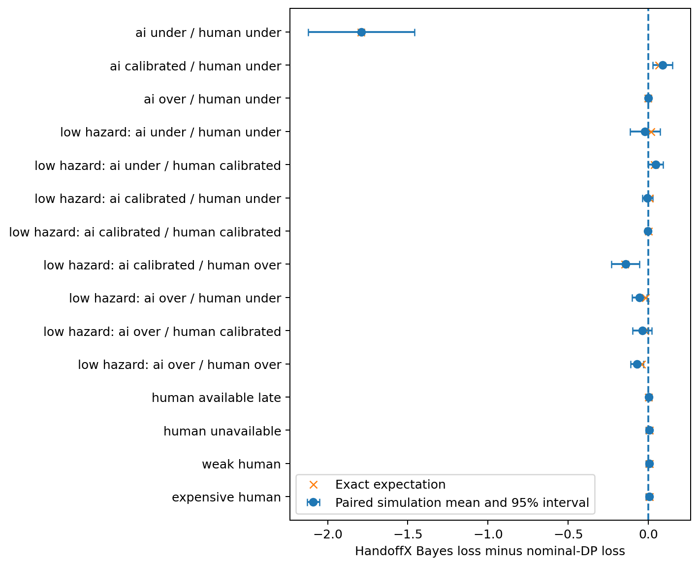
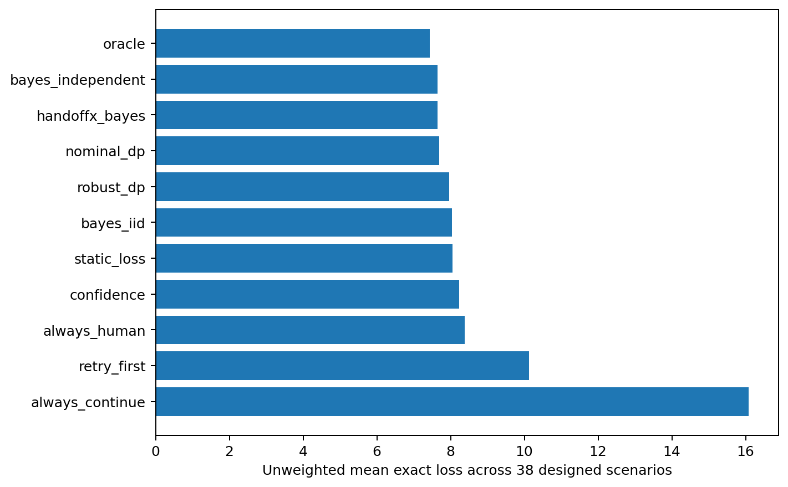
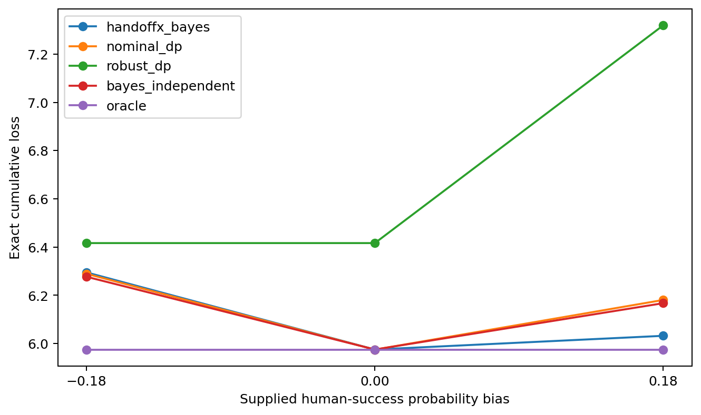
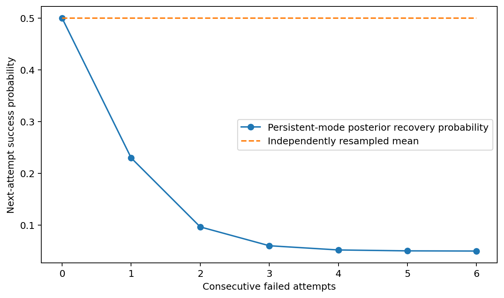
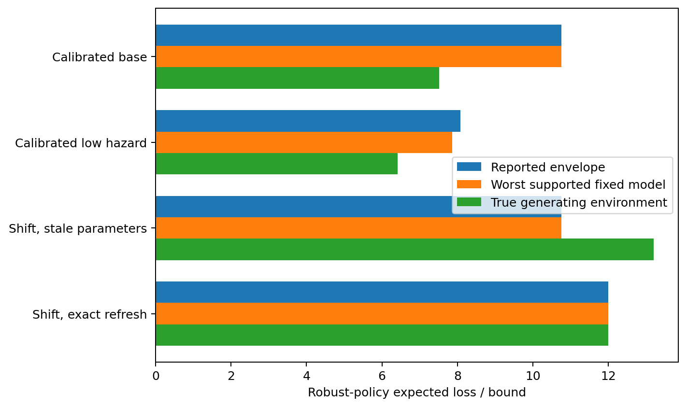
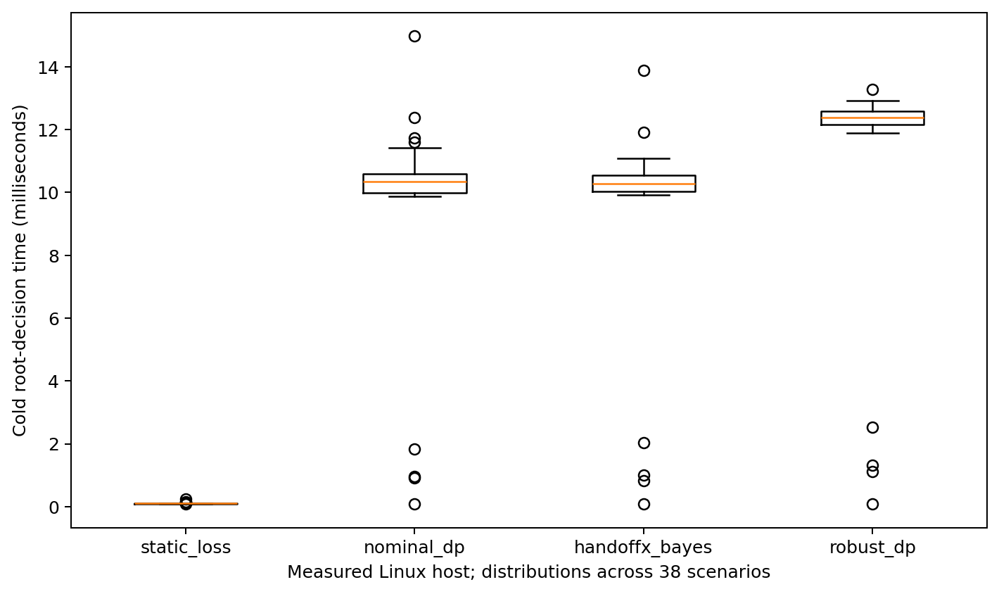

# Abstract

HandoffX investigates intervention decisions in autonomous-agent abstractions with four actions: continue, retry, request human rescue, or stop. A targeted prior-art audit supports an empirical and software contribution rather than a new general decision theory. We specify a finite-horizon partially observed model with a persistent task mode, fixed uncertain capability parameters, fallible terminal human rescue, costs, resources, deadlines and external action restrictions. Bayesian planning, nominal belief-state planning and a history-rectangular robust envelope are implemented separately. Nine conditional propositions and eight counterexamples clarify threshold limits, probability sensitivity, failure dependence, uncertainty semantics and transfer assumptions. A locally prerecorded computational study evaluates 11 policies in 38 synthetic scenarios, with exact expectations and 5,016,000 scenario-policy simulation executions. The joint-Bayesian reference policy has lower exact loss than nominal dynamic programming in six scenarios, equal loss in 23 and higher loss in nine. Modeling persistent modes improves loss relative to the iid-mode ablation in 15 scenarios and ties in 23, while the selected parameter-coupling prior is not generally advantageous. Robust bounds hold for supported models but fail to cover an intentionally shifted environment outside their assumed uncertainty set. The complete numerical study reproduces on rerun, and an independent scalar execution loop matches 16,000 trajectories. The delivered CPU-only Python prototype has 60 passing tests. These findings support an auditable comparison framework and careful probability-model validation, not universal intervention thresholds, superior performance across real AI models, or safety certification. Real-agent evaluation, human-effectiveness estimation, independent review and Windows execution remain uncompleted.

**Keywords:** human-AI collaboration; learning to defer; Bayesian decision-making; robust control; partial observability; dependent retries; reproducible simulation.

**Research status:** Executed synthetic research and working prototype. Not externally peer reviewed, not deposited, and not a real-world validation or a novel general theory.

# Research integrity statement

This report distinguishes established theory, derived applications, executed synthetic evidence and unfinished work. The supplied Phase 1 audit is treated as provenance, not infallible authority. Consequential source metadata were checked and errors preserved in an errata record. Every reported HandoffX experiment comes from the included executable code and numerical records. No real LLM, operator, participant or organization was studied. Computational checks supplement, rather than replace, the written mathematical arguments.

The protocol was recorded locally before the main comparative run, after implementation-correctness checks and design inspection. It was not publicly preregistered. A later robust-objective comparison is explicitly post-hoc. An input-validation hardening change was followed by a complete rerun with identical non-timing outcomes. This document was assembled with AI assistance. Human authorship, responsibility, affiliation and publication approval must be confirmed by the prospective author; none has been invented. The adversarial review is an internal self-audit, not external peer review. A future DOI would identify a deposited version, not confer peer-reviewed acceptance.

The evidence does not justify a 120-150-page monograph. The report instead preserves the completed model, proofs, counterexamples, methods, findings, code and limitations without extending the narrative merely to meet a length target.

# Contents

- [1. Introduction](#1-introduction) - PDF page 7
- [2. Research questions and evidence criteria](#2-research-questions-and-evidence-criteria) - PDF page 8
- [3. Literature and prior-art equivalence](#3-literature-and-prior-art-equivalence) - PDF page 8
- [4. Formal mathematical specification](#4-formal-mathematical-specification) - PDF page 13
- [5. Worked examples and interpretation](#5-worked-examples-and-interpretation) - PDF page 18
- [6. Mathematical properties and proofs](#6-mathematical-properties-and-proofs) - PDF page 20
- [7. Counterexamples and limits](#7-counterexamples-and-limits) - PDF page 25
- [8. Computational methodology](#8-computational-methodology) - PDF page 27
- [9. Experimental findings](#9-experimental-findings) - PDF page 31
- [10. Python architecture and implemented functionality](#10-python-architecture-and-implemented-functionality) - PDF page 40
- [11. Practical interpretation and integration boundaries](#11-practical-interpretation-and-integration-boundaries) - PDF page 43
- [12. Discussion and threats to validity](#12-discussion-and-threats-to-validity) - PDF page 44
- [13. Answers to the research questions](#13-answers-to-the-research-questions) - PDF page 46
- [14. Conclusions and future research](#14-conclusions-and-future-research) - PDF page 46
- [References](#references) - PDF page 48
- [Appendix A. Complete scenario results](#appendix-a-complete-scenario-results) - PDF page 51
- [Appendix B. Assumptions and exclusions](#appendix-b-assumptions-and-exclusions) - PDF page 53
- [Appendix C. Mathematical and experimental verification](#appendix-c-mathematical-and-experimental-verification) - PDF page 55
- [Appendix D. Reproduction and artifact navigation](#appendix-d-reproduction-and-artifact-navigation) - PDF page 57

# Figures and tables

## Figures

- Figure 1. Paired differences from nominal planning - PDF page 33
- Figure 2. Exact expected loss over the fixed design - PDF page 34
- Figure 3. Human-effectiveness miscalibration - PDF page 35
- Figure 4. Posterior recovery after dependent failures - PDF page 36
- Figure 5. Robust bounds and model coverage - PDF page 37
- Figure 6. Cold root-decision runtime - PDF page 39

## Tables

- Table 1. Mathematical notation and abbreviations - PDF page 6
- Table 2. Refined research questions and evidence requirements - PDF page 8
- Table 3. Base action and outcome parameters - PDF page 14
- Table 4. Implemented comparison policies - PDF page 30
- Table 5. Exact loss comparisons across the designed scenarios - PDF page 32
- Table 6. Selected paired comparisons with nominal planning - PDF page 33
- Table 7. Implemented module responsibilities - PDF page 40
- Table 8. Research-question answers - PDF page 46
- Table 9. Complete per-scenario expected losses - PDF page 51
- Table 10. Assumptions and their consequences - PDF page 53
- Table 11. Executed mathematical validation checks - PDF page 55

# Notation and abbreviations


**Table 1**

*Mathematical notation and abbreviations*

| Symbol or term | Meaning and units |
|---|---|
| C, R, H, S | Continue, retry, terminal human rescue, authorized safe stop |
| T, t | Deadline and elapsed time, in artificial time ticks |
| j, J | Completed and required milestones |
| B, b | Resource quota and amount spent, in resource units |
| Z | Fixed hidden task mode: healthy, recoverable or persistent |
| Theta | Fixed latent capability-model index within an episode |
| mu, b(s) | Prior and posterior distributions over model/mode |
| K | Conditional categorical outcome kernel |
| kappa(a) | Operating plus time cost, in common artificial loss units |
| L, F, S | Ordinary-failure, catastrophe and safe-abandonment losses |
| V, Q | Bayesian value and action-value functions |
| W_R | History-rectangular robust value, not a mean-loss estimate |
| delta | Episode severe-risk budget, conditional on model coverage |
| J_P(pi) | Expected cumulative loss of policy pi in environment P |
| MDP / POMDP | Markov / partially observable Markov decision process |
| DP | Dynamic programming |
| CRN | Common random numbers for paired simulation |
| CVaR-style tail mean | Descriptive average of the worst sampled 5% of losses |

# 1. Introduction

An agent can fail because its next step is difficult, because a retry repeats the same underlying failure, because a tool is unavailable, or because its belief about a person's ability to rescue the task is wrong. These situations do not share a universal response. Repeating a low-cost recoverable step can be useful; repeating a persistent failure can consume the entire budget. A skilled person may resolve the task, but an unavailable, costly or equally uninformed person may not improve the outcome. Stopping can be optimal when the remaining expected benefit is smaller than the operational and failure costs.

The decision problem must therefore distinguish an action's immediate cost from its effect on later options. It must also distinguish uncertainty in the true task state from uncertainty in the probabilities used to predict its future. Established belief-state and Bayes-adaptive formulations already supply the relevant mathematical language (Kaelbling et al., 1998; Ross et al., 2011). HandoffX does not claim to invent that language. Its purpose is to make a bounded version operationally explicit and reproducibly test what happens when nominal, Bayesian and robust interpretations are placed on the same synthetic decision problem.

The central practical question is not whether a Bellman equation can contain an action called human assistance. It can. The question is whether the required inputs can be defined and supplied consistently, whether the implemented decision rules respect the intended uncertainty semantics, and whether additional mathematical complexity produces a measurable advantage over simpler or established alternatives. This report separates those questions. It executes the finite-model comparison but does not claim to solve estimation from real execution logs.

## 1.1. Scope of model agnosticism

The controller does not inspect a neural network's weights, hidden activations, architecture or brand. It receives categorical outcome probabilities, observations, costs and restrictions. This is architectural independence within a specified decision-process class. It does not imply that one model's probabilities transfer to another model, that the same milestones have equivalent meanings across tasks, or that performance transfers between organizations. A model-independent equation can still be wrong for a particular workflow.

## 1.2. Contribution boundaries

The completed contribution consists of a fully specified finite model, nine conditional derivations, eight counterexamples, exact and Monte Carlo evaluators, a matched policy suite, a working decision-support library, corrected source provenance and negative empirical results. The contribution is useful as a reference and diagnostic benchmark. Neither the individual methods nor their assembly establishes a first-of-its-kind mathematical framework. The negative findings are central: joint uncertainty did not uniformly help, the chosen correlation prior was not generally beneficial, and a robust bound ceased to cover the true environment under unsupported shift.

# 2. Research questions and evidence criteria

The supplied eight-question framing is retained with precise evidence boundaries. Questions concern the formal model and executed simulation unless expressly marked as untested deployment questions.


**Table 2**

*Refined research questions and evidence requirements*

| ID | Refined question | Evidence required here |
|---|---|---|
| RQ1 | Can a common probability/cost interface support architecture-independent intervention decisions? | Formal state/action contracts and executable APIs |
| RQ2 | When do continue, retry, human rescue and stop minimize the specified objective? | Bellman recursion, thresholds in valid special cases and worked examples |
| RQ3 | How do errors and dependence in AI/human capability estimates change decisions? | Controlled bias factors and prior-factorization ablation |
| RQ4 | How do persistent modes and dependent retries affect loss and escalation? | Posterior derivation and iid-mode comparison |
| RQ5 | Which stability, coverage and transfer statements can be established conditionally? | Complete proofs, counterexamples and numerical checks |
| RQ6 | What transfers when the environment or agent changes? | Structural API reuse versus a deliberately shifted model |
| RQ7 | How do established/reference policies compare under matched information? | Exact expectations, paired intervals and all negative results |
| RQ8 | Is a lightweight, auditable prototype usable without paid infrastructure? | Actual package, examples, tests, installation and runtime records |

The primary empirical quantity is cumulative operational loss in artificial units. Success, human use, severe failure, stopping, resources, time and tail loss remain separate outcomes. A lower average loss is not silently interpreted as a lower catastrophe probability. The exact finite-model oracle is a comparator that knows the generating model, not the hidden realization or future random outcomes.

# 3. Literature and prior-art equivalence

**Review type:** targeted, source-grounded continuation of the supplied Phase 1 scoping audit; not a database-exhaustive systematic review. Search and verification date: October 28, 2026. The original seven-file audit is preserved unchanged in `phase1_original/`.

## LIT-01. Decision after re-verification

The prior Category C decision survives: the defensible contribution is an auditable comparative benchmark and bounded reference implementation. Adding continue, retry, human and stop labels to a sequential decision model does not establish new mathematics. In particular, the additional verification of Bayes-adaptive POMDP literature strengthens, rather than weakens, the equivalence finding. HandoffX's joint belief over model parameters and task modes is a small finite-support specialization of established Bayesian sequential decision-making, not an original general solution.

## LIT-02. Closest evidence and implications

### KAE98: Kaelbling et al. (1998)

Belief-state control in partially observable stochastic environments. The finite count-state solver is a restricted POMDP specialization. Access: metadata/abstract; Publisher metadata verified; author-hosted PDF timed out.

### ROSS11: Ross et al. (2011)

Bayes-adaptive POMDPs jointly track state and uncertain model parameters. Joint hidden-state/parameter beliefs and information-sensitive planning are established. Access: selected original full text; JMLR PDF sections 2-3; selected equations inspected; p. 1736 screenshot inspected.

### MOZ20: Mozannar and Sontag (2020)

Cost-sensitive reduction and consistent surrogate learning; Bayes decisions compare machine and expert conditional correctness. HandoffX reuses the decision principle, not the trained surrogate or its sample guarantees. Access: selected original full text; Original PDF pp. 2-4, displayed Bayes rules and loss; equation pages visually inspected.

### IYE05: Iyengar (2005)

Robust dynamic programming uses structured uncertainty sets to support dynamic recursion. Rectangularity is consequential; HandoffX claims an envelope, not fixed-parameter minimax equivalence. Access: metadata/abstract; Publisher record/abstract; full original proof not independently rechecked.

### NIL05: Nilim and El Ghaoui (2005)

Robust MDP control handles uncertain transition matrices. Uncertain action transitions and worst-case cost optimization are established. Access: metadata/abstract; Publisher record/abstract; exact assumptions not re-proved from original paper.

### SUI20: Suilen et al. (2020)

Uncertain-POMDP policy synthesis via convex optimization. Partial observation plus transition uncertainty is prior art. Access: metadata/abstract; Official IJCAI abstract/metadata; not an implemented algorithm comparison.

### CUB21: Cubuktepe et al. (2021)

Robust finite-state controllers for uncertain POMDPs and specified objectives. HandoffX does not reproduce this controller-synthesis algorithm or inherit all guarantees. Access: metadata/abstract; Official AAAI metadata/abstract; CDN PDF access failed.

### SIN23: Singi et al. (2023)

HULA queries an expert using estimated return variance with a limited call budget. Original method assumes consistently high-quality advice; this prototype permits weak helpers. Access: selected original full text; HTML section III and evaluation overview; robotic expert returns an action, not terminal rescue.

### SHA26: Shaikh (2026)

Bayesian intra-generation stopping, learned competence posterior and stronger-model escalation. Timing/calibration are prior art; reported real-model validation does not execute the optimal stopping DP. Access: selected original full text; arXiv v1 HTML sections 3-5, 8, 10; internal Version 1.1 is not arXiv v2.

### HIL26: Trinh et al. (2026)

Progressive blockers and asking behavior in coding/SQL, evaluated with Ask-F1 and task outcomes. Sequential help-seeking benchmarks already exist; HandoffX instead isolates a costed synthetic decision model. Access: selected original full text; Version 4 HTML design/limitations; corrected author list and order.

### ALV25: Alves et al. (2025)

Learning-to-defer benchmark includes synthetic expert behavior and capacity constraints. Benchmarking fallible humans is established; its tabular allocation task differs from repeated recoveries. Access: selected original full text; PMC full text methods/limitations; synthetic experts are not real participants.

### ROS11: Rosenthal et al. (2011)

Robot assistance decisions model human accuracy and availability. Imperfect or unavailable people are established, not a new HandoffX concept. Access: metadata/abstract; Official AAAI abstract and metadata.

### BAL23: Balazadeh et al. (2023)

Two-layer MDP switches control among agents, with confidence bounds and reported sublinear regret. Switching and shared environment information are prior art; no new online-regret claim is made. Access: metadata/abstract; arXiv v3 record; final TMLR record blocked, so cite this version.

### VER22: Verma and Nalisnick (2022)

One-vs-all construction addresses calibration of expert correctness in learning to defer. Numerically valid probabilities are not automatically calibrated; HandoffX does not fit an estimator. Access: metadata/abstract; Official PMLR abstract and complete metadata.

### VER23: Verma et al. (2023)

Multiple-expert deferral, calibrated surrogate scores and conformal expert ensembles. Multiple candidate helpers or expert uncertainty are not inherently new. Access: metadata/abstract; Official PMLR abstract; no independent proof replication.

### MAD18: Madras et al. (2018)

Predict/defer learning with a fallible downstream decision maker and fairness-sensitive loss. Human-versus-AI expected loss is prior art; no retry benchmark is replicated here. Access: metadata/abstract; Instance features; prediction or deferral; reported classification evaluation.

### CHA22: Charusaie et al. (2022)

Sample-efficient learning of predictors that complement human decisions. Human complementarity and data acquisition require their own learning evaluation. Access: metadata/abstract; Official PMLR abstract and metadata.

### HEM23: Hemmer et al. (2023)

Expertise prediction supplies missing expert predictions from limited labeled examples. Limited human labels are established research; correction: Lukas Thede, not Lars. Access: metadata/abstract; Official AAAI authors/abstract; real and synthetic expert evaluations reported.

### JIT23: Jitkrittum et al. (2023)

Characterizes when confidence-only cascade deferral fails, including specialist downstream models and shift. A scalar AI-confidence threshold need not be sufficient. Access: metadata/abstract; Official NeurIPS abstract; experiments reported by authors, not rerun.

### GHO24: Ghoummaid and Shalit (2024)

Policy learning with deferral accounts for hidden confounding. Observed outcomes do not identify missing human/AI counterfactuals without assumptions. Access: metadata/abstract; Official NeurIPS abstract; no causal estimator is implemented here.

### ANG24: Angelopoulos et al. (2024)

Conformal risk control bounds expected monotone losses under its calibration assumptions. The implemented guard is a union bound, not conformal risk control or distribution-free certification. Access: metadata/abstract; Official ICLR abstract; no conformal implementation or guarantee claimed.

### YAO25: Yao et al. (2025)

Tool-agent-user benchmark evaluates interactions in operational domains. Real agent interaction is broader than the toy simulator; no benchmark result is reproduced. Access: metadata/abstract; Official ICLR abstract and metadata.

## LIT-03. Explicit mapping, not title matching

Let an intervention environment have observable resources, a hidden task mode, action-dependent outcome probabilities and terminal losses. Encode continue and retry as nonterminal actions, human assistance as either a transition or a terminal rescue action, and stop as an absorbing abandonment outcome. The standard belief-state control formulation then contains the decision problem. A finite latent parameter index extends the hidden state to represent uncertainty in both AI and human effectiveness. History-dependent transition ambiguity yields a robust control formulation if its consistency and rectangularity assumptions are made explicit. None of these encodings requires access to neural weights.

This representational argument is not evidence that estimation is solved. One must still define what a successful step means, measure its conditional probability after relevant histories, estimate human outcomes, price delays and consequences, and validate the model. It is also not an efficient algorithm for every POMDP. The exact solver in this package exploits a short horizon and stationary conditional likelihoods.

A one-step learning-to-defer loss is recovered by letting each action terminate. A conventional stopping problem is recovered by retaining only continue and terminal handoff/stop. The four-action model can therefore contain those decision structures without creating a new universal theory. The fixed-parameter and rectangular models are different uncertainty semantics, not interchangeable implementations of the same minimax objective.

## LIT-04. What is solved, partially solved, and not established

**Established formulation:** cost-sensitive deferral; belief-state sequential optimization; joint Bayesian state/model uncertainty; robust control under appropriate ambiguity assumptions; effects of fallible experts; finite-budget assistance. These claims concern available mathematical tools, not validated success of every deployment.

**Partially addressed in existing and present work:** estimating usable conditional probabilities, learning from limited human labels, operating under shift, choosing informative help requests, and comparing policy families fairly. HandoffX does not supersede the cited specialist solutions.

**Not established by this study:** a universal intervention threshold; uniformly superior joint Bayesian or robust intervention; real human benefits; reliable performance transfer between named LLMs; safety under arbitrary misspecification; novelty of every benchmark feature conjunction; production readiness. The reviewed material did not establish an identical matched implementation with this exact finite simulator, but absence from this targeted search is not proof of originality.

## LIT-05. Contribution retained after experiments

The resulting artifact exposes the difference between parameter uncertainty and persistent task difficulty, retains negative policy comparisons, checks exact expectations against simulation, and reports an oracle without future-outcome leakage. These are useful engineering and experimental choices. The new empirical observations are conditional on the explicitly artificial environments. They are neither a new decision-theoretic foundation nor a demonstration that HandoffX outperforms established published learning systems.

# 4. Formal mathematical specification

**Status:** specified and implemented for the bounded latent-mode subclass below. General MDP/POMDP notation explains the relationship to prior art; it does not imply that the prototype solves arbitrary POMDPs. All probabilities in the experiments are synthetic design choices, not observations of LLMs or human workers.

## FM-01. Decision environment and units

An episode is a task with $J$ ordered, otherwise homogeneous milestones, deadline $T$ integer time ticks, resource budget $B$ integer quota units, and at most one terminal human intervention. The controller minimizes expected cumulative operational loss. A loss unit is an artificial common utility unit. A time tick is a synthetic latency unit, not a measured second. Resource units are distinct from loss units and enforce a hard quota. Conversion of money, time and failure consequences into a common utility is an application owner's responsibility.

The broad finite-horizon formulation has hidden state $x_t$, observable history $h_t=(o_0,a_0,o_1,\ldots,o_t)$, available action set $\mathcal A(h_t)$, action-dependent transition kernel $P_\theta(x'\mid x,a)$, observation kernel $O_\theta(o\mid x',a)$, nonnegative cost $c_t(x,a)$, duration $d(a)$, and terminal loss $g(x)$. A history-measurable policy $\pi$ maps the observable history to an admissible action. A belief $b_t(x,\theta)$ is a conditional distribution, not a neural confidence score. These are established POMDP constructions (Kaelbling et al., 1998).

The implemented environment specializes this structure: $Z\in\{0,1,2\}$ is a fixed hidden task mode (healthy, recoverable, persistent), and $\Theta\in\{1,\ldots,M\}$ is a fixed episode-level model index. Neither is observed by any evaluated policy. The observed state contains completed progress, elapsed time, spent resources, unresolved-failure flag, and sufficient outcome counts. There are no hidden-state transitions except absorbing task termination. 'Recoverable' means a higher retry success probability, not a separately modeled repair of $Z$. Shared persistent $Z$ induces dependence among action outcomes even though they are conditionally independent given $(\Theta,Z)$.

## FM-02. Actions, outcomes and terminal semantics

The executable actions are $C$ (continue), $R$ (retry the currently failed milestone), and $H$ (human rescue of the entire remaining task); $S$ is authorized safe stop.


**Table 3**

*Base action and outcome parameters*

| Action | Admissibility | Successful outcome | Failure outcome | Duration | Quota |
|---|---|---|---|---:|---:|
| Continue $C$ | Time/quota/authorization sufficient | Advance one milestone | Remain at milestone; receive soft/hard diagnostic | 1 | 1 |
| Retry $R$ | Previous milestone attempt unresolved, plus constraints | Advance the failed milestone | Remain unresolved; receive diagnostic | 1 | 2 |
| Human $H$ | Ticket, known availability, time/quota sufficient | Complete the entire task | Terminal ordinary failure or catastrophe | 2 by default | 3 |
| Stop $S$ | Always externally authorized in this model | Not task success | Terminal safe abandonment | 0 | 0 |

Human rescue is deliberately not a perfect oracle. Continue and retry are not interchangeable: retry is unavailable initially, has different probability and cost parameters, and consumes twice the quota. Human assistance terminates the episode and consumes a different duration. A nonterminal outcome on the last time tick becomes ordinary deadline failure; it does not acquire a free last-moment safe-stop option. Task completion exactly at the deadline is success. Quota exhaustion before the deadline leaves the authorized safe-stop action available.

For $a\in\{C,R,H\}$ and $(m,z)$, let $p_{mza}$ be probability of progress/success and $q_{mza}$ probability of catastrophe. They are unconditional competing-outcome probabilities, so $0\le p_{mza}+q_{mza}\le1$. The remaining probability is ordinary failure. For $C,R$, a failure carries diagnostic $D\in\{0,1\}$ with $P(D=1\mid\text{failure},m,z,a)=d_z$. The prototype uses known diagnostic likelihoods, not learned ones. The four categorical probabilities are

$$K_{mza}=\left(p_{mza},q_{mza},(1-p_{mza}-q_{mza})(1-d_z),(1-p_{mza}-q_{mza})d_z\right). \tag{1}$$

For human rescue, $K_{mzH}=(p_{mzH},q_{mzH},1-p_{mzH}-q_{mzH},0)$. Its ordinary failure is terminal; it does not emit a diagnostic that can influence another decision. Outcomes are mutually exclusive and exhaustive.

## FM-03. Costs, restrictions and objective

Let $c_a$ be executable-action operating cost and $\lambda$ be loss per time tick. The immediate cost is $\kappa_a=c_a+\lambda d(a)$. Success has terminal loss zero, ordinary terminal failure/deadline has loss $L$, catastrophe has loss $F$, and authorized safe abandonment has loss $S$. All are nonnegative. Stopping does not count as task success and is reported separately from ordinary and severe failures.

$$J_P(\pi)=\mathbb E_P^\pi\left[\sum_{t:\,a_t\ne S}\kappa_{a_t}+g_{\rm terminal}\right],\quad g_{\rm terminal}\in\{0,L,F,S\}. \tag{2}$$

The expected-loss objective is not a tail-risk or catastrophic-failure guarantee. Severe-failure probability and empirical upper-tail loss are distinct secondary measures. One optional action guard imposes a per-decision worst-model catastrophe-probability cap $\delta/T$; Proposition P7 states exactly what this ensures. There is no implemented general constrained-POMDP or CVaR optimizer.

The admissible set excludes actions without enough quota or time, unavailable human assistance, unauthorized actions, retry before a failure, and (in one scenario) continued execution after failure in an irreversible workflow. A known schedule $u_t\in\{0,1\}$ represents human availability. The prototype does not learn availability, model a human queue, or coordinate capacity across simultaneous tasks. A human ticket is a per-task constraint. No passive 'wait' action exists; delaying help means taking a permitted task action. If no such action is authorized, safe stop remains.

## FM-04. Sufficient state and belief update

Let $n=(n_{C+},n_{C0},n_{C1},n_{R+},n_{R0},n_{R1})$ count observed nonterminal progress and soft/hard failures. Let $f\in\{0,1\}$ record whether the last milestone attempt remains unresolved. Elapsed time is $t=\sum_i n_i$, progress is $j=n_{C+}+n_{R+}$, and quota used is $b=\sum_{i=1}^3 n_i+2\sum_{i=4}^6 n_i$. Human actions never enter these counts because they terminate the task. Thus the implemented state is $s=(n,f)$ with the immutable task specification supplied separately.

Write $\mu_{mz}=P(\Theta=m,Z=z)$ for the initial joint distribution. Because the hidden pair is fixed and likelihoods commute, counts are sufficient for inference in this subclass:

$$b_{mz}(n)=\frac{\mu_{mz}\prod_{a\in\{C,R\}}\prod_{o\in\{+,0,1\}}K_{mza,o}^{n_{ao}}}{\sum_{m',z'}\mu_{m'z'}\prod_{a,o}K_{m'z'a,o}^{n_{ao}}}. \tag{3}$$

The code computes this expression in log space. Zero-likelihood observations under every supplied model raise an explicit error; they are not silently renormalized into an arbitrary posterior. Counts do not suffice under time-varying probabilities, fatigue, learning human operators, history-sensitive repairs, or action-order-dependent outcomes. Such applications need a richer adapter and a different solver.

The Bayesian predictive outcome law is $\bar K_{a,o}(s)=\sum_{m,z}b_{mz}(s)K_{mza,o}$. For robustness, $K^m_{a,o}(s)=\sum_z b(z\mid m,s)K_{mza,o}$ is the model-conditional predictive law. A single nominal-model planner keeps $m$ fixed at the central supplied model and updates only $Z$.

## FM-05. Models A and B: static action loss

For a single binary task and mutually terminal alternatives, $Q_a=c_a+(1-p_a)L$, with $Q_S=S$. Catastrophe can be included as $Q_a=\kappa_a+q_aF+(1-p_a-q_a)L$. Minimize over feasible actions. Human rescue is preferred to AI exactly when $p_H-p_A\ge(c_H-c_A)/L$ under the symmetric-loss, no-separate-catastrophe assumptions and $L>0$. This is an adaptation of established Bayes deferral, not new mathematics (Mozannar & Sontag, 2020).

Example: $p_A=.65$, $p_H=.90$, $c_A=1$, $c_H=4$, $L=20$ gives losses 8 and 6, so human rescue is preferred; the human-success threshold is .80. A .05 probability error changes the corresponding action loss by one loss unit. With $S=5$, stopping dominates both. With $L=0$, only action costs matter and division by $L$ is invalid. A computed threshold above 1 means human rescue cannot satisfy that inequality; it is not clipped to manufacture feasibility.

The implemented `static_loss` benchmark uses static committed completion plans because $C,R$ only finish a milestone while $H$ finishes a task. Its $C$ plan attempts all remaining milestones without post-failure recovery; its $R$ plan retries the present milestone then continues. It values failure as terminal but replans after an actually observed nonterminal failure. The fully sequential nominal planner is the principal strong comparator, so conclusions do not depend on this deliberately myopic comparator.

## FM-06. Models C and D: sequential partial-observation control

Let $s^{a,o}$ be the updated count state for $a=C,R$ and a noncatastrophic outcome. The value at completed progress is zero. The value at an unfinished deadline is $L$. Otherwise,

$$V(s)=\min_{a\in\mathcal A(s)}Q(s,a), \tag{4}$$
$$Q(s,S)=S,\qquad Q(s,H)=\kappa_H+\bar K_{H,1}(s)F+[\bar K_{H,2}(s)+\bar K_{H,3}(s)]L, \tag{5}$$
$$Q(s,a)=\kappa_a+\bar K_{a,1}(s)F+\sum_{o\in\{0,2,3\}}\bar K_{a,o}(s)V(s^{a,o}),\quad a\in\{C,R\}. \tag{6}$$

Outcome index 0 means progress, index 1 catastrophe, and indices 2/3 diagnostic failures. The mathematical symbols $+,0,1$ in the counts denote progress and the two diagnostic values; they are distinct from these categorical array indices. All code documentation uses the four categorical indices to avoid an implicit mapping.

This is finite-horizon belief-state dynamic programming, specialized from established POMDP theory. Recursion terminates because every nonterminal action increases elapsed time. A cached exact computation is feasible for the small experiment horizons. No approximation grid or learned value function is used. The general problem can be expensive; the implementation accepts horizons 1 through 12, and the reported evidence is concentrated at 3 and 6 ticks.

## FM-07. Model E: joint fixed-model uncertainty

Each supplied model is an alternative joint account of AI and human effectiveness. The benchmark uses nine combinations of additive offsets $(-.18,0,.18)$ to AI success probabilities (both $C,R$) and human success probabilities. The perturbation generator explicitly clips to $[.01,1-q-.01]$ before constructing a valid model; the public model validator never silently fixes invalid probabilities.

The joint prior over these offsets is

$$W=\begin{pmatrix}.20&.025&.05\\.025&.40&.025\\.05&.025&.20\end{pmatrix}. \tag{7}$$

Its marginal probabilities are $(.275,.45,.275)$ on each axis. The independent-prior ablation uses the outer product of these marginals, retaining the same support and initial one-action predictions. The off-diagonal-reversed true-prior scenario preserves those marginals while changing the sign of association. In every case, the model index is fixed within an episode, rather than independently redrawn on every action.

The prior is elicited synthetic experimental structure. It is not a fitted posterior or a confidence region with empirical coverage. Bayesian optimality applies to its prior-predictive distribution, not automatically to each possible fixed model. Failure observations can update beliefs about human effectiveness through the assumed coupling; incorrect coupling can therefore mislead the policy.

## FM-08. Model F: dependent failure and iid ablation

Conditional independence given a persistent hidden mode does not imply marginal independence. If an action has latent success probability $P$, then survival through $k$ failed attempts has probability $\mathbb E[(1-P)^k]$, not generally $(1-\mathbb E P)^k$. The count posterior responds to repeated failures by shifting mass toward persistent modes. The iid-mode ablation averages the kernel over the initial mode distribution separately within each model, then resamples the implicit mode at each action. It preserves one-step marginals but removes within-model temporal dependence. It retains episode-level parameter uncertainty if multiple models remain.

## FM-09. Model G: history-rectangular robustness

At each observable history, form $\mathcal U(s,a)=\operatorname{conv}\{K^m_a(s):m\text{ remains possible}\}$. The robust policy solves an adversarial history-tree problem in which nature can select a different conditional kernel at each history and action. Its recursion replaces the Bayesian outcome expectation in (5)-(6) with a maximum over the model-conditional expectations, using a common robust continuation value $W_R$.

$$W_R(s)=\min_{a\in\mathcal A(s)}\max_m\left\{\kappa_a+\mathbb E_{K^m_a(s)}[\text{terminal loss or }W_R(s')]\right\}. \tag{8}$$

Stop has no uncertain transition. The row-selection envelope contains every fixed-model history distribution, but usually also distributions that cannot arise from any fixed model. This gives an upper bound on fixed-model worst-case loss, not equality with fixed-parameter minimax. This interpretation is essential to applying established rectangular robust dynamic programming (Iyengar, 2005; Nilim & El Ghaoui, 2005). The code does not reproduce the finite-state-controller algorithm of Cubuktepe et al. (2021); that paper establishes broader prior art.

## FM-10. Transfer and reliability boundary

Structural transfer means the same solver accepts a new adapter's correctly defined kernels, states, costs and restrictions. Parameter transfer means those conditional probabilities remain accurate. Performance transfer additionally requires the objective, feasibility rules and relevant conditional distributions to remain comparable. Only structural transfer is built into the API. The experiment's shifted environment changes success, hazards and mode prevalence; perfect recalibration is an oracle-like upper-bound control, not evidence that a real estimator can recover those values.

Reliability in this report means (i) correct optimization/evaluation within the specified finite model, (ii) reproducible empirical loss and catastrophic-failure rates, and (iii) explicitly conditional theoretical bounds. It does not mean safety certification, universal correctness, an autonomous-control authorization, or verified real-world human benefit.

# 5. Worked examples and interpretation

All figures in this file are either explicitly illustrative arithmetic or values computed from `results/worked_examples.json`. Utility units are artificial and comparable within an example; they are not euros, dollars or a real organization's losses.

## WE-A. Static terminal decision

For autonomous success 0.65, human success 0.90, AI cost 1, human cost 4 and ordinary failure loss 20, expected losses are 8 and 6. The human threshold is 0.80. A stopping loss of 12 does not alter the handoff choice; lowering stopping loss to 5 makes abandonment optimal. With zero failure loss only action costs matter. A threshold outside [0,1] represents impossibility or inevitability of the inequality, not a probability to clip. This is ordinary expected-loss minimization, with constant-size arithmetic.

## WE-B. Four terminal alternatives

As an illustrative one-decision recovery comparison after a failure, add a retry with success 0.75 and cost 1.4. Its expected loss is 6.4, so human assistance at loss 6 remains best among AI continuation (8), retry (6.4), human (6) and stop (12). If human success is instead 0.50, its loss is 14 and retry wins. This terminal model is valid only if the alternatives have comparable success definitions; it cannot directly compare a single-milestone attempt with whole-task rescue. The implemented static comparator therefore scores committed completion plans.

## WE-C. Sequential intervention

In the base calibrated model, two milestones remain. Nominal dynamic scores at the initial state are continue 8.895722, human 7.514800 and stop 12; retry is infeasible. After one successful continuation, the remaining scores change to continue 2.761979, human 6.007805 and stop 12. Continuing now wins. The initial continue score already accounts for future contingent actions and terminal consequences; it is not its immediate cost alone. Cached finite-horizon recursion, rather than a single threshold, computes this comparison.

## WE-D. Partial observability

The base prior assigns persistent mode probability 0.20. After a hard continuation failure, the nominal posterior over healthy, recoverable and persistent modes is approximately (0.025693, 0.343834, 0.630474). The controller was never shown the true mode: it learned from the likelihood of the observed failure. The corresponding nominal future scores are continue 17.280532, retry 13.532213, human 10.892995 and stop 12. A recovery attempt is not necessarily worth taking simply because it is technically available. Observation likelihoods, not raw confidence labels, produce the update.

## WE-E. Joint uncertainty and value semantics

With the declared nine-model coupled prior, the base root Bayesian predicted human loss is 7.902880, while the central true environment yields 7.514800 when that action is taken. These are different quantities: the first averages assumed model uncertainty; the second evaluates a fixed generating environment. They must not be confused in a results table or UI. A hard failure changes both task-mode and model weights. With simultaneous downward 0.18 capability biases, nominal planning selects continue (predicted 10.683540 versus human 10.754800), whereas joint Bayes selects human (predicted 10.754800 versus continue 10.862543). Its actual benefit in that synthetic environment is reported separately in the empirical table.

## WE-F. Persistent recovery

Suppose a task's fixed success probability is 0.80 with probability 0.60 and 0.05 with probability 0.40. Both an iid approximation and the persistent model start with mean success 0.50. After three attempted retries, the iid model predicts success 0.875; the persistent model yields 0.65225. After three failures, the persistent model's next-attempt success probability is approximately 0.060352. The computation requires a two-component posterior, not a claim that failures are independent because the code draws independent uniforms conditional on a mode. The result changes if a real repair alters the mode.

## WE-G. Robust control and a risk guard

The base robust root scores are continue 11.191880, human 10.754800 and stop 12. At the hard-failure state they become continue 18.289857, retry 14.334406, human 14.437118 and stop 12: robust planning stops even though nominal planning requests human rescue. This is conservatism under the larger conditional-kernel envelope, not proof that either action is universally safer.

For a severe-risk budget 0.05 and horizon 6, the guard cap is 0.008333 per action. At the base root, continuation's predicted catastrophe probability is 0.0315, while human rescue's is 0.0034. The former is excluded, the latter allowed. The episode bound requires the true conditional hazards to be covered. In the distribution-shift experiment, the robust value 10.754800 does not bound true loss 13.194520 because the true model lies outside the assumed set. Robust optimization cannot repair an unsupported ambiguity specification.

# 6. Mathematical properties and proofs

**Attribution and status.** P1-P9 below are explicitly derived specializations, elementary consequences, or adaptations of established decision/probability theory. They are not claimed as original HandoffX theorems. Complete arguments are given so that the implementation is auditable. Numerical checks supplement these arguments and do not constitute proofs. No independent external mathematical peer review has occurred.

## P1. Static human-intervention boundary

**Assumptions.** A single task; two mutually terminal actions $A,H$; success losses zero; identical failure loss $L>0$; deterministic action costs $c_A,c_H$; correct conditional success probabilities $p_A,p_H$; no additional constraints or catastrophic-outcome category.

**Result.** Human assistance weakly minimizes expected loss exactly when $p_H\ge p_A+(c_H-c_A)/L$. At equality both actions are optimal. If a stop action or other alternative is present, this is only the pairwise human/AI comparison, not a sufficient condition for global optimality.

**Proof.** Subtract the two losses:

$$Q_H-Q_A=(c_H-c_A)-L(p_H-p_A). \tag{P1.1}$$

Therefore $Q_H\le Q_A$ is equivalent to the stated inequality. This exhausts both directions. Differentiating the threshold with respect to $c_H$ gives $1/L>0$, and with respect to $c_A$ gives $-1/L$. If $c_H\ge c_A$, increasing $L$ weakly lowers the extra probability advantage required from the human; if $c_H<c_A$, the sign of that loss sensitivity reverses. With $L=0$ the comparison reduces to costs, not a probability threshold. Thresholds outside $[0,1]$ indicate always/never feasibility rather than a need to clip the algebra. QED.

**Interpretation.** A more accurate helper can still be too expensive, and a less accurate but sufficiently cheaper helper can still minimize expected cost. The static decision is an established cost-sensitive deferral rule (Mozannar & Sontag, 2020).

## P2. Stability and regret under action-value errors

**Assumptions.** A finite feasible action set is identical under the estimated and true models. For every action, $|Q_a-\widehat Q_a|\le\epsilon_a$. The estimate selects $\hat a\in\arg\min\widehat Q_a$.

**Result.** If $\widehat Q_b-\widehat Q_{\hat a}>\epsilon_b+\epsilon_{\hat a}$ for every $b\ne\hat a$, then $\hat a$ is the unique true minimizer. Without that gap, true regret is at most $\epsilon_{\hat a}+\epsilon_{a^*}$, where $a^*$ minimizes true loss; hence it is at most $2\epsilon$ if all errors are at most $\epsilon$.

**Proof.** For each alternative,

$$Q_b-Q_{\hat a}\ge\widehat Q_b-\widehat Q_{\hat a}-\epsilon_b-\epsilon_{\hat a}>0.$$

For regret,

$$Q_{\hat a}-Q_{a^*}\le\widehat Q_{\hat a}+\epsilon_{\hat a}-\widehat Q_{a^*}+\epsilon_{a^*}\le\epsilon_{\hat a}+\epsilon_{a^*}. \tag{P2.1}$$

The last inequality follows from estimated optimality. QED.

For P1's static losses with exact costs, probability error at most $\eta_a$ yields $\epsilon_a=L\eta_a$. With cost errors at most $\rho_a$, take $\epsilon_a=\rho_a+L\eta_a$. This is a deterministic perturbation bound, not a statistical statement that an uncalibrated model attains those errors. It also does not transfer unchanged to sequential policy regret without controlling continuation-value error.

## P3. Correlation alone cannot change a one-step Bayesian linear-loss rule

**Assumptions.** Before observing any new signal, choose one terminal action. Its loss is $c_a+(1-P_a)L$; $P_a$ is uncertain. Two joint priors have the same marginal means $\mathbb E P_a$ for every action.

**Result.** Both priors produce identical expected action losses and identical sets of Bayes-optimal actions, irrespective of their cross-action correlations.

**Proof.** Linearity gives $\mathbb E[c_a+(1-P_a)L]=c_a+[1-\mathbb E P_a]L$. The right-hand side contains no cross-moment or covariance. Since it is equal action by action under the two priors, the minimizing sets agree. QED.

**Important limit.** The result does not apply to nonlinear objectives, multi-action contingent policies, or posterior means after an informative observation. For example, let $(P_A,P_H)$ be $(.2,.2)$ or $(.8,.8)$ with equal prior weights. A failed AI attempt yields $\mathbb E[P_H\mid A\text{ fails}]=.32$. For the opposite coupling $(.2,.8)$ or $(.8,.2)$, the same observed failure yields .68. Both initial human means were .5. With $c_H=.2,c_A=0,L=1$ and posterior AI success .32, the human action has loss .88 versus AI .68 under positive coupling, but human .52 under negative coupling. The human decision flips. This is the specific mechanism tested by the joint-prior ablation; vague claims that 'correlation always matters' are rejected.

## P4. Persistent mixtures make iid retry calculations optimistic

**Assumptions.** A fixed but unobserved $P\in[0,1]$ is drawn once per task. Repeated identical attempts are conditionally iid Bernoulli successes given $P$. Failed attempts do not repair or otherwise change $P$. Let $S_k=\mathbb E[(1-P)^k]$ and $p_k=\mathbb E[P\mid k\text{ failures}]$ whenever $S_k>0$.

**Results.** For integer $k\ge1$, $S_k\ge(1-\mathbb EP)^k$. Whenever $p_k<1$, the posterior success probability satisfies

$$p_k-p_{k+1}=\frac{\operatorname{Var}(P\mid k\text{ failures})}{1-p_k}\ge0. \tag{P4.1}$$

**Proof.** For $k=1$ the first statement is equality. For $k\ge2$, $(1-p)^k$ is convex on $[0,1]$, so Jensen's inequality gives the bound. For the second statement, take expectations under the posterior after $k$ failures, denoted $\mathbb E_k$:

$$p_{k+1}=\frac{\mathbb E_k[P(1-P)]}{\mathbb E_k[1-P]}=\frac{p_k-\mathbb E_k[P^2]}{1-p_k}.$$

Subtract this from $p_k$ to obtain $(\mathbb E_k[P^2]-p_k^2)/(1-p_k)$. This proves the identity and sign. If $p_k=1$, another failure has probability zero and the conditional posterior is undefined, rather than a counterexample. QED.

**Example.** $P=.8$ with probability .6 and $.05$ with probability .4 gives mean .5. Three iid attempts at .5 would promise success .875. The persistent mixture instead gives $1-[.6(.2)^3+.4(.95)^3]=.65225$. Dependence changes the prospective decision without introducing a new optimal-stopping theory. The result need not hold after a genuine repair action changes the latent mode; that process lies outside these assumptions.

## P5. Exactness of the finite-horizon Bayesian recursion

**Assumptions.** Finite latent model/mode and action/outcome sets; a correct prior and stationary conditional kernels; nonnegative bounded costs; observable feasibility restrictions; every nonterminal executable action consumes at least one time tick; the sufficient state and terminal losses are as defined in FM-01 through FM-06.

**Result.** Equations (4)-(6) return the minimum prior-predictive expected cumulative loss over all history-measurable admissible policies. A minimizing action at each sufficient state defines an optimal policy for that model.

**Proof.** At a success or unfinished deadline, the specified terminal value is the entire remaining loss, so the assertion holds. Induct on remaining time. At an earlier state, any admissible policy selects a first action using only history. Conditioning on the next outcome decomposes its loss into the action cost, any terminal loss, and continuation loss. The posterior in (3) is Bayes' rule; therefore it yields the correct predictive outcome probabilities. Conditional independence and stationary likelihoods make the count state sufficient, while $f$ retains the information needed for retry feasibility. By the induction hypothesis, each nonterminal continuation costs at least $V(s')$, with equality attained by the recursively minimizing policy. Minimizing the resulting first-action expectations gives (4)-(6) and an attaining policy. Every recursion reduces remaining time, so the induction terminates. QED.

This is a specialization of established POMDP dynamic programming (Kaelbling et al., 1998), not a guarantee under model misspecification or an assertion that the solver scales to arbitrary state spaces.

## P6. What the robust envelope actually guarantees

**Assumptions.** For each retained fixed model $m$, its conditional outcome kernel after each possible observable history is $K^m(s,a)$. The action set and costs are shared. The history-rectangular uncertainty set permits nature to choose any retained conditional kernel independently at each history/action. A fixed-model environment is included in this larger set. Priors over latent modes conditional on each model and observation likelihoods are correctly specified for the included environment.

**Result.** For any admissible policy $\pi$,

$$\max_m J_m(\pi)\le J_{\rm envelope}(\pi). \tag{P6.1}$$

The minimax recursion (8) computes the optimal envelope value. For its selected policy $\pi_R$, $\max_mJ_m(\pi_R)\le W_R(s_0)$. In general neither $W_R(s_0)=\min_\pi\max_mJ_m(\pi)$ nor universal improvement over a nominal policy follows.

**Proof.** Every distribution generated by keeping one model $m$ fixed is a permitted history-tree selection in the envelope: choose that model's conditional kernel at every history. The supremum over a set that contains each such distribution is at least its largest fixed-model expectation, giving (P6.1). The independent per-history choices make nature's continuation subproblems separable. Backward induction, with maximum over nature's kernel before minimization over the chosen action at that history, gives (8). Applying (P6.1) to its minimizing policy yields the bound. QED.

The guarantee is conditional on coverage of the true history kernels. Changing hazard rates, latent prevalence or diagnostic likelihoods can invalidate it even when a success-probability interval looks wide. Rectangularity and robust dynamic programming are established (Iyengar, 2005; Nilim & El Ghaoui, 2005). Counterexample CE5 shows why the larger uncertainty set cannot be silently equated with fixed-parameter uncertainty.

## P7. Conditional per-action catastrophe guard

**Assumptions.** At most $T$ executable actions occur per episode. For every history reached by a guarded policy, its next-action catastrophe probability under the true environment is at most $\delta/T$. Stop has zero catastrophe probability. The chosen ambiguity set contains the true conditional next-outcome law whenever a worst-model cap is used.

**Result.** Episode catastrophe probability is at most $\delta$ for every policy that obeys the guard, even with dependent failures and adaptive decisions.

**Proof.** Let $I_t$ indicate catastrophe on the $t$th executable action, assigning zero after termination. By conditional expectation, $\mathbb E I_t\le\delta/T$. Since $\mathbf1\{\text{any catastrophe}\}\le\sum_{t=1}^T I_t$, taking expectations yields $P(\text{any catastrophe})\le\sum_t\mathbb EI_t\le\delta$. Independence is not needed. QED.

This is a conservative union-bound specialization, not a new safety theorem. Its premise is stronger than average calibration, and checking an estimated cap does not establish its premise. The filter may force safe abandonment. Task success and feasibility costs must therefore be reported alongside catastrophe frequency.

## P8. A bounded-horizon transfer/approximation inequality

**Assumptions.** Two processes share the same finite history/action tree, feasible actions and terminal-loss function. There are at most $T$ decisions. Nonterminal action costs lie in $[0,c_{\max}]$ and differ between models by at most $\epsilon_c$ at every history/action. Terminal losses lie in $[0,G]$. The total variation distance of the next-outcome laws is at most $\epsilon_p$ uniformly over all those histories/actions, including terminal outcomes. Total variation is $\frac12\sum_o|P(o)-P'(o)|$.

**Result.** For a fixed policy,

$$|J_P(\pi)-J_{P'}(\pi)|\le D_T:=T\epsilon_c+\epsilon_p\left[TG+\tfrac12T(T-1)c_{\max}\right]. \tag{P8.1}$$

If $\pi'$ is optimal under $P'$, its regret under $P$ is at most $2D_T$.

**Proof.** Let $\Delta_h$ bound the fixed-policy value difference with $h$ decisions remaining. At the next action, the immediate-cost difference is at most $\epsilon_c$. Add and subtract the expectation of the same reference continuation under the other next-outcome law. The difference caused by continuation values is at most $\Delta_{h-1}$. The reference continuation, including a terminal branch's loss, lies between zero and $(h-1)c_{\max}+G$, so the total-variation inequality bounds the distributional difference by $\epsilon_p[(h-1)c_{\max}+G]$. Thus $\Delta_h\le\epsilon_c+\Delta_{h-1}+\epsilon_p[(h-1)c_{\max}+G]$, with $\Delta_0=0$ because the terminal-loss functions agree. Summing proves (P8.1). For regret add and subtract the two $P'$ policy values; their difference is nonpositive by optimality, leaving at most two fixed-policy discrepancies. QED.

The bound can be numerically loose. Importantly, it requires uniform error in history-conditioned outcome laws, not just small raw parameter error or aggregate calibration. The formula is an elementary finite-horizon simulation-lemma-style adaptation, not a newly claimed online-learning regret rate.

## P9. Free information cannot increase optimal Bayes loss

**Assumptions.** An optional signal is observed before a terminal decision. It does not change the environment, feasible actions, costs or deadline, and has no acquisition cost. The posterior model is correct and the controller may ignore the signal.

**Result.** The optimal expected loss with the signal is no greater than without it. If a signal costs $k$, its use is beneficial exactly when the reduction in optimal expected terminal loss exceeds $k$, subject to the stated unchanged-environment assumptions.

**Proof.** Any fixed action available before the signal can be used after every signal realization, so the signal-contingent policy class contains every signal-ignoring policy. Minimization over a superset cannot increase the optimum. Equivalently, $\mathbb E[\min_a\mathbb E(\ell_a\mid Y)]\le\min_a\mathbb E\ell_a$. Adding a deterministic cost $k$ gives the second statement. QED.

**Example.** Two equally likely task types favor opposite actions with success probabilities .9 and .1; failure loss is 10 and action costs are zero. Before information either action has loss 5. Perfect type information gives loss 1, so its value is 4. An 80%-accurate symmetric signal gives selected-action success .74 and loss 2.6, a value of 2.4. Waiting in the HandoffX simulator is not a free exogenous signal: it consumes time, may incur risk, and can alter human availability. This proposition cannot justify unqualified recommendations to delay intervention.

## Mathematical claim ceiling

The complete arguments above establish properties of the specified mathematical objects. They do not prove probability-estimator consistency, universal threshold monotonicity, robust dominance, unconditional transfer, human superiority, real-world intervention benefit, or novel mathematical priority. There are no unresolved theorems presented as results and no unproved conjectures used by the implementation.

# 7. Counterexamples and limits

All values below are constructed mathematical examples, not empirical observations. The validation script checks their arithmetic.

## CE1. AI confidence alone does not determine handoff

Set $p_A=.7,c_A=0,c_H=.1,L=1$. AI loss is .3. If $p_H=.95$, human loss is .15 and handoff is preferable; if $p_H=.4$, human loss is .7 and continuation is preferable. The same AI probability yields opposite decisions. A universal threshold on AI confidence alone therefore requires additional fixed assumptions about human effectiveness and costs.

## CE2. An identical confidence can imply different decisions at different horizons

Let $p_A=.6,c_A=.1,p_H=1,c_H=.4,L=1$, with both actions completing the task upon success and human action taking one tick. With one tick left, AI loss is $.1+.4(1)=.5$ and human loss .4. With two ticks left and human available after AI failure, continuing then using human assistance costs $.1+.4(.4)=.26$. The preferred action switches solely because recovery opportunities change. No claim of a state-independent confidence threshold is warranted.

## CE3. iid retries overestimate recovery under a persistent mixture

For the two-mode mixture in P4, one-attempt success is .5. Three iid attempts predict success .875, while the persistent mixture yields .65225. The error is .22275 in absolute success probability. These values concern repeated identical attempts without catastrophic outcomes or state repair; the main simulator is more detailed.

## CE4. Robustness need not improve true expected loss

True autonomous success is .95, autonomous cost zero, human success .8, human cost .05, failure loss one. The nominal optimal action has true loss .05. An ambiguity set that permits autonomous success as low as .1 but fixes human success at .8 makes the robust rule choose human assistance, with true loss .25. The robust action is worse by .20 in the true favorable environment, despite being optimal for its stated ambiguity set.

## CE5. Rectangularization can double worst-case cost

There are two fixed environment models and two compulsory stages. Their deterministic stage-loss vectors are $(0,1)$ and $(1,0)$. Every fixed model has total loss 1. Allowing nature to switch models after each stage yields a rectangular worst case of $1+1=2$. Thus $\max_m\sum_t\ell_{mt}$ is not generally equal to $\sum_t\max_m\ell_{mt}$. This abstract example can also be represented by stage-specific deterministic transitions to unit-cost outcomes. It rejects the interpretation of a per-stage adversary as one fixed unknown parameter.

## CE6. No human-outcome overlap prevents identification

Suppose every logged task is assigned to AI with observed success probability .5 and cost zero. Two data-generating worlds agree on every observed record but have human success .95 versus .05. With human cost .1 and failure loss one, the human loss is .15 in the first world and 1.05 in the second, compared with AI .5 in both. Opposite optimal choices are observationally indistinguishable. More AI-only logs do not identify human outcomes. Logging action propensities does not repair zero probability of assigning the human action. This is an identifiability limitation, not proof that all selective-label problems are unsolvable under additional assumptions.

## CE7. Aggregate calibration is insufficient for conditional decision quality

Two equally common observable groups have actual AI success .9 and .1. A constant prediction .5 is perfectly calibrated in aggregate. Human success is .6 at cost .05 and failure loss is one. A group-blind expected-loss policy selects human assistance with loss .45. A group-aware policy selects AI in the high-success group (loss .1) and human in the other group (loss .45), averaging .275. Aggregate calibration alone does not establish the history-conditioned error premise of P8.

## CE8. Expected-loss optimality is not a severe-risk constraint

An autonomous action succeeds with probability .99 and catastrophically fails with probability .01, has cost zero, and catastrophe loss 100. A human action is perfectly safe but costs 2. Expected-loss minimization chooses AI (loss 1 versus 2), while an episode catastrophe constraint below .01 forbids it. The objectives are different; neither metric may be relabeled as the other.

## Additional limits checked in the text

P3 proves that correlation of uncertain probabilities cannot by itself change a one-step linear Bayes decision with unchanged marginal means. A claimed universal correlation advantage is therefore rejected even before simulation. The fixed-mode model cannot describe genuine fault repair that changes subsequent probabilities; future work must not reuse the P4 inequality after violating that assumption.

# 8. Computational methodology

**Status:** locally recorded before the main comparative run. This is NOT an independently timestamped public preregistration. The included protocol/configuration hashes preserve the executed specification. Small implementation-correctness examples preceded this recording; no final comparative Monte Carlo outcomes were used to select the study design.

## EP-01. Objective and hypotheses

Primary outcome: cumulative operational loss per episode, in the artificial common utility units of `TaskSpec`. The primary comparison is `handoffx_bayes` minus `nominal_dp`; negative values favor the Bayesian joint-model reference policy. Exact finite-model expected values accompany Monte Carlo estimates. Oracle excess loss is a derived outcome, not a separate claim of learned regret convergence.

H1: A joint uncertainty model is not uniformly better than certainty-equivalent sequential control. Null: no mean-loss difference within a fixed scenario. Directional improvements, degradations and ties will all be reported.

H2: Uncertainty correlation can matter after observations even when initial one-step marginals match. Compare coupled and independent priors on identical supports. The prediction is conditional, not that coupled uncertainty always wins.

H3: Resampling hidden modes changes recovery decisions relative to fixed persistent modes. The iid ablation preserves one-step marginals. It need not help or harm on every cost regime.

H4: The rectangular robust policy upper-bounds fixed-model loss under coverage, but can sacrifice expected performance. Root envelope values must not be mislabeled fixed-parameter minimax optima.

H5: Structural transfer alone does not protect outcomes under changed success, hazards and mode prevalence. Perfect recalibration is an upper-bound control, not an implemented learning method.

## EP-02. Design

There are 38 fixed synthetic scenarios: an 18-cell factorial (three AI probability biases x three human biases x two hazard regimes) plus 20 named sensitivity/structural checks. Biases are -0.18, 0 and +0.18; positive means the controller is overconfident. The lower-hazard regime multiplies all catastrophe probabilities by 0.2 while retaining the other base parameters. This regime was added during pre-main-run design inspection to avoid making the entire factorial a single high-risk routing setting; its results were not known when chosen.

The 20 checks vary persistent-mode prevalence, independent modes, response duration, delayed availability, absence of human tickets, high/low failure consequences, limited quota, deadline, diagnostic information, human effectiveness/cost, joint distribution shift with and without exact parameter refresh, irreversible-action authorization, a conditional severe-risk cap, and correct/opposite parameter-prior coupling. They are not independent random samples of real applications.

The base process requires two milestones within six ticks and seven resource units. The three latent modes have prior (0.50,0.30,0.20). Full kernels, priors, restrictions and costs are stored in JSON; those machine-readable configurations are authoritative.

## EP-03. Information and policies

All non-oracle policies receive the same observable outcome counts, failure flag, quota/deadline, availability schedule, supplied nominal kernel, nine-model uncertainty support and externally imposed action guard. They differ in how much of that supplied information their decision rule uses. No policy observes the realized model/mode or any future random number.

Eleven policies: always continue; always human when available; tuned retry-first; tuned confidence threshold; static committed-plan expected loss; exact nominal belief-state dynamic programming; exact history-rectangular robust dynamic programming; HandoffX Bayesian joint-model reference; independent-parameter-prior ablation; iid-mode ablation; and a generative-model oracle. The oracle has the true conditional model and prior but the same observed histories and action restrictions. In prior-predictive scenarios it knows the true prior, not the realized episode-level model index.

The static policy implements the Bayes-loss decision principle from learning to defer, not a reproduction of trained neural surrogate losses. No claim that this study beats published learning-to-defer implementations is permitted. The exact nominal dynamic program and robust dynamic program are the principal strong comparators.

## EP-04. Development versus evaluation

Tune the confidence threshold over (0.20,0.35,0.50,0.65,0.80) and the retry limit over (1,2,3) using exact expected loss on four separately specified development environments (five ticks; distinct mode prevalence/cost/hazard combinations). Use the lowest average loss; break ties toward the smaller numeric hyperparameter. Save all tuning scores. Do not tune the final policy priors, support width, costs, or scenario weights using final results.

Evaluate 24 independent PCG64 seed batches, 500 episodes per batch, per scenario/policy: 12,000 episodes per cell and 5,016,000 scenario-policy episode executions overall. Seeds are `20261028 + 997*i` for i=0,...,23. Within a scenario/seed, policies share the hidden-mode uniform and a pre-generated outcome-uniform array indexed by absolute tick and action. This common-random-number construction induces pairing without exposing future outcomes to policies. It does not establish individual-level causal counterfactuals.

## EP-05. Statistical analysis

For every scenario/policy, save raw episode records, 24 batch means and exact expectations. Monte Carlo 95% confidence intervals use the Student-t quantile with 23 degrees of freedom applied to independent seed-batch means. For policy differences, subtract within the same scenario/seed before forming intervals. These are pointwise conditional-simulation intervals, not simultaneous intervals or uncertainty about real human/AI probabilities. Do not claim multiplicity-controlled statistical discoveries.

Report exact loss differences, their simulation estimates and intervals; success, catastrophe, human-use, safe-stop and ordinary-failure probabilities; elapsed time; resource consumption; retry efficiency; conditional time to success; exact accumulated oracle-action advantage; upper 5% empirical mean loss (CVaR-style descriptive tail metric); and selected-action Brier score. Brier scores use each policy's Bayesian assessment probabilities even for the robust policy, not its worst-case value. They are on-policy selected-action metrics, not proof of global calibration.

An 'excess handoff' is a human action whose oracle conditional cost exceeds a feasible nonhuman alternative. It is a model-dependent cost comparison, not proof the particular person was unnecessary. We do not estimate real-world avoidable-failure causality. Report policy failure-probability differences separately without relabeling them causal effects.

Exact recursion already integrates all latent outcomes in this finite model. Monte Carlo intervals validate the executable simulator and describe finite-sample variability; they are not needed to pretend that a computed finite-model expected value is unknown. Every conclusion must still distinguish model correctness from reality.

## EP-06. Verification and reporting

Check probability normalization, terminal-outcome partition, oracle dominance at exact expectation, the performance-difference identity, and robust bounds against each supported fixed model. Report any assertion failure instead of suppressing a scenario. Publish all scenarios, including ties, failures and negative comparisons. No policy is removed because it loses.

Measure cold root-decision runtime on a fresh policy/guard and cached recommendation overhead separately. Record Python/NumPy/SciPy versions, OS, CPU information, process memory and actual wall time. The execution host is Linux; no Windows execution or claimed speedup on the user's laptop follows from these timings.

There is no real LLM, paid API, human participant, real-agent trace dataset, randomized workplace intervention, learned probability estimator or external safety certification in this experiment.

## Implementation and baseline fairness

All policies use the same observable state and externally admissible actions. The same supplied nominal kernel, uncertainty support, priors and known costs are available to non-oracles, although each policy may use a subset. Hidden task modes and future outcomes never enter a policy interface.


**Table 4**

*Implemented comparison policies*

| Policy | Actual decision mechanism | Interpretation |
|---|---|---|
| always_continue | Continue if authorized, otherwise stop | Weak diagnostic control |
| always_human | Human if available, otherwise continue, otherwise stop | Tests whether full delegation is already sufficient |
| retry_first | Continue initially; up to two retries; then human/stop | Retry limit selected on separate development environments |
| confidence | Compare committed remaining-milestone success to 0.50; use fixed fallback order | Threshold selected on development environments |
| static_loss | Expected loss of committed completion plans; failures terminal in scoring | Bayes-loss principle, not trained learning-to-defer reproduction |
| nominal_dp | Exact dynamic planning with central model and latent-mode posterior | Principal strong comparator |
| robust_dp | Exact history-rectangular minimax DP over supplied model-conditional laws | Different objective; not fixed-model minimax |
| handoffx_bayes | Exact posterior-predictive DP over joint model and mode | Established Bayesian principle in a reference implementation |
| bayes_independent | Same support and marginals; factorized AI/H prior | Coupling ablation, not a weak unrelated baseline |
| bayes_iid | Same initial one-step predictions; mode persistence removed within each model | Dependence ablation; episode-level parameter uncertainty retained |
| oracle | True generating model/prior, same observations and action guard | No hidden-mode or future-outcome knowledge |

Static plans compare task completion fairly: autonomous continuation must finish the remaining milestones, while human rescue handles the remaining task. Merely comparing single-step AI success with terminal human rescue would be invalid. The static policy still omits adaptive recovery choices in its score, which is why exact nominal DP is the principal comparator.

No HULA, neural surrogate learning-to-defer, Cubuktepe controller synthesis, or Shaikh real-model code is represented as reimplemented. The experiment compares reference decision rules in a shared simulator, not published systems on their original datasets. Source-specific guarantees do not transfer automatically.

The post-run robust-objective audit evaluates every policy against the same conditional-kernel envelope and each supported fixed model. This prevents expected-loss rankings from being mistaken for a failure of robust optimization's own objective. It is disclosed as post-hoc analysis and does not tune any policy.

# 9. Experimental findings

## 9.1. Execution and the primary comparison

The main study evaluated 38 scenarios and 11 policies using 24 independent seed batches of 500 episodes per scenario-policy cell: 12,000 trajectories per cell and 5,016,000 scenario-policy executions. Policies shared common random numbers, so that total is not a count of mutually independent tasks. Exact finite-model expectations were computed for every cell. The selected confidence threshold was 0.50 and the retry limit was two, based on four separate development environments.

Relative to nominal dynamic programming, the joint-Bayesian reference policy had lower exact loss in six scenarios, equal loss within 1e-9 in 23, and higher loss in nine. The greatest improvement was 1.793531 loss units and the greatest degradation was 0.065293. Some differences were numerically small. The count of designed environments favoring a policy is descriptive; it is not an estimate of its probability of winning on a real task population.


**Table 5**

*Exact loss comparisons across the designed scenarios*

| Comparator | Bayes lower loss | Equal | Bayes higher loss | Mean exact difference over this design |
|---|---:|---:|---:|---:|
| nominal_dp | 6 | 23 | 9 | -0.049937 |
| robust_dp | 18 | 20 | 0 | -0.319987 |
| static_loss | 13 | 23 | 2 | -0.408122 |
| bayes_independent | 1 | 31 | 6 | 0.003084 |
| bayes_iid | 15 | 23 | 0 | -0.394996 |
| oracle | 0 | 22 | 16 | 0.205554 |

Negative differences favor the joint-Bayesian policy. The mean gives each deliberately selected scenario equal weight; it has no real-world prevalence interpretation. Robust planning optimizes a different worst-case objective, evaluated separately below. The oracle comparison confirms that extra modeled uncertainty cannot outperform the correctly specified full-information-of-the-model benchmark in expected loss.

**Figure 1**

*Paired differences from nominal planning in every scenario with a nonzero exact difference.*

{width=6.2in}

Note. Crosses are exact expectations. Points and bars are simulated paired means and pointwise 95% t intervals across 24 seed batches. The other 23 scenarios have equal exact loss. Intervals quantify conditional simulation variability, not uncertainty about real model capability.

## 9.2. Illustrative improvements and degradations


**Table 6**

*Selected paired comparisons with nominal planning*

| Scenario | Exact Bayes minus nominal | Paired estimate | 95% paired interval |
|---|---:|---:|---:|
| Both capability estimates low | -1.793531 | -1.790950 | [-2.122071, -1.459829] |
| Human estimate low; AI calibrated | 0.065293 | 0.087875 | [0.026344, 0.149406] |
| Low hazard; human estimate high | -0.148622 | -0.142971 | [-0.229442, -0.056499] |
| Low hazard; both calibrated | 0.000304 | -0.003875 | [-0.008195, 0.000445] |

With both capability estimates biased downward in the base hazard regime, nominal planning continued autonomously and achieved true expected loss 9.308331. The Bayesian reference requested human rescue and achieved 7.514800. This improvement is not evidence that parameter correlation caused it: the independent-prior ablation selected the same root action. It can reflect the broader modeled transition mixture and subsequent decision consequences rather than a unique value of coupling.

When only human success was underestimated, Bayes instead achieved loss 9.373126 versus nominal 9.307833. Its human-use probability was zero, although the correctly specified oracle immediately requested help. Increasing model sophistication did not rescue an inaccurate view of human competence. The same method can therefore improve one misspecified case and worsen another without contradiction to its correct-prior optimality theorem.

**Figure 2**

*Exact expected loss averaged over the fixed scenario design.*

{width=6.2in}

Note. This is a descriptive ranking under an explicit artificial weighting, not a general leaderboard. The independent-prior ablation has slightly lower mean loss than the coupled Bayesian reference. No interval across heterogeneous hand-selected scenarios is used to imply population inference.

## 9.3. Human-effectiveness sensitivity

Under the base hazard regime with calibrated AI probabilities, underestimating human success by 0.18 changes the Bayesian decision from immediate rescue to autonomous execution. True expected loss increases from 7.514800 to 9.373126; human-use probability changes from 1 to 0, and severe-failure probability changes from 0.0034 to approximately 0.045786. Overestimating human success in that same regime does not change the root action. The response is therefore asymmetric and piecewise, not a smooth universal sensitivity curve.

In the lower-hazard regime, the calibrated Bayesian controller uses human assistance on approximately 28.21% of episodes rather than always delegating. Human overestimation increases that use to approximately 34.15%, while underestimation reduces it to zero. These rates reflect optimal decisions under supplied estimates, not validated human behavior. Figure 3 shows how the loss response also depends on the policy family.

**Figure 3**

*Sensitivity to supplied human-success probability bias with calibrated AI probabilities and lower hazards.*

{width=6.2in}

Note. Each point is an exact conditional-model expectation, not a fitted empirical curve. The true environment is held fixed while supplied human-success estimates change.

## 9.4. Retry dependence and parameter-coupling ablations

The persistent-mode reference has lower exact loss than the iid-mode ablation in 15 scenarios and equal loss in 23. The largest difference is 1.745502 loss units. This supports the importance of representing persistence in the tested environments, but not a universal preference for persistent models: the independent-modes generating scenario removes the corresponding within-model dependence. The ablation retains uncertainty about the fixed model index; it removes only persistence of task modes within each model.

The coupled parameter prior is less successful. It improves one scenario, ties 31 and worsens six relative to a prior with the same marginal offset distributions but independent AI/human offsets. Both priors still share the hidden task mode, so this is not an ablation of every possible form of AI-human dependence. Incorrect additional coupling can propagate an autonomous failure into a misleading belief about a helper. The selected prior-predictive and opposite-coupling root states both immediately request human rescue; their equality cannot establish that learning correlation is unnecessary or beneficial in more informative tasks.

**Figure 4**

*Posterior recovery probability after repeated failures in the two-mode worked example.*

{width=6.2in}

Note. This figure is a deterministic illustration of P4, not additional real-agent data. The iid line and persistent model have the same initial mean probability, but very different predictions after failures.

## 9.5. Robust optimization evaluated under its own objective

The Bayesian reference has lower generating-environment expected loss than the robust policy in 18 scenarios and ties it in 20. That finding alone is not a fair assessment of minimax optimization, because its objective is an envelope over multiple possible environments. A disclosed post-hoc audit therefore evaluates every policy under both the same history-rectangular envelope and the worst supported fixed model, without changing policies or scenarios.

The robust policy's envelope value is no greater than any compared policy's envelope value in all 38 cases. However, when evaluated against the worst supported fixed model, robust planning has lower loss than the Bayesian reference in eight scenarios, equal loss in 20, and higher loss in ten. The largest gap between the robust envelope value and its own worst supported fixed-model loss is 0.485778. This difference is the cost of the larger uncertainty semantics, not evidence that the Bellman calculation failed.

All supported fixed-model bound checks pass. In the out-of-set shift case, the robust policy reports envelope loss 10.754800 while its true generating-environment loss is 13.194520. The shift changed success probabilities, catastrophe probabilities and mode prevalence, whereas the retained uncertainty set primarily perturbed success. The guarantee's coverage premise was false. Reporting only a wide success interval would obscure that failure.

**Figure 5**

*Robust envelope values, supported fixed-model losses and true-environment losses.*

{width=6.2in}

Note. The stale-parameter shifted environment lies outside the asserted conditional-kernel family. The reported envelope is not a valid upper bound for that unsupported environment.

## 9.6. Loss, success and risk are different outcomes

In the calibrated lower-hazard environment, the Bayesian reference has exact loss 5.975357 and success probability approximately 0.874395. Always asking the human has higher loss 7.318960 and lower success probability 0.835, but its severe-failure probability is only 0.000680 rather than approximately 0.010040. An expected-loss improvement can coexist with substantially greater catastrophic risk. The empirical worst-5% loss means are 36.16525 and 22.78, respectively, under the common random-number sample. These tail summaries are descriptive, not optimized risk bounds.

When low failure penalties make safe abandonment cheap, the optimal reference policies stop immediately. Success is then zero even though expected loss is minimal. This is not a contradiction: the objective values abandonment explicitly. A real organization must choose whether those costs and constraints represent its priorities before accepting any recommendation.

## 9.7. Transfer, runtime and reproducibility

The stale-parameter shifted environment causes the principal planners to request human rescue, yielding loss 13.194520. Supplying exact updated parameters changes their decision to stop at loss 12. This demonstrates parameter dependence, not the practical feasibility of learning the new parameters. The same code runs on both specifications; structural transfer succeeds while performance protection fails without an adequate model.

The full recorded main run took 27.976 seconds on the specified Linux AMD EPYC host, with numerical-library thread limits set to one. The median cold root computation for the joint-Bayesian policy was 10.269 ms and its median cached recommendation call was 4.088 microseconds. The process peak resident memory reported by the operating system was 176.12 MiB; a separate base-case Python-allocation trace peaked at 291.67 KiB. These are different measurements and exclude any promise about a user's laptop or a larger decision model.

**Figure 6**

*Cold root-decision runtime across the 38 scenarios.*

{width=6.2in}

Note. Timings were measured on the execution host, not on Windows. Cached results are reported separately. Small-horizon timing does not establish scalability to arbitrary POMDPs.

Every non-timing value in the 418 main summary rows was identical on a complete rerun after validation hardening. A separate scalar simulation loop matched 16,000 trajectories. Raw episode means and terminal partitions were checked for all stored records. All 418 Monte Carlo loss intervals contained their exact expectations in this run; this observed containment is not an estimate of universal coverage, because cells share random draws and the finite design was not a dedicated coverage experiment.

## 9.8. Hypotheses and negative outcomes

H1's conditional claim that uncertainty modeling is not uniformly better is supported by both improvements and degradations. H2's mathematical possibility of correlation-sensitive sequential decisions is established, but the selected coupling is not generally helpful empirically. H3 is supported within persistent-mode scenarios, with 15 beneficial dependence-aware comparisons and no claim beyond the specified processes. H4 is supported under model coverage and falsified as an unconditional interpretation by the shifted case. H5 is supported: changing parameters matters even when solver structure is unchanged.

The findings do not establish that a sophisticated controller is always necessary. Many scenarios are dominated by immediate rescue or immediate stopping, and simple policies can tie the optimal reference. The exact nominal dynamic program is extremely competitive when its supplied model is right. These negative and null findings constrain the HandoffX contribution more strongly than an isolated favorable example would.


# 10. Python architecture and implemented functionality

## ARC-01. Purpose and non-goals

HandoffX computes recommendations from an explicitly supplied probability model, costs, deadline, resources and authorization restrictions. Researchers and agent-system engineers can inspect action values, reproduce a decision and compare policies on a common simulator. It is a decision-support component, not an LLM wrapper, task orchestrator, probability predictor, human scheduling service or safety certification product.

The implemented scope deliberately matches the mathematics: a fixed hidden mode and finite model index; independent categorical outcomes conditional on that pair; observable progress and failure signals; continue/retry as milestone attempts; one terminal human-rescue action; authorized safe stop. Shared latent causes induce dependence without pretending to model every possible repair process.

## ARC-02. Components and responsibility boundaries

Adapter evidence -> validated model and state -> external action guard -> decision engine -> auditable recommendation -> separately authorized executor. Simulation and evaluation remain independent of external execution.

The external executor is not included. The feedback arrow describes a prospective integration contract, not a deployed connector. Authorization filtering precedes optimization; expected utility cannot restore a forbidden action. Safe stop is an explicit assumption rather than a universal remedy for physical processes where stopping can itself be dangerous.


**Table 7**

*Implemented module responsibilities*

| Module | Implemented responsibility | Not implemented |
|---|---|---|
| `models.py` | Immutable count state; validated costs, kernels and joint priors; log posterior | Learned calibration, arbitrary state transitions |
| `static.py` | Terminal-action expected losses and human threshold | Sequential control |
| `policies.py` | Action guard, exact Bayes/nominal DP, rectangular robust DP, baselines, explanations | General constrained-POMDP solver; autonomous executor |
| `scenarios.py` | Synthetic kernels, 38 specifications, serialization, shared policy factory | Real-agent dataset adapters |
| `evaluation.py` | Exact expectations and grouped CRN simulation | Real causal counterfactual inference |
| `__main__.py` | Runnable synthetic demonstration | Production service |
| Experiment scripts | Configuration, tuning, benchmarks, audits and plots | Hosted monitoring or scheduled work |

## ARC-03. Mathematical traceability

Equation (3) maps to `ModelSet.posterior`; equations (4)-(6) map to `Planner.scores/value` in Bayes mode; equation (8) maps to robust mode and `ModelSet.conditionals`. P7 maps to `ActionGuard.allowed`. P4 motivates the persistent-mode generator and the iid-mode ablation, not a fitted failure model. P8 is an analytical limit on transfer, not an API that certifies adapter correctness. `ExactEvaluator` implements policy evaluation independently of the policy's action-value recursion. The scalar audit loop is another implementation of trajectory execution.

## ARC-04. Data and uncertainty contracts

`ModelSet.kernels[m,z,a,o]` contains finite normalized probabilities for three executable actions and four outcomes. `prior[m,z]` is a normalized joint distribution. The Bayesian policy integrates this fixed-model prior; the robust policy instead evaluates the history-rectangular envelope of conditional kernels. Its action values must retain the string `history-rectangular worst-case cumulative loss` in serialized explanations. Converting these values to estimated mean loss would be a semantic error.

The adapter must define success, catastrophe, soft failure and hard failure consistently. A retrieval similarity, token probability, entropy, critic score or safety flag is not automatically a task-success probability. Evidence status records how the caller describes its evidence; it is not independently authenticated. Estimation, confidence-set coverage and data-governance reviews remain outside the core.

## ARC-05. State transitions

Adapter evidence -> validated model and state -> external action guard -> decision engine -> auditable recommendation -> separately authorized executor. Simulation and evaluation remain independent of external execution.

A retry is eligible only after an unresolved failure; there is no duplicate execution token, remote side effect, job queue or rollback mechanism. Applications with asynchronous actions, multiple concurrent tasks, fatigue, within-episode distribution changes, or nonterminal clarification need a different state representation and cannot be integrated by merely renaming outcomes.

## ARC-06. Validation and error handling

Costs are finite and nonnegative; executable action durations and resource use are positive integers; continue/retry durations equal one; tuple-valued task specifications are immutable; kernels and priors have valid shapes and normalize within explicit tolerance; unsupported evidence labels are rejected. Arrays are copied and made read-only. Posterior underflow is mitigated in log space. A zero-likelihood history raises `ModelError`, never silent uniform replacement. Terminal-state recommendation requests raise `TerminalStateError`.

`recommend_or_stop` provides explicit unscored abstention for a missing planner or model error. It does not swallow all programming exceptions or pretend a quantitative bound exists. Consumers must preserve that distinction in user interfaces. Caller-supplied objects and serialized inputs still require application-level schema, size, authentication and audit controls; this prototype is not hardened for hostile inputs.

## ARC-07. Performance and caching

Exact recursion is cached per planner instance with bounded `lru_cache(maxsize=32768)`, avoiding a global method cache that retains every historical planner. A state has six nonnegative counts and one feasibility flag. Enumerating all reachable count states still grows with horizon, milestones and branching; small benchmark timings are not scalability guarantees. Rebuild the controller when probabilities, costs, constraints or semantics change. Do not mutate a cached planner's attributes or share mutable adapters without a concurrency policy.

The recorded CPU-only Linux run measures cold first decisions separately from cached explanations. Peak process memory and Python allocator tracing are distinct metrics. Neither is a promise about an arbitrary Windows deployment. No microservices, Redis, vector database or orchestration framework is necessary for the MVP.

## ARC-08. Integrations and security

SQLGuard-Ninja could provide externally verified hard authorization decisions; RelVector could provide provenance or observation features. Their source code was not supplied or audited here. There are no implemented imports, classes or adapters for either project. Any future integration must map verified source APIs and preserve fail-closed authorization. A denied database operation cannot become permitted because its expected loss is low. A provenance score must not be relabeled a calibrated probability without evidence.

## ARC-09. Packaging and development

The package uses setuptools, a `src/` layout and semantic version `0.1.0` for an unreleased research prototype. Core dependency: NumPy; experimental extras: SciPy, Matplotlib, pytest and SymPy. Freeze the actually executed environment separately from the broad compatibility ranges. Publish a release only after license choice, package-name checks, Windows CI, documentation/API review and external scrutiny. The repository structure in this archive is an actual local implementation, not a claim that a public GitHub or PyPI project exists.

## 10.1. Public use and validation evidence

The installed package exposes `State`, `TaskSpec`, `ModelSet`, `ActionGuard`, `Planner`, `Decision` and explicit error types. `Planner.recommend` returns action values and their semantics; `ModelSet.posterior` exposes the assumed belief; `State.next` updates a nonterminal observed outcome. No LLM, GPU, network call or cloud account is required. An editable installation, wheel build, isolated target installation, CLI and three examples were executed. Sixty pytest cases passed. API and data-model documents contain actual code examples, while optional SQLGuard-Ninja and RelVector interfaces remain conceptual because their sources were not audited.

A call such as `Planner(spec, models, mode="bayes").recommend(State())` computes a recommendation only. It cannot prove that supplied probabilities are calibrated, that the modeled loss reflects a stakeholder's values, or that a safe stop is physically safe. Those responsibilities remain external. `recommend_or_stop(None)` makes the absence of usable probability evidence explicit and returns no numeric risk estimate. The fallback is not an authorization to stop a critical process without its own control policy.

# 11. Practical interpretation and integration boundaries

## 11.1. Enterprise data and SQL workflows

A bounded data-analysis task may expose milestones such as verified input acquisition and validated result construction. An adapter could supply observed failures and separately estimated conditional outcome kernels. Mandatory data-access restrictions must be imposed before optimization. The intervention library cannot turn a forbidden query into an authorized one because the estimated expected loss is small. Human rescue in this prototype means terminal transfer of the remaining task; asking a short clarifying question and returning to autonomous execution requires a different model.

SQLGuard-Ninja is discussed only as a possible source of external policy signals. No function names, repository behavior or existing adapter are asserted. RelVector is likewise only a possible source of provenance observations. Similarity and retrieval-quality scores would need validated links to the task outcomes before entering a probability model. These examples are architectural illustrations, not implemented integrations or claims of commercial readiness.

## 11.2. ERP and logistics workflows

An ERP support workflow can contain reversible diagnostic steps and irreversible operational actions. The former may be candidates for a research simulator; the latter require system-specific authorization and safety constraints. Operational time, resource consumption and the severity of an erroneous action cannot be inferred from a generic confidence score. The same decision equations can accept another validated task specification, but the present experiments do not contain SAP data, logistics incidents or company-specific human expertise measurements.

## 11.3. What an integrating agent must provide

The minimum contract is a consistent observable state, feasible actions, a task horizon, costs/terminal consequences, valid conditional outcome distributions and an explicit treatment of uncertainty. To model human rescue it must also supply the meaning of success, availability and duration. A probability without its conditioning context is insufficient after dependent failures. A history that every supplied model deems impossible should trigger model review, not arbitrary extrapolation. Cross-model transfer requires checking these conditions again rather than retaining old numerical thresholds by default.

## 11.4. Data collection and missing counterfactuals

A historical log often records only the outcome of the chosen action. It does not automatically reveal what an unavailable or unchosen person would have achieved. CE6 constructs two compatible observed-data worlds with opposite optimal decisions. Work on limited expert labels and hidden confounding confirms that estimation and identification need their own assumptions and methods (Hemmer et al., 2023; Ghoummaid & Shalit, 2024). This package does not implement those estimators. Consent, appropriate outcome definitions, overlap and prospective validation are prerequisites to claiming real intervention effectiveness.

# 12. Discussion and threats to validity

## 12.1. Internal validity

Exact evaluation, a separate trajectory loop, outcome partition checks and full-run reproduction reduce the risk that favorable results are simulator artifacts. They do not eliminate every possible implementation defect: parts of the calculation still share model definitions, state semantics and policy code. The strong oracle comparison is conditional on that common model. A second implementation by another researcher would provide a more meaningful independent replication than rerunning the same package alone.

## 12.2. Construct validity

The label human rescue is operationalized as an imperfect terminal action, not a person providing dialogue, partial advice, error correction or supervision. The task mode is fixed, including after a successful recovery attempt. The action called retry therefore changes the attempt's success distribution but does not repair the underlying mode. These choices make the model tractable, but they limit the interpretation of the action names. Calling a simulator model-agnostic does not make its constructs universally appropriate.

The assumed prior is not calibrated from observations. Its support width, coupling weights and success-probability clipping are experimental choices. Clipping near boundaries can change predictive means; any favorable result must not be attributed solely to epistemic uncertainty or correlation without the corresponding ablation. Costs and severe-loss weights are also invented experimental parameters, not measured business preferences.

## 12.3. Design and statistical validity

The 38 scenarios cover the requested dimensions but do not form a representative sample of agent deployments. Several produce identical actions and outcomes, making counts of wins particularly unsuitable for generalization. Immediate human rescue dominates many base-risk cases. The low-hazard factorial permits more sequential behavior, but it is still a deliberately chosen regime. The coupling-prior test is weak at initial states where immediate rescue prevents further learning.

Confidence intervals are pointwise and conditional on the synthetic generating model. Common random numbers improve paired comparisons but make pooled episode counts inappropriate as a total independent sample size. No multiple-testing-adjusted discovery claim is made. Selected-action Brier scores do not establish overall calibration, and upper-tail sample means do not establish a real safety guarantee. Exact calculations allow small effects to be identified numerically, but numerical nonzero differences may have no practical importance.

## 12.4. External and theoretical validity

There were no real agents, live tools, paid APIs, human participants, organizational deployments or real-world counterfactual interventions. The model cannot express operator fatigue, queues, multiple simultaneous tasks, changing latent modes, stochastic human delays, nonterminal clarification, order-sensitive observations or arbitrary within-episode distribution shift. A general POMDP can represent many such processes, but this exact count-state implementation cannot do so without redesign.

The proved statements have explicit premises. Bayesian optimality requires a correct prior-predictive model. Robust bounds require conditional-kernel coverage. The risk guard requires true conditional hazard control. Transfer requires a uniform history-conditioned discrepancy bound and comparable costs/feasibility. Raw confidence calibration alone implies none of these. The numerical transfer bound is loose, so its formal existence does not solve adapter validation.

## 12.5. Literature and publication limitations

The active literature set has 22 metadata-verified primary records, with selected methods inspected in six full texts. This is not a comprehensive systematic review. Older operations-research, shared-autonomy, nonrectangular robust-control and reliability literature may contain closer exact equivalents. No originality claim rests solely on a missing paper title. The publication requires human authorship approval, licensing decisions and independent scientific/editorial review; it has not been deposited or assigned a DOI.

# 13. Answers to the research questions


**Table 8**

*Research-question answers*

| Question | Answer supported by the completed work | Boundary |
|---|---|---|
| RQ1 | Yes, within the fixed latent-mode, finite outcome/count-state class; the API does not inspect neural architecture. | No demonstration across named real AI models. |
| RQ2 | Exact finite-horizon action values decide the modeled problem; static thresholds exist only under restricted terminal-loss assumptions. | No universal scalar confidence threshold. |
| RQ3 | Joint estimates and dependence can change action rankings; selected joint Bayes improves six, ties 23 and worsens nine nominal comparisons. | Coupling is assumed and not uniformly beneficial. |
| RQ4 | Persistent failures reduce recovery optimism; dependence-aware control improves 15 iid-ablation comparisons and ties 23. | No learned repair dynamics or universal dominance. |
| RQ5 | Nine conditional propositions and eight counterexamples bound the claims. | No external proof certification or novel-theory priority. |
| RQ6 | Equations/software transfer structurally; stale parameters do not preserve performance. | Exact refresh is an oracle-like control, not a trained calibration result. |
| RQ7 | Strong nominal planning is competitive; robust performance depends on objective and coverage; some simple actions suffice. | Results are conditional synthetic comparisons. |
| RQ8 | A CPU-only package, actual examples, wheel and 60 passing tests demonstrate a usable research prototype. | Production hardening, Windows testing and real adapters remain incomplete. |

# 14. Conclusions and future research

HandoffX can compute interpretable intervention recommendations in a carefully bounded model using established mathematical methods. The executed evidence does not support a universal or generally superior intervention policy. The most reliable contribution is an explicit separation of hidden task difficulty, uncertain capability, dependent retries, uncertainty-set semantics, optimization objectives and empirical evidence.

The central question is therefore answerable conditionally: a model-agnostic mathematical interface can determine an optimal action for a specified and adequately estimated decision process. It cannot guarantee reliability when its probabilities, human assumptions or coverage statements are unsupported. In this study, the more complex Bayesian policy sometimes improves and sometimes worsens nominal decisions; robust guarantees fail to cover a shifted model outside their premises; and shared failure causes materially affect recovery choices. These are substantive constraints on what the library should promise.

The next research priority is not a longer collection of optimal-stopping formulas. It is a prospectively defined, low-risk empirical study that measures the conditional outcomes needed by the controller, including human-rescue effectiveness and selection effects, while preserving strong baselines and transparent costs. Nonterminal assistance, changing failure modes and multi-task human capacity are meaningful extensions, but they require new state models and renewed validation. Until then, the package should be presented as a reproducible research report and reference implementation rather than an operationally validated safety system.

# References

Alves, J. V., Leitão, D., Jesus, S., Sampaio, M. O. P., Liébana, J., Saleiro, P., Figueiredo, M. A. T., & Bizarro, P. (2025). A benchmarking framework and dataset for learning to defer in human-AI decision-making. *Scientific Data, 12*, Article 506. https://doi.org/10.1038/s41597-025-04664-y

Angelopoulos, A. N., Bates, S., Fisch, A., Lei, L., & Schuster, T. (2024). Conformal risk control. *International Conference on Learning Representations*. https://proceedings.iclr.cc/paper_files/paper/2024/hash/f3549ef9b5ff520a7e41ff3cc306ab2b-Abstract-Conference.html

Balazadeh, V., De, A., Singla, A., & Gomez-Rodriguez, M. (2023). *Learning to switch among agents in a team via 2-layer Markov decision processes* (Version 3). arXiv. https://doi.org/10.48550/arXiv.2002.04258

Charusaie, M., Mozannar, H., Sontag, D., & Samadi, S. (2022). Sample efficient learning of predictors that complement humans. *Proceedings of Machine Learning Research, 162*, 2972-3005. https://proceedings.mlr.press/v162/charusaie22a.html

Cubuktepe, M., Jansen, N., Junges, S., Marandi, A., Suilen, M., & Topcu, U. (2021). Robust finite-state controllers for uncertain POMDPs. *Proceedings of the AAAI Conference on Artificial Intelligence, 35*(13), 11792-11800. https://doi.org/10.1609/aaai.v35i13.17401

Ghoummaid, M., & Shalit, U. (2024). When to act and when to ask: Policy learning with deferral under hidden confounding. *Advances in Neural Information Processing Systems, 37*. https://doi.org/10.52202/079017-1785

Hemmer, P., Thede, L., Vössing, M., Jakubik, J., & Kühl, N. (2023). Learning to defer with limited expert predictions. *Proceedings of the AAAI Conference on Artificial Intelligence, 37*(5), 6002-6011. https://doi.org/10.1609/aaai.v37i5.25742

Iyengar, G. N. (2005). Robust dynamic programming. *Mathematics of Operations Research, 30*(2), 257-280. https://doi.org/10.1287/moor.1040.0129

Jitkrittum, W., Gupta, N., Menon, A. K., Narasimhan, H., Rawat, A. S., & Kumar, S. (2023). When does confidence-based cascade deferral suffice? *Advances in Neural Information Processing Systems, 36*. https://doi.org/10.52202/075280-0431

Kaelbling, L. P., Littman, M. L., & Cassandra, A. R. (1998). Planning and acting in partially observable stochastic domains. *Artificial Intelligence, 101*(1-2), 99-134. https://doi.org/10.1016/S0004-3702(98)00023-X

Madras, D., Pitassi, T., & Zemel, R. (2018). Predict responsibly: Improving fairness and accuracy by learning to defer. *Advances in Neural Information Processing Systems, 31*. https://papers.neurips.cc/paper_files/paper/2018/hash/09d37c08f7b129e96277388757530c72-Abstract.html

Mozannar, H., & Sontag, D. (2020). Consistent estimators for learning to defer to an expert. *Proceedings of Machine Learning Research, 119*, 7076-7087. https://proceedings.mlr.press/v119/mozannar20b.html

Nilim, A., & El Ghaoui, L. (2005). Robust control of Markov decision processes with uncertain transition matrices. *Operations Research, 53*(5), 780-798. https://doi.org/10.1287/opre.1050.0216

Rosenthal, S., Veloso, M., & Dey, A. (2011). Learning accuracy and availability of humans who help mobile robots. *Proceedings of the AAAI Conference on Artificial Intelligence, 25*(1), 1501-1506. https://doi.org/10.1609/aaai.v25i1.7980

Ross, S., Pineau, J., Chaib-draa, B., & Kreitmann, P. (2011). A Bayesian approach for learning and planning in partially observable Markov decision processes. *Journal of Machine Learning Research, 12*, 1729-1770. https://www.jmlr.org/papers/v12/ross11a.html

Shaikh, N. (2026). *Knowing when to ask for help: Bayesian self-escalation in hierarchical LLM agents* (arXiv version 1; manuscript Version 1.1). arXiv. https://doi.org/10.48550/arXiv.2608.24087

Singi, S., He, Z., Pan, A., Patel, S., Sigurdsson, G. A., Piramuthu, R., Song, S., & Ciocarlie, M. (2023). *Decision making for human-in-the-loop robotic agents via uncertainty-aware reinforcement learning* (Version 2). arXiv. https://doi.org/10.48550/arXiv.2303.06710

Suilen, M., Jansen, N., Cubuktepe, M., & Topcu, U. (2020). Robust policy synthesis for uncertain POMDPs via convex optimization. *Proceedings of the Twenty-Ninth International Joint Conference on Artificial Intelligence* (pp. 4113-4120). https://doi.org/10.24963/ijcai.2020/569

Trinh, T., Elfeki, M., Luo, G., Luu, K., Hunt, N., Hernández, E., Marwaha, N., He, Y. Y., Wang, C., Carabedo, F., Castillo, A., & Liu, B. (2026). *HiL-Bench (Human-in-Loop Benchmark): Do agents know when to ask for help?* (Version 4). arXiv. https://doi.org/10.48550/arXiv.2604.09408

Verma, R., Barrejon, D., & Nalisnick, E. (2023). Learning to defer to multiple experts: Consistent surrogate losses, confidence calibration, and conformal ensembles. *Proceedings of Machine Learning Research, 206*, 11415-11434. https://proceedings.mlr.press/v206/verma23a.html

Verma, R., & Nalisnick, E. (2022). Calibrated learning to defer with one-vs-all classifiers. *Proceedings of Machine Learning Research, 162*, 22184-22202. https://proceedings.mlr.press/v162/verma22c.html

Yao, S., Shinn, N., Razavi, P., & Narasimhan, K. (2025). τ-bench: A benchmark for tool-agent-user interaction in real-world domains. *International Conference on Learning Representations*. https://proceedings.iclr.cc/paper_files/paper/2025/hash/1b126cc38b8638e07bef37e7b2bb72bf-Abstract-Conference.html

# Appendix A. Complete scenario results

Values are artificial loss units. Every row is a deliberately chosen synthetic environment; rows are not a sample of real deployments.


**Table 9**

*Complete per-scenario expected losses*

| Scenario | Bayes | Nominal | Robust | Oracle |
|---|---:|---:|---:|---:|
| ai_under__human_under | 7.514800 | 9.308331 | 12.000000 | 7.514800 |
| ai_under__human_calibrated | 7.514800 | 7.514800 | 7.514800 | 7.514800 |
| ai_under__human_over | 7.514800 | 7.514800 | 7.514800 | 7.514800 |
| ai_calibrated__human_under | 9.373126 | 9.307833 | 9.394822 | 7.514800 |
| ai_calibrated__human_calibrated | 7.514800 | 7.514800 | 7.514800 | 7.514800 |
| ai_calibrated__human_over | 7.514800 | 7.514800 | 7.514800 | 7.514800 |
| ai_over__human_under | 9.390831 | 9.394822 | 9.394822 | 7.514800 |
| ai_over__human_calibrated | 7.514800 | 7.514800 | 9.394822 | 7.514800 |
| ai_over__human_over | 7.514800 | 7.514800 | 7.514800 | 7.514800 |
| low_hazard__ai_under__human_under | 6.386974 | 6.371399 | 6.591485 | 5.975053 |
| low_hazard__ai_under__human_calibrated | 6.058354 | 6.023292 | 6.516528 | 5.975053 |
| low_hazard__ai_under__human_over | 7.318960 | 7.318960 | 7.318960 | 5.975053 |
| low_hazard__ai_calibrated__human_under | 6.295072 | 6.289329 | 6.416550 | 5.975053 |
| low_hazard__ai_calibrated__human_calibrated | 5.975357 | 5.975053 | 6.416550 | 5.975053 |
| low_hazard__ai_calibrated__human_over | 6.032232 | 6.180854 | 7.318960 | 5.975053 |
| low_hazard__ai_over__human_under | 6.307131 | 6.327034 | 6.310483 | 5.975053 |
| low_hazard__ai_over__human_calibrated | 6.279943 | 6.302932 | 6.310483 | 5.975053 |
| low_hazard__ai_over__human_over | 5.989880 | 6.034171 | 6.063619 | 5.975053 |
| persistent_low | 5.680485 | 5.680485 | 6.083607 | 5.680485 |
| persistent_high | 9.431800 | 9.431800 | 12.000000 | 9.431800 |
| independent_modes | 7.514800 | 7.514800 | 7.514800 | 7.514800 |
| human_delay_3 | 7.664800 | 7.664800 | 7.664800 | 7.664800 |
| human_available_late | 9.282354 | 9.281856 | 9.394822 | 9.281856 |
| human_unavailable | 9.373126 | 9.368707 | 9.394822 | 9.368707 |
| high_consequence | 7.820800 | 7.820800 | 7.820800 | 7.820800 |
| low_consequence | 4.000000 | 4.000000 | 4.000000 | 4.000000 |
| limited_budget | 7.514800 | 7.514800 | 7.514800 | 7.514800 |
| short_deadline | 7.514800 | 7.514800 | 7.514800 | 7.514800 |
| uninformative_diagnostic | 7.514800 | 7.514800 | 7.514800 | 7.514800 |
| weak_human | 9.373126 | 9.368707 | 9.394822 | 9.368707 |
| expensive_human | 9.373126 | 9.368707 | 9.394822 | 9.368707 |
| cheap_human | 4.514800 | 4.514800 | 4.514800 | 4.514800 |
| shift_unrecalibrated | 13.194520 | 13.194520 | 13.194520 | 12.000000 |
| shift_perfect_recalibration | 12.000000 | 12.000000 | 12.000000 | 12.000000 |
| irreversible_guard | 7.514800 | 7.514800 | 7.514800 | 7.514800 |
| conditional_risk_guard | 7.514800 | 7.514800 | 7.514800 | 7.514800 |
| joint_prior_predictive | 7.902880 | 7.902880 | 7.902880 | 7.902880 |
| opposite_coupling | 7.902880 | 7.902880 | 7.902880 | 7.902880 |

# Appendix B. Assumptions and exclusions


**Table 10**

*Assumptions and their consequences*

| ID | Assumption | Where used | What fails without it |
|---|---|---|---|
| A01 | Finite action/outcome sets and finite horizon | Exact recursion P5 | No claim of efficient arbitrary POMDP solution |
| A02 | Model index and hidden task mode fixed within each episode | Count sufficiency; P4; simulator | Count compression loses history/order effects |
| A03 | Outcomes conditionally independent given model, mode and action | Posterior likelihood product | Repeated outcomes require a richer state |
| A04 | Human rescue is a terminal action | Time, quota, human ticket logic | Repeated human/agent collaboration not represented |
| A05 | Known deterministic availability schedule and delay | Feasible action calculation | Queues, fatigue and random response times absent |
| A06 | Supplied probabilities are valid categorical probabilities | All optimizers | Raw LLM confidence is not an acceptable substitute |
| A07 | Synthetic priors and ambiguity support are explicitly chosen | Bayesian and robust comparisons | No empirical coverage or estimator-quality claim |
| A08 | Safe stop is externally authorized, has known loss and no catastrophic side effect | Guaranteed nonempty action set | Physical/clinical stopping may not be safe; adapter must reject |
| A09 | Costs and losses share a common artificial utility scale | Expected-loss objective | Numerical ordering has no direct monetary interpretation |
| A10 | Feasibility guard shared by all compared policies | Matched-action comparisons | Oracle advantage could conflate authorization differences |
| A11 | Oracle knows the generative process but not latent realization/future uniforms | Regret comparisons | Hidden-state omniscience would be an unfair baseline |
| A12 | True history kernels covered by envelope | P6 and optional guard P7 | Miscovered uncertainty sets invalidate guarantees |
| A13 | Uniform history-kernel error, unchanged costs/actions as specified | P8 | Structural API compatibility alone gives no performance bound |
| A14 | Independent seed batches, fixed scenario definitions | Monte Carlo confidence intervals | Adaptive tuning on results would undermine their interpretation |
| A15 | Common random numbers are a variance-reduction coupling only | Paired comparisons | They do not identify real individual treatment effects |

## Implemented versus general formulation

Implemented: competing terminal consequences; multi-milestone progress; retry eligibility; persistent latent modes; soft/hard observations; finite joint parameter priors; nominal/Bayesian/rectangular-robust recursion; quota/deadline/availability/action guards; exact evaluation; common-random-number simulation; explicit abstention on missing evidence.

Not implemented: learned probability estimation, training on real traces, full-state transition POMDPs, continuous beliefs with approximate solvers, random human queues, multi-operator routing, endogenous repair of latent mode, within-episode nonstationarity, a general chance-constrained optimizer, a CVaR policy, real-agent control, external SQLGuard-Ninja or RelVector adapters, public PyPI release, or a Windows runtime validation.

The experiment uses Linux CPU execution. The source uses portable Python/NumPy and includes Windows commands; portability is an engineering intention, not an executed Windows test. No GPU, LLM API, internet access, or cloud account is required for running the library and experiments after dependency installation.

# Appendix C. Mathematical and experimental verification

**Status:** nine stated propositions with complete written derivations; eight explicit counterexamples; computational checks executed. These are established/adapted results in a bounded model, not claims of novel mathematical priority. This is an automated self-review, not independent external proof certification.


**Table 11**

*Executed mathematical validation checks*

| Claim | Executed supplementary check | Outcome |
|---|---|---|
| P1 static threshold | SymPy simplification of the loss difference | Exact symbolic residual zero |
| P2 sensitivity/stability | 5,000 random trials; 3,306 strict-gap cases | All asserted inequalities held |
| P3 joint dependence | Equal-marginal two-model posterior examples | Human-after-failure probabilities 0.32 versus 0.68 |
| P4 persistent retry mixture | 5,000 random mixtures; variance identity and Jensen check | All assertions held; example 0.65225 versus iid 0.875 |
| P5 Bayesian recursion | Independent small history-tree recurrence and exact oracle evaluation | Agreement within stated numerical tolerances |
| P6 robust envelope | 418 policy-scenario objective audits and supported fixed-model checks | Bound and rectangular optimality checks held |
| P7 conditional guard | 99 policy/fixed-model checks | Maximum exact severe probability 0.0034 under a 0.05 cap |
| P8 transfer bound | 376 reachable states and uniform conditional TV | Actual regret 0; bound 483.288756, practically loose |
| P9 information value | Direct finite calculations | Loss 5 without information, 1 with perfect, 2.6 with noisy signal |

CE1-CE8 were evaluated directly by `validate_mathematics.py`; their arithmetic is in `results/mathematical_checks.json`. Boundary cases include zero failure loss, impossible conditioning histories, stopping dominance, completion exactly at the deadline, and lack of causal identification when rescue outcomes are never observed.

The validation establishes code/calculation consistency for the tested instances. Finite random checks do not prove a theorem. The written proofs, definitions and assumptions are the mathematical arguments; numerical checks are supplementary. There is no unproved conjecture used as an implemented guarantee. The transfer bound's numerical weakness is a negative finding, not hidden by reporting only its existence.

Executed: 38 scenarios x 11 policies x 24 independent seed batches x 500 episodes = 5,016,000 stored scenario-policy episode executions. All 418 cells also have exact finite-model expectations. A full rerun reproduced every non-timing summary column. A separately written scalar loop matched 16,000 additional trajectories from four scenarios and four policies. The tests and audit are internal, not independent external replication.

Checks passed: terminal outcomes mutually exclusive/exhaustive; stored loss means equal raw arrays; all-policy oracle dominance; expected accumulated oracle action advantage equals excess loss; every supported fixed model is bounded by the rectangular envelope; robust policy minimizes that envelope among the evaluated policies. All 418 reported loss intervals contained their exact reference values in this run. This is not an empirical proof that the interval method has 100% coverage: comparisons share random draws and the finite design is not independent repeated coverage experimentation.

The selected risk guard is only conditional on uncertainty-set coverage. In `shift_unrecalibrated`, true robust-policy loss exceeds its envelope because hazards and latent prevalence changed outside the assumed set. This is preserved as a failure of model coverage, not suppressed as a numerical anomaly.

The main protocol was recorded locally before the main comparative run; it was not publicly preregistered. Correctness pilots and design inspection preceded it. Validation hardening changed input rejection only; a full numerical rerun checked that outcomes did not change. Additional objective-aligned robust comparisons were post-hoc and are labeled as such. No tuning was done on final outcomes.

Threats: hand-designed costs and kernels; often terminal human dominance; duplicated action behavior in some stress cases; limited horizons; no estimated probabilities; no real human participants or live agents; no multiple-comparison-adjusted claims; sampled CVaR-style tail means have no population safety interpretation. Machine-specific performance numbers are not Windows laptop measurements.

# Appendix D. Reproduction and artifact navigation

## Recorded environment

See `results/main/run_metadata.json` for actual Python, NumPy, SciPy, OS, processor, process memory, timing and configuration/source SHA-256 hashes. Computation occurred on a Linux AMD EPYC host, not on Windows or the user's Intel laptop. The algorithm is CPU-only and uses no external APIs; actual Windows execution remains unverified.

## Windows PowerShell, from the archive root

```powershell
py -3.11 -m venv .venv
.\.venv\Scripts\Activate.ps1
python -m pip install -e ".\04_Python_Library[research]"
$env:OPENBLAS_NUM_THREADS="1"
$env:OMP_NUM_THREADS="1"
$env:MKL_NUM_THREADS="1"
python -m pytest -q .\04_Python_Library\tests
python .\04_Python_Library\examples\basic_usage.py
python .\05_Experiments\scripts\validate_mathematics.py
python .\05_Experiments\scripts\run_experiments.py
python .\05_Experiments\scripts\audit_results.py
python .\05_Experiments\scripts\analyze_results.py
```

The PowerShell activation policy is a local system setting; using `.venv\Scripts\python.exe` directly avoids needing activation. Python 3.11+ is the declared compatibility target; the exact tested version is recorded in metadata. Pin dependencies to `requirements-executed.txt` for the closest software reproduction; use a clean environment instead of altering an unrelated project.

## Quick check

`python 05_Experiments/scripts/run_experiments.py --quick` runs two scenarios, two batches and 50 episodes per batch, writing `results/quick/` rather than overwriting the main results. Main execution overwrites the main numerical outputs; copy the supplied reference archive before running it. Reproduce from the stored JSON, rather than regenerating defaults after editing code.

## What is deterministic

The 24 PCG64 seeds and all kernel/prior/cost parameters are stored. Conditional simulation results are reproducible in the recorded environment. Every non-timing column of all 418 summary rows was identical on a complete rerun after input-validation hardening. Platform/library changes can alter floating-point ties or low-level random-number implementations; exact numerical identity on all future versions is not promised. Wall time, memory measurements, timestamps and ZIP metadata are not deterministic research outcomes.

## Files and audits

- `configs/study.json`: study names, seeds and sample sizes.
- `configs/*.json`: true environment and supplied information for each scenario.
- `results/main/raw/*.npz`: 418 compressed episode arrays, 12,000 records each.
- `summary.csv`: exact and sampled loss/outcome measures, action and timing data.
- `batch_results.csv`: 24 independent seed-batch summaries per cell.
- `paired_effects.csv`: pointwise paired differences versus six comparators.
- `robust_bound_checks.csv`: supported-model coverage and true-environment check.
- `robust_objective_evaluation.csv`: objective-aligned post-hoc fairness audit.
- `tuning.csv` and `development_configs/`: all heuristic tuning candidates.
- `results/mathematical_checks.json`: computational supplements to written proofs.
- `results/reproduction_audit.json`: stored-array checks and 16,000 scalar matches.

The complete package's checksum file covers static deliverables and explicitly excludes itself. No external scholarly paper PDFs or copyrighted fonts are bundled.

## Artifact map

`01_Publication` contains the human-readable report, synchronized Markdown, abstract and executive summary. `02_Mathematics` contains formal definitions, complete derivations, assumptions, counterexamples, worked examples and validation. `03_Literature` preserves both the original audit and corrected active records. `04_Python_Library` contains the installable implementation, actual API documentation, tests, examples and wheel. `05_Experiments` contains all configurations, raw/aggregated results, analysis scripts, figures and logs. `06_AI_Knowledge_Base` carries the complete research plus verified findings and open questions. `07_Quality_Assurance` records audits and the conditional readiness verdict. `08_Publication_Metadata` contains proposed deposit metadata without an invented DOI.

The archive README and manifest identify completed versus uncompleted components. A valid ZIP and extensive documentation do not turn synthetic experiments into real-world evidence, or internal self-review into peer review.
