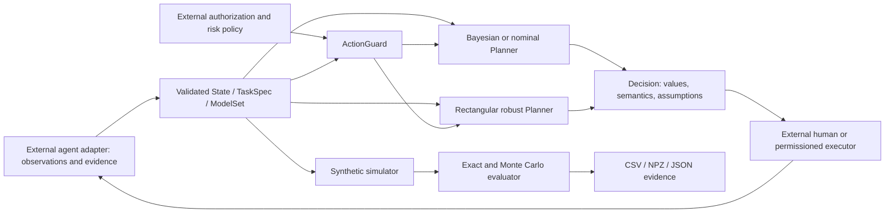
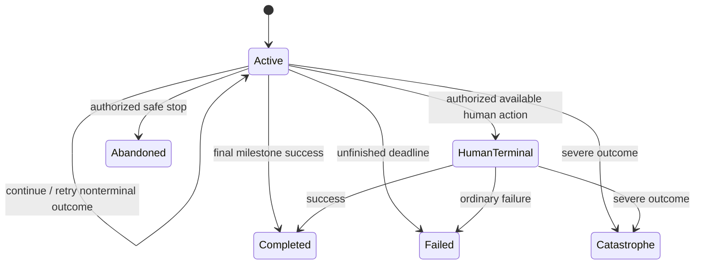

# HandoffX architecture

## ARC-01. Purpose and non-goals

HandoffX computes recommendations from an explicitly supplied probability model, costs, deadline, resources and authorization restrictions. Researchers and agent-system engineers can inspect action values, reproduce a decision and compare policies on a common simulator. It is a decision-support component, not an LLM wrapper, task orchestrator, probability predictor, human scheduling service or safety certification product.

The implemented scope deliberately matches the mathematics: a fixed hidden mode and finite model index; independent categorical outcomes conditional on that pair; observable progress and failure signals; continue/retry as milestone attempts; one terminal human-rescue action; authorized safe stop. Shared latent causes induce dependence without pretending to model every possible repair process.

## ARC-02. Components and responsibility boundaries

The external executor is not included. The feedback arrow describes a prospective integration contract, not a deployed connector. Authorization filtering precedes optimization; expected utility cannot restore a forbidden action. Safe stop is an explicit assumption rather than a universal remedy for physical processes where stopping can itself be dangerous.

| Module | Implemented responsibility | Not implemented |
|---|---|---|
| `models.py` | Immutable count state; validated costs, kernels and joint priors; log posterior | Learned calibration, arbitrary state transitions |
| `static.py` | Terminal-action expected losses and human threshold | Sequential control |
| `policies.py` | Action guard, exact Bayes/nominal DP, rectangular robust DP, baselines, explanations | General constrained-POMDP solver; autonomous executor |
| `scenarios.py` | Synthetic kernels, 38 specifications, serialization, shared policy factory | Real-agent dataset adapters |
| `evaluation.py` | Exact expectations and grouped CRN simulation | Real causal counterfactual inference |
| `__main__.py` | Runnable synthetic demonstration | Production service |
| Experiment scripts | Configuration, tuning, benchmarks, audits and plots | Hosted monitoring or scheduled work |

## ARC-03. Mathematical traceability

Equation (3) maps to `ModelSet.posterior`; equations (4)-(6) map to `Planner.scores/value` in Bayes mode; equation (8) maps to robust mode and `ModelSet.conditionals`. P7 maps to `ActionGuard.allowed`. P4 motivates the persistent-mode generator and the iid-mode ablation, not a fitted failure model. P8 is an analytical limit on transfer, not an API that certifies adapter correctness. `ExactEvaluator` implements policy evaluation independently of the policy's action-value recursion. The scalar audit loop is another implementation of trajectory execution.

## ARC-04. Data and uncertainty contracts

`ModelSet.kernels[m,z,a,o]` contains finite normalized probabilities for three executable actions and four outcomes. `prior[m,z]` is a normalized joint distribution. The Bayesian policy integrates this fixed-model prior; the robust policy instead evaluates the history-rectangular envelope of conditional kernels. Its action values must retain the string `history-rectangular worst-case cumulative loss` in serialized explanations. Converting these values to estimated mean loss would be a semantic error.

The adapter must define success, catastrophe, soft failure and hard failure consistently. A retrieval similarity, token probability, entropy, critic score or safety flag is not automatically a task-success probability. Evidence status records how the caller describes its evidence; it is not independently authenticated. Estimation, confidence-set coverage and data-governance reviews remain outside the core.

## ARC-05. State transitions

A retry is eligible only after an unresolved failure; there is no duplicate execution token, remote side effect, job queue or rollback mechanism. Applications with asynchronous actions, multiple concurrent tasks, fatigue, within-episode distribution changes, or nonterminal clarification need a different state representation and cannot be integrated by merely renaming outcomes.

## ARC-06. Validation and error handling

Costs are finite and nonnegative; executable action durations and resource use are positive integers; continue/retry durations equal one; tuple-valued task specifications are immutable; kernels and priors have valid shapes and normalize within explicit tolerance; unsupported evidence labels are rejected. Arrays are copied and made read-only. Posterior underflow is mitigated in log space. A zero-likelihood history raises `ModelError`, never silent uniform replacement. Terminal-state recommendation requests raise `TerminalStateError`.

`recommend_or_stop` provides explicit unscored abstention for a missing planner or model error. It does not swallow all programming exceptions or pretend a quantitative bound exists. Consumers must preserve that distinction in user interfaces. Caller-supplied objects and serialized inputs still require application-level schema, size, authentication and audit controls; this prototype is not hardened for hostile inputs.

## ARC-07. Performance and caching

Exact recursion is cached per planner instance with bounded `lru_cache(maxsize=32768)`, avoiding a global method cache that retains every historical planner. A state has six nonnegative counts and one feasibility flag. Enumerating all reachable count states still grows with horizon, milestones and branching; small benchmark timings are not scalability guarantees. Rebuild the controller when probabilities, costs, constraints or semantics change. Do not mutate a cached planner's attributes or share mutable adapters without a concurrency policy.

The recorded CPU-only Linux run measures cold first decisions separately from cached explanations. Peak process memory and Python allocator tracing are distinct metrics. Neither is a promise about an arbitrary Windows deployment. No microservices, Redis, vector database or orchestration framework is necessary for the MVP.

## ARC-08. Integrations and security

SQLGuard-Ninja could provide externally verified hard authorization decisions; RelVector could provide provenance or observation features. Their source code was not supplied or audited here. There are no implemented imports, classes or adapters for either project. Any future integration must map verified source APIs and preserve fail-closed authorization. A denied database operation cannot become permitted because its expected loss is low. A provenance score must not be relabeled a calibrated probability without evidence.

## ARC-09. Packaging and development

The package uses setuptools, a `src/` layout and semantic version `0.1.0` for an unreleased research prototype. Core dependency: NumPy; experimental extras: SciPy, Matplotlib, pytest and SymPy. Freeze the actually executed environment separately from the broad compatibility ranges. Publish a release only after license choice, package-name checks, Windows CI, documentation/API review and external scrutiny. The repository structure in this archive is an actual local implementation, not a claim that a public GitHub or PyPI project exists.
