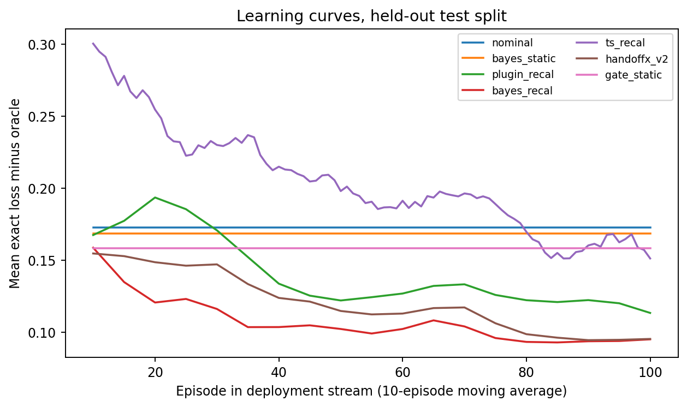
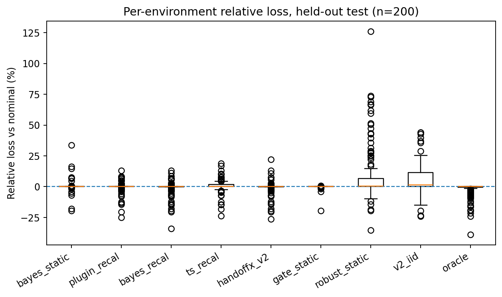
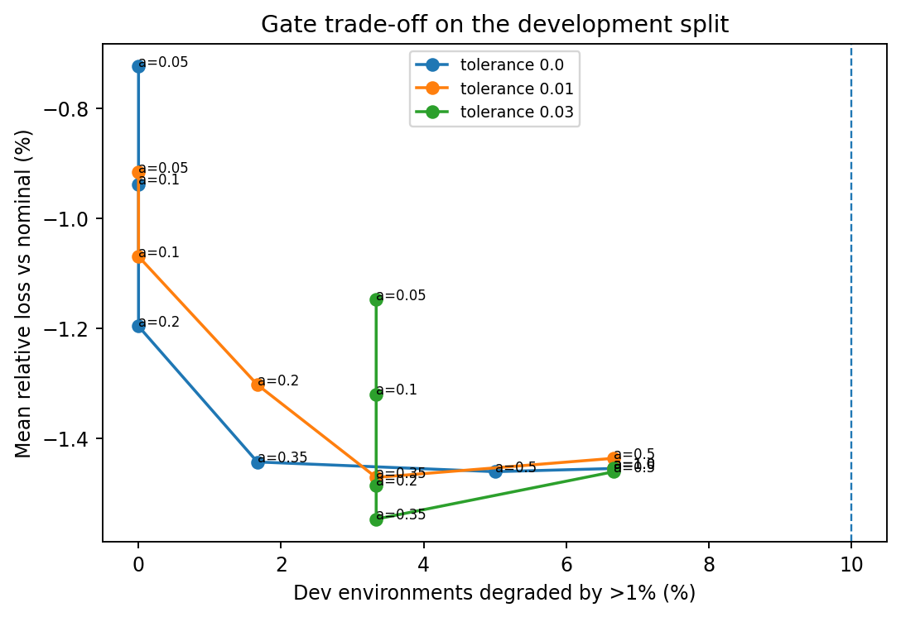
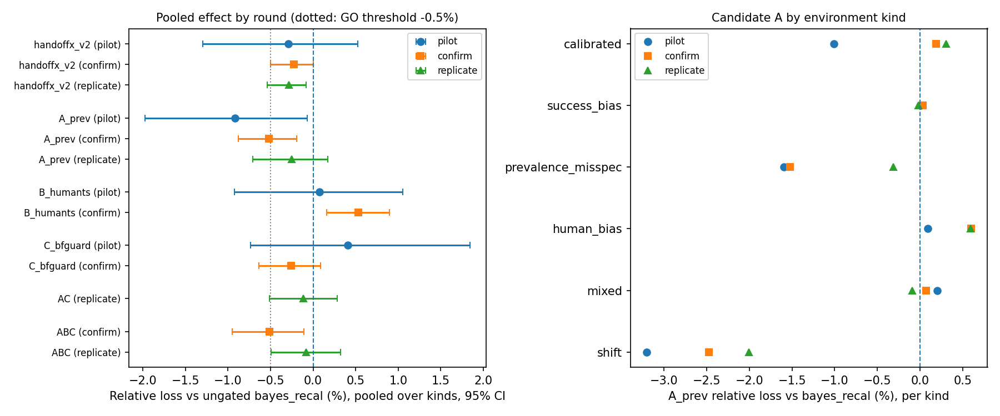
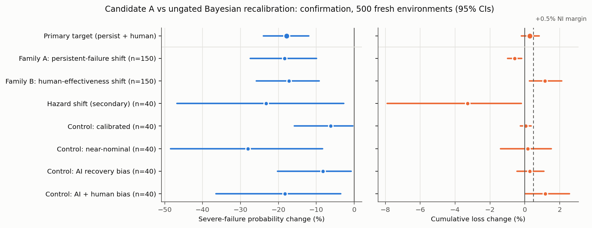
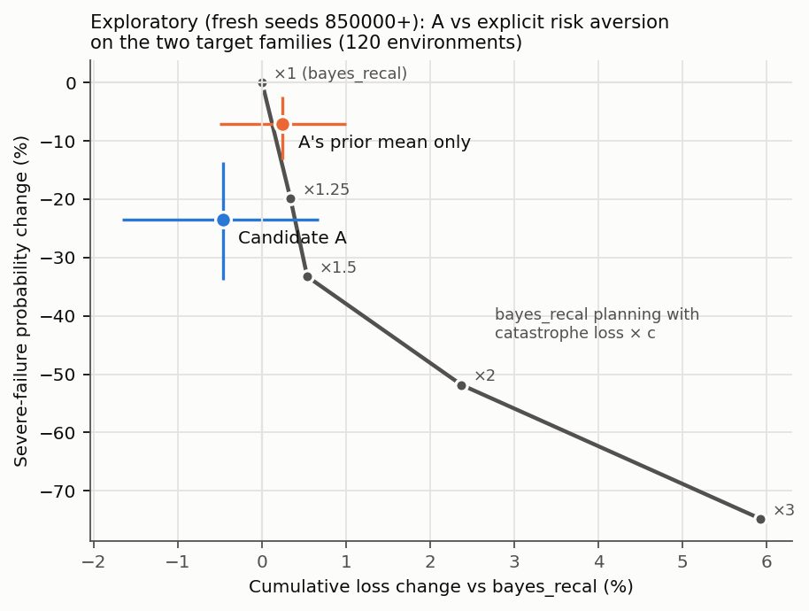

# Abstract

Autonomous agents repeatedly decide whether to continue, retry a failed step, request human assistance or stop. HandoffX formulates this choice as a finite-horizon, partially observed decision problem with:
- latent persistent failure modes;
- uncertain AI and human effectiveness;
- fallible terminal human rescue;
- costs, deadlines, resources and external action restrictions.

It provides exact nominal, Bayesian and history-rectangular robust planners in a small open-source Python library. This paper consolidates five studies conducted with that framework.

- **Study I** compared 11 policies in 38 designed scenarios using exact expectations and 5,016,000 paired simulated executions. Joint-Bayesian planning had lower exact loss than nominal planning in 6 scenarios, equal loss in 23 and higher loss in 9. Removing failure persistence was costly, and a robust bound failed outside its uncertainty set.
- **Study II** diagnosed that result as within-episode non-identifiability and added cross-episode Bayesian calibration with a conservative switching gate. On 200 pre-registered held-out environments, the gated controller changed mean exact loss relative to nominal planning by −0.46% (95% bootstrap interval −1.07% to +0.09%). Ungated posterior recalibration did at least as well (−0.63%), so the gate was not shown to add value. Under misspecification, the posterior concentrated on a wrong model.
- **Study III** screened three extensions against ungated recalibration in three independent rounds. No candidate's average-loss improvement replicated. One candidate, which adds uncertainty about the prevalence of persistent failures, consistently reduced severe failures.
- **Study IV**, a pre-registered confirmation on 500 fresh environments, confirmed that reduction. Severe-failure probability fell by 17.8% in relative terms (95% CI 12.0% to 24.0%), an absolute reduction of 3.2 per 1,000 episodes, in both prespecified shift families. Average-loss non-inferiority within a 0.5% margin was not demonstrated: +0.28%, with an upper bound of +0.82%. The candidate completed 3.3 percentage points fewer tasks and stopped more often.
- **Study V**, exploratory, attributes the reduction mainly to more cautious decisions rather than more accurate estimation of failure prevalence. Simpler catastrophe-weighted planning reaches comparable or larger reductions along a risk–loss trade-off.

Overall:
- HandoffX does not demonstrate universal superiority over nominal planning.
- Its supported contributions are a unified, reproducible framework and benchmark, and a precise account of when adaptation helps or fails.
- The work also identifies learning failures caused by selective observation and misspecification, and characterizes the trade-off between severe-failure reduction, expected loss and task completion.

All evidence is synthetic.

**Keywords:** human–AI collaboration; learning to defer; Bayesian sequential decision-making; partially observable Markov decision processes; robust control; model misspecification; risk-sensitive decision-making; reproducible research.

**Research status.** This paper reports theory, exact finite-model calculations and synthetic simulations. It reports no real agents, real operators or deployments, and it has not been peer reviewed. The reference software is MIT-licensed; the text is CC BY 4.0.

# How to read this paper

The five studies were carried out in sequence, and each was designed in response to the previous one.

**Table 1.** *Overview of the five studies*

| Study | Question | Design | Evidence status |
|---|---|---|---|
| I. Original framework (v0.1) | How do nominal, Bayesian and robust planning compare on a fixed design? | 38 designed scenarios, 11 policies, exact expectations plus simulation | Locally recorded protocol; descriptive comparisons |
| II. Adaptive learning (v0.2) | Can cross-episode calibration beat nominal planning, and is a conservative gate useful? | Pre-registered development, validation, held-out test and shift splits | Pre-registered; held-out |
| III. Feasibility screening (v0.3) | Can any of three extensions improve average loss over the best v0.2 learner? | Pilot, confirmation and replication rounds | Frozen protocol per round; screening |
| IV. Risk-reduction confirmation | Does prevalence uncertainty reduce severe failures without unacceptable loss? | Pre-registered, 500 fresh environments | **Confirmatory** for the primary endpoint |
| V. Mechanism analysis | Why does the reduction occur; can explicit risk aversion reproduce it? | Post hoc ablations on separate fresh seeds | **Exploratory** |

Results from earlier studies are reported unchanged. Where a later study refines an earlier interpretation, the text says so explicitly; Section 15 summarizes these developments. The labels P1–P9, A1–A4 and CE1–CE9 identify propositions and counterexamples throughout. Equations are numbered consecutively, and tables and figures are numbered in order of appearance.

# 1. Introduction

An agent can fail for several reasons:
- its next step is difficult;
- a retry repeats the same underlying failure;
- a tool is unavailable;
- its belief about a person's ability to rescue the task is wrong.

These situations do not share a universal response. Repeating a low-cost recoverable step can be useful, while repeating a persistent failure can consume the entire budget. A skilled person may resolve the task, but an unavailable, costly or equally uninformed person may not improve the outcome. Stopping can be optimal when the remaining expected benefit is smaller than the operational and failure costs.

The decision problem must therefore separate an action's immediate cost from its effect on later options. It must also separate uncertainty in the true task state from uncertainty in the probabilities used to predict the future. Established belief-state and Bayes-adaptive formulations already supply the relevant mathematical language (Kaelbling et al., 1998; Ross et al., 2011), and HandoffX does not claim to invent it. Its purpose is to make a bounded version operationally explicit, and to test reproducibly what happens when nominal, Bayesian, adaptive, robust and risk-averse interpretations are applied to the same synthetic decision problem.

The central practical question is not whether a Bellman equation can contain an action called human assistance; it can. The questions are:
1. Can the required inputs be defined and supplied consistently?
2. Do the implemented decision rules respect the intended uncertainty semantics?
3. Does additional mathematical or statistical machinery produce a measurable advantage over simpler or established alternatives?
4. When an advantage appears, what does it actually consist of?

This paper answers these questions for a specified model class and a sequence of synthetic benchmarks. It does not claim to solve estimation from real execution logs.

## 1.1. Scope of model agnosticism

The controller does not inspect a neural network's weights, hidden activations, architecture or brand. It receives categorical outcome probabilities, observations, costs and restrictions. This is architectural independence within a specified decision-process class, and it implies none of the following:
- that one model's probabilities transfer to another model;
- that the same milestones have equivalent meanings across tasks;
- that performance transfers between organizations.

A model-independent equation can still be wrong for a particular workflow.

## 1.2. The research sequence in brief

- **Study I** found no uniform advantage for joint-Bayesian planning over nominal planning: 6 improvements, 23 ties and 9 degradations across 38 scenarios. Persistent-failure modelling was, however, consistently valuable.
- **Study II** showed why: within one episode, a prior centred on a biased estimate cannot be corrected, because human effectiveness is observed only after a terminal handoff. Pooling evidence across episodes produced a small held-out improvement whose interval included zero, and the conservative gate added nothing measurable.
- **Study III** asked whether the remaining headroom could be recovered:
  - the model grid was not the bottleneck;
  - learning stalled, partly through a self-confirming escalation trap and partly through misspecified failure prevalence;
  - none of the three tested remedies produced a replicated average-loss gain;
  - one of them repeatedly reduced severe failures.
- **Study IV** tested that reduction prospectively, and **Study V** examined its mechanism.

The resulting picture is consistent and modest. Exact planning with persistent-failure modelling captures most of the value available in this decision structure. The remaining choices are mainly about how much expected loss and task completion to trade for fewer severe failures.

# 2. Related work

This section is a targeted synthesis, not a systematic review. The first prior-art audit and its source-by-source mapping are preserved in Appendix E. Bibliographic records were verified against publisher, Crossref or proceedings metadata. Older records were verified on 28–29 October 2026; the five references added for the consolidated paper were verified on 29 October 2026.

## 2.1. Sequential decision-making under partial observability and parameter uncertainty

Belief-state control of partially observable Markov decision processes (POMDPs) supplies the basic language: a policy acts on a posterior distribution over hidden states (Kaelbling et al., 1998). Bayes-adaptive POMDPs extend the hidden state with unknown model parameters, so that information gathering and exploitation are traded off within one Bayesian objective (Ross et al., 2011).

HandoffX's joint belief over a finite model index and a latent failure mode is a small, finite-support specialization of these formulations. Its exact recursion is standard dynamic programming on a sufficient count state.

## 2.2. Deferral, selective prediction and human–AI complementarity

The decision to hand a case to a human is closely related to selective prediction with a reject option. Chow (1970) characterized the optimal error–reject trade-off for classification. Learning-to-defer methods extend this to a fallible downstream expert:
- consistent surrogate losses for deferral (Mozannar & Sontag, 2020);
- fairness-sensitive deferral (Madras et al., 2018);
- calibrated and multi-expert deferral (Verma & Nalisnick, 2022; Verma et al., 2023);
- complementarity-oriented learning (Charusaie et al., 2022);
- learning with limited expert labels (Hemmer et al., 2023).

Related benchmarks and analyses show that synthetic experts and capacity constraints are established evaluation devices (Alves et al., 2025). Confidence-only cascades can fail (Jitkrittum et al., 2023), and hidden confounding complicates learning from deferral logs (Ghoummaid & Shalit, 2024).

HandoffX reuses the Bayes decision principle behind these methods; Proposition P1 is the static deferral rule. It differs in three ways:
- it studies repeated, sequential recovery decisions rather than one-shot classification;
- it does not train a surrogate;
- it treats the human as a costly, fallible, terminal action whose effectiveness is itself uncertain.

## 2.3. Help-seeking agents and human-in-the-loop control

Robots that request help from imperfect and sometimes unavailable humans have long been studied (Rosenthal et al., 2011). Other prior work covers:
- uncertainty-aware querying of an expert under a call budget (Singi et al., 2023);
- switching control among agents in a team (Balazadeh et al., 2023);
- Bayesian self-escalation in hierarchical language-model agents (Shaikh, 2026);
- benchmarks of when agents ask for help (Trinh et al., 2026);
- benchmarks of tool–agent–user interaction (Yao et al., 2025).

These works show that help-seeking, escalation timing and imperfect helpers are not new concepts. HandoffX instead isolates a costed synthetic decision model in which exact optimal values are computable. It therefore complements, rather than competes with, benchmarks of real agents.

## 2.4. Robust and risk-sensitive control

Robust dynamic programming under rectangular uncertainty sets is established (Iyengar, 2005; Nilim & El Ghaoui, 2005), as are robust policies for uncertain POMDPs (Suilen et al., 2020; Cubuktepe et al., 2021). The rectangularity assumption is consequential: Counterexample CE5 shows a factor-of-two gap.

Risk-sensitive alternatives to expected-loss minimization include:
- exponential-utility Markov decision processes (Howard & Matheson, 1972);
- constrained Markov decision processes (Altman, 1999/2021);
- conditional value-at-risk optimization (Rockafellar & Uryasev, 2000);
- distribution-free conformal risk control (Angelopoulos et al., 2024).

HandoffX does not implement a constrained or CVaR optimizer. Its risk tools are:
- a union-bound per-action catastrophe guard (P7);
- a robust planner;
- in Study V only, an exploratory catastrophe-weighted planning objective.

## 2.5. Safe improvement, Bayesian learning and misspecification

Studies II–IV use the following established results:
- the conservative gate of Study II follows the logic of high-confidence and safe policy improvement (Thomas et al., 2015; Laroche et al., 2019), but makes a posterior rather than a frequentist statement;
- cross-episode learning relies on the ignorability of data-dependent action selection (Rubin, 1976);
- exploration is compared with Thompson sampling (Thompson, 1933; Russo et al., 2018);
- under misspecification, posteriors concentrate on the Kullback–Leibler-closest model (Berk, 1966), which motivates posterior predictive checking (Box, 1980);
- Study III's reversion guard uses Bayes factors (Kass & Raftery, 1995);
- its "learning trap" diagnosis corresponds to incomplete learning in Bayesian sequential decisions (Harrison et al., 2012).

# 3. Research gap and contributions

## 3.1. Gap

The literature supplies the mathematics for each component. It does not supply a single, executable, exactly evaluable benchmark of continue/retry/human/stop decisions that allows all of the following to be compared on equal information:
- nominal, Bayesian, robust and adaptive interpretations;
- persistent failures and fallible terminal human rescue;
- pre-registered held-out evaluation;
- explicit separation of average loss, task completion and severe-failure risk.

Without such a benchmark it is hard to say when uncertainty-aware or adaptive intervention is worth its complexity, and what kind of benefit it delivers when it is. The reviewed material did not show an identical matched implementation, but the absence of a title in a targeted search is not proof of originality. No novelty is claimed for established Bayesian or decision-theoretic principles.

## 3.2. Contributions

The contributions are limited to those supported by the evidence:

1. **A unified mathematical decision framework.** A finite-horizon formulation of continue, retry, human rescue and stop with:
   - latent persistent failure modes and uncertain AI and human effectiveness;
   - Bayesian, nominal and history-rectangular robust semantics;
   - a cross-episode extension.

   Nine conditional propositions (P1–P9), four adaptive-layer propositions (A1–A4) and nine counterexamples (CE1–CE9) state exactly what holds and what does not.
2. **A reproducible benchmark and Python reference implementation.** The benchmark has exact finite-model evaluation, common-random-number simulation and pre-registered protocols. The open-source library has a small integration API and runnable examples.
3. **Controlled evaluation of Bayesian adaptation and uncertainty.** Joint-Bayesian, robust, cross-episode-calibrated, gated, Thompson-sampling and three extended learners are compared against nominal planning and an oracle under equal information.
4. **Identification of learning failures** caused by:
   - selective observation: no learning about an action that is not taken;
   - a self-confirming escalation trap;
   - model misspecification: confident convergence to a wrong model.
5. **Empirical characterization of the trade-off** between severe-failure reduction, expected loss and task completion. This includes an independently confirmed severe-failure reduction and an inconclusive loss non-inferiority test.
6. **Transparent negative findings and practical limitations.** These include:
   - no uniform improvement over nominal planning;
   - a gate with no demonstrated value;
   - failed replication of average-loss gains;
   - a risk reduction obtained by caution rather than better estimation.

## 3.3. Kinds of evidence

**Table 2.** *Kinds of evidence used in this paper*

| Label | Meaning | Examples |
|---|---|---|
| Theoretical | Proved under stated assumptions; adapted from established theory | P1–P9, A1–A4 |
| Constructed counterexample | Exact arithmetic on a specified example | CE1–CE8 |
| Exact finite-model calculation | Expected values computed exactly for a specified synthetic model | All "exact loss" and "severe-failure probability" values |
| Synthetic simulation | Monte Carlo trajectories from the specified generator | Paired intervals in Study I; realized-event counts |
| Pre-registered held-out evidence | Protocol and code frozen before the evaluation data were run once | Study II test and shift splits; Study IV |
| Confirmatory | Pre-registered primary endpoint, comparator, threshold and sample size | Study IV primary endpoint only |
| Exploratory | Designed or examined after results were seen | Study V; post-pilot diagnostics in Study III |
| Real-world generalization | Not established | None |

## 3.4. Research questions

The eight original questions (RQ1–RQ8) are retained; their final answers are in Section 15.3. Studies II–V add three questions:

**Table 3.** *Research questions*

| ID | Question | Evidence required |
|---|---|---|
| RQ1 | Can a common probability/cost interface support architecture-independent intervention decisions? | Formal state/action contracts and executable APIs |
| RQ2 | When do continue, retry, human rescue and stop minimize the specified objective? | Bellman recursion, thresholds in valid special cases and worked examples |
| RQ3 | How do errors and dependence in AI/human capability estimates change decisions? | Controlled bias factors and prior-factorization ablation |
| RQ4 | How do persistent modes and dependent retries affect loss and escalation? | Posterior derivation and iid-mode comparison |
| RQ5 | Which stability, coverage and transfer statements can be established conditionally? | Complete proofs, counterexamples and numerical checks |
| RQ6 | What transfers when the environment or agent changes? | Structural API reuse versus a deliberately shifted model |
| RQ7 | How do established/reference policies compare under matched information? | Exact expectations, paired intervals and all negative results |
| RQ8 | Is a lightweight, auditable prototype usable without paid infrastructure? | Actual package, examples, tests, installation and runtime records |
| RQ9 | Can cross-episode learning improve on nominal planning on held-out environments, and does a conservative gate help? | Pre-registered held-out benchmark (Study II) |
| RQ10 | What limits further adaptive improvement in average loss? | Headroom diagnostics and candidate screening (Study III) |
| RQ11 | Can severe-failure risk be reduced without unacceptable loss, and by what mechanism? | Pre-registered confirmation (Study IV); exploratory mechanism analysis (Study V) |

# 4. Problem formulation

**Status.** Specified and implemented for the bounded latent-mode subclass below. General MDP/POMDP notation explains the relationship to prior art; it does not imply that the software solves arbitrary POMDPs. All probabilities in the experiments are synthetic design choices, not observations of language models or human workers.

**Table 4.** *Notation and abbreviations*

| Symbol or term | Meaning and units |
|---|---|
| C, R, H, S | Continue, retry, terminal human rescue, authorized safe stop |
| T, t | Deadline and elapsed time, in artificial time ticks |
| j, J | Completed and required milestones |
| B, b | Resource quota and amount spent, in resource units |
| Z | Fixed hidden task (failure) mode within an episode: healthy/transient, recoverable/intermediate, persistent |
| Θ, m | Fixed latent capability-model index; $M$ is the finite model set |
| μ, b(s) | Prior and posterior distributions over model and mode |
| K, k | Conditional categorical outcome kernel |
| κ(a) | Operating plus time cost of action a, in common artificial loss units |
| L, F, S | Ordinary-failure, catastrophe (severe-failure) and safe-abandonment losses |
| V, Q | Bayesian value and action-value functions |
| W_R | History-rectangular robust value, not a mean-loss estimate |
| δ | Episode severe-risk budget, conditional on model coverage |
| J_P(π) | Expected cumulative loss of policy π in environment P |
| e, τ_e, w_E | Episode index, logged trajectory of episode e, posterior over the model index after E episodes |
| π(z∣m) | Prevalence of latent mode z under model m |
| λ | Prevalence level of candidate A (Study III–V) |
| ARD, RRR | Absolute risk difference; relative risk reduction (ratio of means) |
| pp | Percentage points (difference of two percentages) |
| MDP / POMDP | Markov / partially observable Markov decision process |
| DP | Dynamic programming |
| CRN | Common random numbers for paired simulation |

## 4.1. Decision environment and units (FM-01)

An episode is a task with $J$ ordered, otherwise homogeneous milestones, deadline $T$ integer time ticks, resource budget $B$ integer quota units, and at most one terminal human intervention. The controller minimizes expected cumulative operational loss. A loss unit is an artificial common utility unit. A time tick is a synthetic latency unit, not a measured second. Resource units are distinct from loss units and enforce a hard quota. Conversion of money, time and failure consequences into a common utility is an application owner's responsibility.

The broad finite-horizon formulation has hidden state $x_t$, observable history $h_t=(o_0,a_0,o_1,\ldots,o_t)$, available action set $\mathcal A(h_t)$, action-dependent transition kernel $P_\theta(x'\mid x,a)$, observation kernel $O_\theta(o\mid x',a)$, nonnegative cost $c_t(x,a)$, duration $d(a)$, and terminal loss $g(x)$. A history-measurable policy $\pi$ maps the observable history to an admissible action. A belief $b_t(x,\theta)$ is a conditional distribution, not a neural confidence score. These are established POMDP constructions (Kaelbling et al., 1998).

The implemented environment specializes this structure: $Z\in\{0,1,2\}$ is a fixed hidden task mode (healthy, recoverable, persistent), and $\Theta\in\{1,\ldots,M\}$ is a fixed episode-level model index. Neither is observed by any evaluated policy. The observed state contains completed progress, elapsed time, spent resources, unresolved-failure flag, and sufficient outcome counts. There are no hidden-state transitions except absorbing task termination. 'Recoverable' means a higher retry success probability, not a separately modeled repair of $Z$. Shared persistent $Z$ induces dependence among action outcomes even though they are conditionally independent given $(\Theta,Z)$.

## 4.2. Actions, outcomes and terminal semantics (FM-02)

The executable actions are $C$ (continue), $R$ (retry the currently failed milestone), and $H$ (human rescue of the entire remaining task); $S$ is authorized safe stop.

**Table 5.** *Base action and outcome parameters*

| Action | Admissibility | Successful outcome | Failure outcome | Duration | Quota |
|---|---|---|---|---:|---:|
| Continue $C$ | Time/quota/authorization sufficient | Advance one milestone | Remain at milestone; receive soft/hard diagnostic | 1 | 1 |
| Retry $R$ | Previous milestone attempt unresolved, plus constraints | Advance the failed milestone | Remain unresolved; receive diagnostic | 1 | 2 |
| Human $H$ | Ticket, known availability, time/quota sufficient | Complete the entire task | Terminal ordinary failure or catastrophe | 2 by default | 3 |
| Stop $S$ | Always externally authorized in this model | Not task success | Terminal safe abandonment | 0 | 0 |

Human rescue is deliberately not a perfect oracle. Continue and retry are not interchangeable: retry is unavailable initially, has different probability and cost parameters, and consumes twice the quota. Human assistance terminates the episode and consumes a different duration. A nonterminal outcome on the last time tick becomes ordinary deadline failure; it does not acquire a free last-moment safe-stop option. Task completion exactly at the deadline is success. Quota exhaustion before the deadline leaves the authorized safe-stop action available.

For $a\in\{C,R,H\}$ and $(m,z)$, let $p_{mza}$ be probability of progress/success and $q_{mza}$ probability of catastrophe. They are unconditional competing-outcome probabilities, so $0\le p_{mza}+q_{mza}\le1$. The remaining probability is ordinary failure. For $C,R$, a failure carries diagnostic $D\in\{0,1\}$ with $P(D=1\mid\text{failure},m,z,a)=d_z$. The prototype uses known diagnostic likelihoods, not learned ones. The four categorical probabilities are

$$K_{mza}=\left(p_{mza},q_{mza},(1-p_{mza}-q_{mza})(1-d_z),(1-p_{mza}-q_{mza})d_z\right). \tag{1}$$

For human rescue, $K_{mzH}=(p_{mzH},q_{mzH},1-p_{mzH}-q_{mzH},0)$. Its ordinary failure is terminal; it does not emit a diagnostic that can influence another decision. Outcomes are mutually exclusive and exhaustive.

## 4.3. Costs, restrictions and objective (FM-03)

Let $c_a$ be executable-action operating cost and $\lambda$ be loss per time tick. The immediate cost is $\kappa_a=c_a+\lambda d(a)$. Success has terminal loss zero, ordinary terminal failure/deadline has loss $L$, catastrophe has loss $F$, and authorized safe abandonment has loss $S$. All are nonnegative. Stopping does not count as task success and is reported separately from ordinary and severe failures.

$$J_P(\pi)=\mathbb E_P^\pi\left[\sum_{t:\,a_t\ne S}\kappa_{a_t}+g_{\rm terminal}\right],\quad g_{\rm terminal}\in\{0,L,F,S\}. \tag{2}$$

The expected-loss objective is not a tail-risk or catastrophic-failure guarantee. Severe-failure probability and empirical upper-tail loss are distinct secondary measures. One optional action guard imposes a per-decision worst-model catastrophe-probability cap $\delta/T$; Proposition P7 states exactly what this ensures. There is no implemented general constrained-POMDP or CVaR optimizer.

The admissible set excludes actions without enough quota or time, unavailable human assistance, unauthorized actions, retry before a failure, and (in one scenario) continued execution after failure in an irreversible workflow. A known schedule $u_t\in\{0,1\}$ represents human availability. The prototype does not learn availability, model a human queue, or coordinate capacity across simultaneous tasks. A human ticket is a per-task constraint. No passive 'wait' action exists; delaying help means taking a permitted task action. If no such action is authorized, safe stop remains.

## 4.4. Deployment streams (Studies II–V)

Studies II–V embed the within-episode model in a deployment, without changing the within-episode model:
- A deployment is a sequence of episodes $e=1,2,\ldots$ that share a fixed model index $m^*$ from a finite set $M$.
- Each episode draws a latent failure mode $z_e\sim\pi(\cdot\mid m^*)$, which stays fixed within the episode.
- Episode $e$ yields a trajectory $\tau_e$ of action–outcome pairs; the stop action produces no outcome.
- Actions may depend on earlier trajectories, the current history and independent randomization, but never on $m^*$ or $z_e$.

The objective of a deployment policy is the mean per-episode expected loss over a stream of fixed length; in Studies II–V the length is 100 episodes. The severe-failure probability of an episode is the exact probability, under the hidden true kernel, that the policy in force for that episode ends in catastrophe (outcome index 1). It is a separate endpoint, not a component that expected loss controls.

## 4.5. Transfer and reliability boundary (FM-10)

Structural transfer means the same solver accepts a new adapter's correctly defined kernels, states, costs and restrictions. Parameter transfer means those conditional probabilities remain accurate. Performance transfer additionally requires the objective, feasibility rules and relevant conditional distributions to remain comparable. Only structural transfer is built into the API. The experiment's shifted environment changes success, hazards and mode prevalence; perfect recalibration is an oracle-like upper-bound control, not evidence that a real estimator can recover those values.

Reliability in this report means (i) correct optimization/evaluation within the specified finite model, (ii) reproducible empirical loss and catastrophic-failure rates, and (iii) explicitly conditional theoretical bounds. It does not mean safety certification, universal correctness, an autonomous-control authorization, or verified real-world human benefit.

# 5. Mathematical framework

## 5.1. Sufficient state and belief update (FM-04)

Let $n=(n_{C+},n_{C0},n_{C1},n_{R+},n_{R0},n_{R1})$ count observed nonterminal progress and soft/hard failures. Let $f\in\{0,1\}$ record whether the last milestone attempt remains unresolved. Elapsed time is $t=\sum_i n_i$, progress is $j=n_{C+}+n_{R+}$, and quota used is $b=\sum_{i=1}^3 n_i+2\sum_{i=4}^6 n_i$. Human actions never enter these counts because they terminate the task. Thus the implemented state is $s=(n,f)$ with the immutable task specification supplied separately.

Write $\mu_{mz}=P(\Theta=m,Z=z)$ for the initial joint distribution. Because the hidden pair is fixed and likelihoods commute, counts are sufficient for inference in this subclass:

$$b_{mz}(n)=\frac{\mu_{mz}\prod_{a\in\{C,R\}}\prod_{o\in\{+,0,1\}}K_{mza,o}^{n_{ao}}}{\sum_{m',z'}\mu_{m'z'}\prod_{a,o}K_{m'z'a,o}^{n_{ao}}}. \tag{3}$$

The code computes this expression in log space. Zero-likelihood observations under every supplied model raise an explicit error; they are not silently renormalized into an arbitrary posterior. Counts do not suffice under time-varying probabilities, fatigue, learning human operators, history-sensitive repairs, or action-order-dependent outcomes. Such applications need a richer adapter and a different solver.

The Bayesian predictive outcome law is $\bar K_{a,o}(s)=\sum_{m,z}b_{mz}(s)K_{mza,o}$. For robustness, $K^m_{a,o}(s)=\sum_z b(z\mid m,s)K_{mza,o}$ is the model-conditional predictive law. A single nominal-model planner keeps $m$ fixed at the central supplied model and updates only $Z$.

## 5.2. Static action loss (FM-05)

For a single binary task and mutually terminal alternatives, $Q_a=c_a+(1-p_a)L$, with $Q_S=S$. Catastrophe can be included as $Q_a=\kappa_a+q_aF+(1-p_a-q_a)L$. Minimize over feasible actions. Human rescue is preferred to AI exactly when $p_H-p_A\ge(c_H-c_A)/L$ under the symmetric-loss, no-separate-catastrophe assumptions and $L>0$. This is an adaptation of established Bayes deferral, not new mathematics (Mozannar & Sontag, 2020).

Example: $p_A=.65$, $p_H=.90$, $c_A=1$, $c_H=4$, $L=20$ gives losses 8 and 6, so human rescue is preferred; the human-success threshold is .80. A .05 probability error changes the corresponding action loss by one loss unit. With $S=5$, stopping dominates both. With $L=0$, only action costs matter and division by $L$ is invalid. A computed threshold above 1 means human rescue cannot satisfy that inequality; it is not clipped to manufacture feasibility.

The implemented `static_loss` benchmark uses static committed completion plans because $C,R$ only finish a milestone while $H$ finishes a task. Its $C$ plan attempts all remaining milestones without post-failure recovery; its $R$ plan retries the present milestone then continues. It values failure as terminal but replans after an actually observed nonterminal failure. The fully sequential nominal planner is the principal strong comparator, so conclusions do not depend on this deliberately myopic comparator.

## 5.3. Sequential partial-observation control (FM-06)

Let $s^{a,o}$ be the updated count state for $a=C,R$ and a noncatastrophic outcome. The value at completed progress is zero. The value at an unfinished deadline is $L$. Otherwise,

$$V(s)=\min_{a\in\mathcal A(s)}Q(s,a), \tag{4}$$
$$Q(s,S)=S,\qquad Q(s,H)=\kappa_H+\bar K_{H,1}(s)F+[\bar K_{H,2}(s)+\bar K_{H,3}(s)]L, \tag{5}$$
$$Q(s,a)=\kappa_a+\bar K_{a,1}(s)F+\sum_{o\in\{0,2,3\}}\bar K_{a,o}(s)V(s^{a,o}),\quad a\in\{C,R\}. \tag{6}$$

Outcome index 0 means progress, index 1 catastrophe, and indices 2/3 diagnostic failures. The mathematical symbols $+,0,1$ in the counts denote progress and the two diagnostic values; they are distinct from these categorical array indices. All code documentation uses the four categorical indices to avoid an implicit mapping.

This is finite-horizon belief-state dynamic programming, specialized from established POMDP theory. Recursion terminates because every nonterminal action increases elapsed time. A cached exact computation is feasible for the small experiment horizons. No approximation grid or learned value function is used. The general problem can be expensive; the implementation accepts horizons 1 through 12, and the reported evidence is concentrated at 3 and 6 ticks.

## 5.4. Joint fixed-model uncertainty (FM-07)

Each supplied model is an alternative joint account of AI and human effectiveness. The benchmark uses nine combinations of additive offsets $(-.18,0,.18)$ to AI success probabilities (both $C,R$) and human success probabilities. The perturbation generator explicitly clips to $[.01,1-q-.01]$ before constructing a valid model; the public model validator never silently fixes invalid probabilities.

The joint prior over these offsets is

$$W=\begin{pmatrix}.20&.025&.05\\.025&.40&.025\\.05&.025&.20\end{pmatrix}. \tag{7}$$

Its marginal probabilities are $(.275,.45,.275)$ on each axis. The independent-prior ablation uses the outer product of these marginals, retaining the same support and initial one-action predictions. The off-diagonal-reversed true-prior scenario preserves those marginals while changing the sign of association. In every case, the model index is fixed within an episode, rather than independently redrawn on every action.

The prior is elicited synthetic experimental structure. It is not a fitted posterior or a confidence region with empirical coverage. Bayesian optimality applies to its prior-predictive distribution, not automatically to each possible fixed model. Failure observations can update beliefs about human effectiveness through the assumed coupling; incorrect coupling can therefore mislead the policy.

## 5.5. Dependent failure and the iid ablation (FM-08)

Conditional independence given a persistent hidden mode does not imply marginal independence. If an action has latent success probability $P$, then survival through $k$ failed attempts has probability $\mathbb E[(1-P)^k]$, not generally $(1-\mathbb E P)^k$. The count posterior responds to repeated failures by shifting mass toward persistent modes. The iid-mode ablation averages the kernel over the initial mode distribution separately within each model, then resamples the implicit mode at each action. It preserves one-step marginals but removes within-model temporal dependence. It retains episode-level parameter uncertainty if multiple models remain.

## 5.6. History-rectangular robustness (FM-09)

At each observable history, form $\mathcal U(s,a)=\operatorname{conv}\{K^m_a(s):m\text{ remains possible}\}$. The robust policy solves an adversarial history-tree problem in which nature can select a different conditional kernel at each history and action. Its recursion replaces the Bayesian outcome expectation in (5)-(6) with a maximum over the model-conditional expectations, using a common robust continuation value $W_R$.

$$W_R(s)=\min_{a\in\mathcal A(s)}\max_m\left\{\kappa_a+\mathbb E_{K^m_a(s)}[\text{terminal loss or }W_R(s')]\right\}. \tag{8}$$

Stop has no uncertain transition. The row-selection envelope contains every fixed-model history distribution, but usually also distributions that cannot arise from any fixed model. This gives an upper bound on fixed-model worst-case loss, not equality with fixed-parameter minimax. This interpretation is essential to applying established rectangular robust dynamic programming (Iyengar, 2005; Nilim & El Ghaoui, 2005). The code does not reproduce the finite-state-controller algorithm of Cubuktepe et al. (2021); that paper establishes broader prior art.

## 5.7. Cross-episode posterior

Under the deployment structure of Section 4.4, the posterior over the model index after $E$ completed episodes is

$$w_E(m)\propto w_0(m)\prod_{e=1}^{E}\sum_{z}\pi(z\mid m)\prod_{(a,o)\in\tau_e}k(o\mid m,z,a). \tag{9}$$

Each episode contributes its marginal likelihood, in which the latent mode is summed out per episode, because modes are redrawn independently across episodes. Proposition A1 (Section 7.10) shows that the data-dependent choice of actions does not enter (9). Planning then uses the posterior-weighted model set as the prior of the within-episode recursion (4)–(6). Studies II–IV recompute this "posterior model set" every five episodes. The implementation (`handoffx.adaptive.EpisodeBelief`) works in log space. A history with zero likelihood under every model raises an error rather than being renormalized. From version 0.2.1, when the posterior model set is formed, models with exactly zero likelihood are omitted and finite posterior weights that underflow to zero are floored at the smallest normal floating-point number (Section 8.4).

# 6. Decision policies and algorithms

## 6.1. Study I policy suite

All policies use the same observable state and externally admissible actions. The same supplied nominal kernel, uncertainty support, priors and known costs are available to non-oracles, although each policy may use a subset. Hidden task modes and future outcomes never enter a policy interface.

**Table 6.** *Implemented comparison policies*

| Policy | Actual decision mechanism | Interpretation |
|---|---|---|
| always_continue | Continue if authorized, otherwise stop | Weak diagnostic control |
| always_human | Human if available, otherwise continue, otherwise stop | Tests whether full delegation is already sufficient |
| retry_first | Continue initially; up to two retries; then human/stop | Retry limit selected on separate development environments |
| confidence | Compare committed remaining-milestone success to 0.50; use fixed fallback order | Threshold selected on development environments |
| static_loss | Expected loss of committed completion plans; failures terminal in scoring | Bayes-loss principle, not trained learning-to-defer reproduction |
| nominal_dp | Exact dynamic planning with central model and latent-mode posterior | Principal strong comparator |
| robust_dp | Exact history-rectangular minimax DP over supplied model-conditional laws | Different objective; not fixed-model minimax |
| handoffx_bayes | Exact posterior-predictive DP over joint model and mode | Established Bayesian principle in a reference implementation |
| bayes_independent | Same support and marginals; factorized AI/H prior | Coupling ablation, not a weak unrelated baseline |
| bayes_iid | Same initial one-step predictions; mode persistence removed within each model | Dependence ablation; episode-level parameter uncertainty retained |
| oracle | True generating model/prior, same observations and action guard | No hidden-mode or future-outcome knowledge |

Static plans compare task completion fairly: autonomous continuation must finish the remaining milestones, while human rescue handles the remaining task. Merely comparing single-step AI success with terminal human rescue would be invalid. The static policy still omits adaptive recovery choices in its score, which is why exact nominal DP is the principal comparator.

No HULA, neural surrogate learning-to-defer, Cubuktepe controller synthesis, or Shaikh real-model code is represented as reimplemented. The experiment compares reference decision rules in a shared simulator, not published systems on their original datasets. Source-specific guarantees do not transfer automatically.

The post-run robust-objective audit evaluates every policy against the same conditional-kernel envelope and each supported fixed model. This prevents expected-loss rankings from being mistaken for a failure of robust optimization's own objective. It is disclosed as post-hoc analysis and does not tune any policy.

## 6.2. Cross-episode learners (Study II)

All learners use the same supplied information as nominal planning:
- a model set built around the supplied estimate;
- the action guard;
- the costs;
- common random numbers.

They differ only in how they use logged episodes:

- **nominal**: exact DP on the supplied centre model; no learning.
- **bayes_static**, **robust_static**: the Study I Bayesian and robust planners on the prior model set; no learning.
- **plugin_recal**: plan on the maximum-a-posteriori model under (9).
- **bayes_recal**: plan by exact Bayes-adaptive DP with the posterior model set ("ungated posterior recalibration"). This is the strongest deployable learner of Study II and the comparator in Studies III–V.
- **ts_recal**: Thompson sampling of one model per episode (Thompson, 1933; Russo et al., 2018).
- **handoffx_v2**: the conservative gate below, choosing between nominal and bayes_recal.
- **gate_static**: the gate evaluated on the prior only.
- **v2_iid**: handoffx_v2 without persistent modes.
- **oracle**: exact DP on the true model. It knows the generating process, but not the realized mode or future outcomes.

**Conservative switching gate.** Let $\pi_0$ be nominal DP and $\pi_c$ the Bayes-adaptive DP with posterior prior $w$. For each model $m$, let $\Delta_m=L_m(\pi_0)-L_m(\pi_c)$, computed exactly. The gate deploys $\pi_c$ for the next five episodes if and only if

$$\mathbb E_w[\Delta]>\text{margin}\quad\text{and}\quad P_w(\Delta<-\tau)\le\alpha, \tag{10}$$

and otherwise keeps $\pi_0$. The tolerance $\tau$ is a fraction of the incumbent's posterior expected loss. The frozen Study II setting is $\alpha=0.35$, $\tau=3\%$ and margin $0$, selected on development data only. This follows the logic of high-confidence and safe policy improvement (Thomas et al., 2015; Laroche et al., 2019). It is a posterior statement inside a finite, possibly misspecified model set, not a frequentist guarantee.

## 6.3. Study III candidates

All three candidates sit on top of bayes_recal and add no new solver.

**Candidate A: prevalence-augmented posterior planning.** Each supplied model is crossed with three prevalence levels $\lambda\in\{-0.25,0,+0.25\}$ with prior $(0.25,0.5,0.25)$:

$$z(\lambda)=(1-|\lambda|)\,\hat z+|\lambda|\,e_{k(\lambda)},\qquad k(\lambda)=\begin{cases}\text{transient}&\lambda<0\\\text{persistent}&\lambda>0\end{cases}, \tag{11}$$

where $\hat z$ is the supplied prevalence and $e_k$ a vertex of the simplex. The posterior is exact over the resulting 75 models, with planning as in bayes_recal. Under this prior, the expected persistent-mode share is $0.875\,\hat z_{\text{persistent}}+0.0625$, which is higher than the supplied share whenever that share is below 0.5. This asymmetry matters in Study V.

**Candidate B: escalation-targeted posterior sampling.** Each episode, only the human-success offset $h$ is sampled from its posterior marginal; planning is exact Bayes over the models with that offset. Exploration is confined to the parameter that suffers from selective observation (Proposition A2).

**Candidate C: Bayes-factor reversion guard.** With cumulative episode log-likelihoods $\ell_m$, define

$$\log\mathrm{BF}=\log\sum_m w_0(m)\,e^{\ell_m}-\ell_{\text{centre}}. \tag{12}$$

C plans with the posterior only if $\log\mathrm{BF}>\log 3$ (Kass & Raftery, 1995), and otherwise acts nominally. The intent is to stay with the supplied estimate unless the data clearly contradict it.

## 6.4. Catastrophe-weighted planning (exploratory, Study V)

To ask whether explicit risk aversion reproduces candidate A's effect, Study V plans bayes_recal with an inflated catastrophe loss, $F'=cF$ with $c\in\{1.25,1.5,2,3\}$. It evaluates every policy with the true costs:

$$\pi_c=\arg\min_\pi \mathbb E_w\Big[\sum_t\kappa_{a_t}+g'_{\text{terminal}}\Big],\quad g'\in\{0,L,cF,S\};\qquad \text{evaluate }J_P(\pi_c)\text{ with }F. \tag{13}$$

This is a simple risk-sensitive heuristic, related in spirit to exponential-utility and constrained formulations (Howard & Matheson, 1972; Altman, 1999/2021). It is not an implementation of them, and $c$ was not tuned.

# 7. Theoretical properties and limitations

**Attribution and status.** P1–P9 and A1–A4 are derived specializations, elementary consequences or adaptations of established decision and probability theory. They are not claimed as original theorems. Complete arguments are given so that the implementation can be audited. Numerical checks supplement these arguments and do not constitute proofs. No external mathematical peer review has taken place. All guarantees are **model-relative**: they hold for the specified finite model and its assumptions, not for real agents or people.

## 7.1. Static human-intervention boundary (P1)

**Assumptions.** A single task; two mutually terminal actions $A,H$; success losses zero; identical failure loss $L>0$; deterministic action costs $c_A,c_H$; correct conditional success probabilities $p_A,p_H$; no additional constraints or catastrophic-outcome category.

**Result.** Human assistance weakly minimizes expected loss exactly when $p_H\ge p_A+(c_H-c_A)/L$. At equality both actions are optimal. If a stop action or other alternative is present, this is only the pairwise human/AI comparison, not a sufficient condition for global optimality.

**Proof.** Subtract the two losses:

$$Q_H-Q_A=(c_H-c_A)-L(p_H-p_A). \tag{P1.1}$$

Therefore $Q_H\le Q_A$ is equivalent to the stated inequality. This exhausts both directions. Differentiating the threshold with respect to $c_H$ gives $1/L>0$, and with respect to $c_A$ gives $-1/L$. If $c_H\ge c_A$, increasing $L$ weakly lowers the extra probability advantage required from the human; if $c_H<c_A$, the sign of that loss sensitivity reverses. With $L=0$ the comparison reduces to costs, not a probability threshold. Thresholds outside $[0,1]$ indicate always/never feasibility rather than a need to clip the algebra. QED.

**Interpretation.** A more accurate helper can still be too expensive, and a less accurate but sufficiently cheaper helper can still minimize expected cost. The static decision is an established cost-sensitive deferral rule (Mozannar & Sontag, 2020).

## 7.2. Stability and regret under action-value errors (P2)

**Assumptions.** A finite feasible action set is identical under the estimated and true models. For every action, $|Q_a-\widehat Q_a|\le\epsilon_a$. The estimate selects $\hat a\in\arg\min\widehat Q_a$.

**Result.** If $\widehat Q_b-\widehat Q_{\hat a}>\epsilon_b+\epsilon_{\hat a}$ for every $b\ne\hat a$, then $\hat a$ is the unique true minimizer. Without that gap, true regret is at most $\epsilon_{\hat a}+\epsilon_{a^*}$, where $a^*$ minimizes true loss; hence it is at most $2\epsilon$ if all errors are at most $\epsilon$.

**Proof.** For each alternative,

$$Q_b-Q_{\hat a}\ge\widehat Q_b-\widehat Q_{\hat a}-\epsilon_b-\epsilon_{\hat a}>0.$$

For regret,

$$Q_{\hat a}-Q_{a^*}\le\widehat Q_{\hat a}+\epsilon_{\hat a}-\widehat Q_{a^*}+\epsilon_{a^*}\le\epsilon_{\hat a}+\epsilon_{a^*}. \tag{P2.1}$$

The last inequality follows from estimated optimality. QED.

For P1's static losses with exact costs, probability error at most $\eta_a$ yields $\epsilon_a=L\eta_a$. With cost errors at most $\rho_a$, take $\epsilon_a=\rho_a+L\eta_a$. This is a deterministic perturbation bound, not a statistical statement that an uncalibrated model attains those errors. It also does not transfer unchanged to sequential policy regret without controlling continuation-value error.

## 7.3. Correlation alone cannot change a one-step Bayesian linear-loss rule (P3)

**Assumptions.** Before observing any new signal, choose one terminal action. Its loss is $c_a+(1-P_a)L$; $P_a$ is uncertain. Two joint priors have the same marginal means $\mathbb E P_a$ for every action.

**Result.** Both priors produce identical expected action losses and identical sets of Bayes-optimal actions, irrespective of their cross-action correlations.

**Proof.** Linearity gives $\mathbb E[c_a+(1-P_a)L]=c_a+[1-\mathbb E P_a]L$. The right-hand side contains no cross-moment or covariance. Since it is equal action by action under the two priors, the minimizing sets agree. QED.

**Important limit.** The result does not apply to nonlinear objectives, multi-action contingent policies, or posterior means after an informative observation. For example, let $(P_A,P_H)$ be $(.2,.2)$ or $(.8,.8)$ with equal prior weights. A failed AI attempt yields $\mathbb E[P_H\mid A\text{ fails}]=.32$. For the opposite coupling $(.2,.8)$ or $(.8,.2)$, the same observed failure yields .68. Both initial human means were .5. With $c_H=.2,c_A=0,L=1$ and posterior AI success .32, the human action has loss .88 versus AI .68 under positive coupling, but human .52 under negative coupling. The human decision flips. This is the specific mechanism tested by the joint-prior ablation; vague claims that 'correlation always matters' are rejected.

## 7.4. Persistent mixtures make iid retry calculations optimistic (P4)

**Assumptions.** A fixed but unobserved $P\in[0,1]$ is drawn once per task. Repeated identical attempts are conditionally iid Bernoulli successes given $P$. Failed attempts do not repair or otherwise change $P$. Let $S_k=\mathbb E[(1-P)^k]$ and $p_k=\mathbb E[P\mid k\text{ failures}]$ whenever $S_k>0$.

**Results.** For integer $k\ge1$, $S_k\ge(1-\mathbb EP)^k$. Whenever $p_k<1$, the posterior success probability satisfies

$$p_k-p_{k+1}=\frac{\operatorname{Var}(P\mid k\text{ failures})}{1-p_k}\ge0. \tag{P4.1}$$

**Proof.** For $k=1$ the first statement is equality. For $k\ge2$, $(1-p)^k$ is convex on $[0,1]$, so Jensen's inequality gives the bound. For the second statement, take expectations under the posterior after $k$ failures, denoted $\mathbb E_k$:

$$p_{k+1}=\frac{\mathbb E_k[P(1-P)]}{\mathbb E_k[1-P]}=\frac{p_k-\mathbb E_k[P^2]}{1-p_k}.$$

Subtract this from $p_k$ to obtain $(\mathbb E_k[P^2]-p_k^2)/(1-p_k)$. This proves the identity and sign. If $p_k=1$, another failure has probability zero and the conditional posterior is undefined, rather than a counterexample. QED.

**Example.** $P=.8$ with probability .6 and $.05$ with probability .4 gives mean .5. Three iid attempts at .5 would promise success .875. The persistent mixture instead gives $1-[.6(.2)^3+.4(.95)^3]=.65225$. Dependence changes the prospective decision without introducing a new optimal-stopping theory. The result need not hold after a genuine repair action changes the latent mode; that process lies outside these assumptions.

## 7.5. Exactness of the finite-horizon Bayesian recursion (P5)

**Assumptions.** Finite latent model/mode and action/outcome sets; a correct prior and stationary conditional kernels; nonnegative bounded costs; observable feasibility restrictions; every nonterminal executable action consumes at least one time tick; the sufficient state and terminal losses are as defined in FM-01 through FM-06.

**Result.** Equations (4)-(6) return the minimum prior-predictive expected cumulative loss over all history-measurable admissible policies. A minimizing action at each sufficient state defines an optimal policy for that model.

**Proof.** At a success or unfinished deadline, the specified terminal value is the entire remaining loss, so the assertion holds. Induct on remaining time. At an earlier state, any admissible policy selects a first action using only history. Conditioning on the next outcome decomposes its loss into the action cost, any terminal loss, and continuation loss. The posterior in (3) is Bayes' rule; therefore it yields the correct predictive outcome probabilities. Conditional independence and stationary likelihoods make the count state sufficient, while $f$ retains the information needed for retry feasibility. By the induction hypothesis, each nonterminal continuation costs at least $V(s')$, with equality attained by the recursively minimizing policy. Minimizing the resulting first-action expectations gives (4)-(6) and an attaining policy. Every recursion reduces remaining time, so the induction terminates. QED.

This is a specialization of established POMDP dynamic programming (Kaelbling et al., 1998), not a guarantee under model misspecification or an assertion that the solver scales to arbitrary state spaces.

## 7.6. What the robust envelope actually guarantees (P6)

**Assumptions.** For each retained fixed model $m$, its conditional outcome kernel after each possible observable history is $K^m(s,a)$. The action set and costs are shared. The history-rectangular uncertainty set permits nature to choose any retained conditional kernel independently at each history/action. A fixed-model environment is included in this larger set. Priors over latent modes conditional on each model and observation likelihoods are correctly specified for the included environment.

**Result.** For any admissible policy $\pi$,

$$\max_m J_m(\pi)\le J_{\rm envelope}(\pi). \tag{P6.1}$$

The minimax recursion (8) computes the optimal envelope value. For its selected policy $\pi_R$, $\max_mJ_m(\pi_R)\le W_R(s_0)$. In general neither $W_R(s_0)=\min_\pi\max_mJ_m(\pi)$ nor universal improvement over a nominal policy follows.

**Proof.** Every distribution generated by keeping one model $m$ fixed is a permitted history-tree selection in the envelope: choose that model's conditional kernel at every history. The supremum over a set that contains each such distribution is at least its largest fixed-model expectation, giving (P6.1). The independent per-history choices make nature's continuation subproblems separable. Backward induction, with maximum over nature's kernel before minimization over the chosen action at that history, gives (8). Applying (P6.1) to its minimizing policy yields the bound. QED.

The guarantee is conditional on coverage of the true history kernels. Changing hazard rates, latent prevalence or diagnostic likelihoods can invalidate it even when a success-probability interval looks wide. Rectangularity and robust dynamic programming are established (Iyengar, 2005; Nilim & El Ghaoui, 2005). Counterexample CE5 shows why the larger uncertainty set cannot be silently equated with fixed-parameter uncertainty.

## 7.7. Conditional per-action catastrophe guard (P7)

**Assumptions.** At most $T$ executable actions occur per episode. For every history reached by a guarded policy, its next-action catastrophe probability under the true environment is at most $\delta/T$. Stop has zero catastrophe probability. The chosen ambiguity set contains the true conditional next-outcome law whenever a worst-model cap is used.

**Result.** Episode catastrophe probability is at most $\delta$ for every policy that obeys the guard, even with dependent failures and adaptive decisions.

**Proof.** Let $I_t$ indicate catastrophe on the $t$th executable action, assigning zero after termination. By conditional expectation, $\mathbb E I_t\le\delta/T$. Since $\mathbf1\{\text{any catastrophe}\}\le\sum_{t=1}^T I_t$, taking expectations yields $P(\text{any catastrophe})\le\sum_t\mathbb EI_t\le\delta$. Independence is not needed. QED.

This is a conservative union-bound specialization, not a new safety theorem. Its premise is stronger than average calibration, and checking an estimated cap does not establish its premise. The filter may force safe abandonment. Task success and feasibility costs must therefore be reported alongside catastrophe frequency.

## 7.8. A bounded-horizon transfer/approximation inequality (P8)

**Assumptions.** Two processes share the same finite history/action tree, feasible actions and terminal-loss function. There are at most $T$ decisions. Nonterminal action costs lie in $[0,c_{\max}]$ and differ between models by at most $\epsilon_c$ at every history/action. Terminal losses lie in $[0,G]$. The total variation distance of the next-outcome laws is at most $\epsilon_p$ uniformly over all those histories/actions, including terminal outcomes. Total variation is $\frac12\sum_o|P(o)-P'(o)|$.

**Result.** For a fixed policy,

$$|J_P(\pi)-J_{P'}(\pi)|\le D_T:=T\epsilon_c+\epsilon_p\left[TG+\tfrac12T(T-1)c_{\max}\right]. \tag{P8.1}$$

If $\pi'$ is optimal under $P'$, its regret under $P$ is at most $2D_T$.

**Proof.** Let $\Delta_h$ bound the fixed-policy value difference with $h$ decisions remaining. At the next action, the immediate-cost difference is at most $\epsilon_c$. Add and subtract the expectation of the same reference continuation under the other next-outcome law. The difference caused by continuation values is at most $\Delta_{h-1}$. The reference continuation, including a terminal branch's loss, lies between zero and $(h-1)c_{\max}+G$, so the total-variation inequality bounds the distributional difference by $\epsilon_p[(h-1)c_{\max}+G]$. Thus $\Delta_h\le\epsilon_c+\Delta_{h-1}+\epsilon_p[(h-1)c_{\max}+G]$, with $\Delta_0=0$ because the terminal-loss functions agree. Summing proves (P8.1). For regret add and subtract the two $P'$ policy values; their difference is nonpositive by optimality, leaving at most two fixed-policy discrepancies. QED.

The bound can be numerically loose. Importantly, it requires uniform error in history-conditioned outcome laws, not just small raw parameter error or aggregate calibration. The formula is an elementary finite-horizon simulation-lemma-style adaptation, not a newly claimed online-learning regret rate.

## 7.9. Free information cannot increase optimal Bayes loss (P9)

**Assumptions.** An optional signal is observed before a terminal decision. It does not change the environment, feasible actions, costs or deadline, and has no acquisition cost. The posterior model is correct and the controller may ignore the signal.

**Result.** The optimal expected loss with the signal is no greater than without it. If a signal costs $k$, its use is beneficial exactly when the reduction in optimal expected terminal loss exceeds $k$, subject to the stated unchanged-environment assumptions.

**Proof.** Any fixed action available before the signal can be used after every signal realization, so the signal-contingent policy class contains every signal-ignoring policy. Minimization over a superset cannot increase the optimum. Equivalently, $\mathbb E[\min_a\mathbb E(\ell_a\mid Y)]\le\min_a\mathbb E\ell_a$. Adding a deterministic cost $k$ gives the second statement. QED.

**Example.** Two equally likely task types favor opposite actions with success probabilities .9 and .1; failure loss is 10 and action costs are zero. Before information either action has loss 5. Perfect type information gives loss 1, so its value is 4. An 80%-accurate symmetric signal gives selected-action success .74 and loss 2.6, a value of 2.4. Waiting in the HandoffX simulator is not a free exogenous signal: it consumes time, may incur risk, and can alter human availability. This proposition cannot justify unqualified recommendations to delay intervention.

## 7.10. Propositions for the cross-episode layer (A1–A4)

**Proposition A1 (ignorable sequential design; adaptation of Rubin, 1976).**

*Assumptions.* The deployment structure of Section 4.4: $m^*$ is fixed, modes are redrawn independently per episode and fixed within it, kernels are stationary, and actions depend only on logged data and independent randomization.

*Result.* The posterior over the model index after $E$ episodes is given by (9).

*Proof.* The joint probability of all actions and outcomes factorizes into two kinds of terms:
- action terms $P(a_t\mid\text{past data},\text{randomization})$, which do not involve $m$;
- outcome terms $k(o_t\mid m,z_e,a_t)$.

Integrating each $z_e$ independently gives the episode marginal in (9), and terms not involving $m$ cancel on normalization. The action terms are why the action-selection mechanism is ignorable: no reweighting for data-dependent action choice is required, and unobserved counterfactual outcomes need no imputation. QED.

*Checks.* Sequential and batch updates agree to $4.8\times10^{-15}$, and update order changes nothing ($1.9\times10^{-16}$). The result fails if escalation also depends on unlogged information, such as an operator's private judgement.

**Proposition A2 (no learning without the action).**

*Assumptions.* Models $m,m'$ have identical prevalences and identical kernels for every action except $a$, and $a$ was never taken in the data.

*Result.* $w_E(m)/w_E(m')=w_0(m)/w_0(m')$.

*Proof.* Every factor in (9) other than the prior is identical for $m$ and $m'$. QED.

*Consequences.*
- Within one episode, human effectiveness is never learned before handing off. This formalizes CE6 for the planner and explains Study I's inability to correct a biased human estimate (Section 11.1).
- Across episodes, a policy that stops escalating stops learning about the human. This exploration problem underlies the self-confirming trap of Section 7.13.

**Proposition A3 (posterior-risk monotonicity of the gate).**

*Result.* (a) If $\pi_c$ is the Bayes-adaptive DP policy for prior $w$, then $\mathbb E_w[\Delta]\ge0$. (b) For any margin $\ge0$, the policy deployed by (10) has posterior expected loss no larger than the incumbent's.

*Proof.* (a) Exact DP with prior $w$ minimizes $\mathbb E_w[L_m(\pi)]$ over all history-dependent admissible policies (P5), and $\pi_0$ is such a policy. (b) The gate switches only when $\mathbb E_w[\Delta]>\text{margin}\ge0$. QED.

*Checks.* Over 30 random environments and posteriors: minimum posterior advantage 0.0, and maximum posterior risk increase of the gate 0.0.

**Proposition A4 (credible degradation statement).**

*Result.* If the gate switches, then $P_w(L_m(\pi_c)>L_m(\pi_0)+\tau)\le\alpha$. In the boundary cases:
- with $\alpha=0$ and $\tau=0$, it switches only under weak dominance on every model with positive posterior weight;
- with $\alpha=1$ and margin $-\infty$, it reduces to posterior-risk minimization over $\{\pi_0,\pi_c\}$, which is bayes_recal.

*Proof.* Direct from (10). QED.

*What A4 does not say.* It is not a frequentist bound on the true environment. If the truth is not in $M$, the posterior concentrates on the models closest in Kullback–Leibler divergence (Berk, 1966), which need not be the models closest in decision loss. The gate can then become more confident precisely when it is wrong (CE9).

## 7.11. Mathematical claim ceiling

The complete arguments above establish properties of the specified mathematical objects. They do not prove probability-estimator consistency, universal threshold monotonicity, robust dominance, unconditional transfer, human superiority, real-world intervention benefit, or novel mathematical priority. There are no unresolved theorems presented as results and no unproved conjectures used by the implementation.

The cross-episode layer adds A1–A4 and CE9. Not established:
- any frequentist improvement guarantee;
- regret bounds for deployment streams;
- consistency under misspecification beyond Berk's (1966) KL-projection result;
- optimality of the gate, of candidate A or of catastrophe weighting outside the benchmark distributions.

## 7.12. Counterexamples (CE1–CE9)

All values below are constructed mathematical examples, not empirical observations. The validation script checks their arithmetic.

### CE1. AI confidence alone does not determine handoff

Set $p_A=.7,c_A=0,c_H=.1,L=1$. AI loss is .3. If $p_H=.95$, human loss is .15 and handoff is preferable; if $p_H=.4$, human loss is .7 and continuation is preferable. The same AI probability yields opposite decisions. A universal threshold on AI confidence alone therefore requires additional fixed assumptions about human effectiveness and costs.

### CE2. An identical confidence can imply different decisions at different horizons

Let $p_A=.6,c_A=.1,p_H=1,c_H=.4,L=1$, with both actions completing the task upon success and human action taking one tick. With one tick left, AI loss is $.1+.4(1)=.5$ and human loss .4. With two ticks left and human available after AI failure, continuing then using human assistance costs $.1+.4(.4)=.26$. The preferred action switches solely because recovery opportunities change. No claim of a state-independent confidence threshold is warranted.

### CE3. iid retries overestimate recovery under a persistent mixture

For the two-mode mixture in P4, one-attempt success is .5. Three iid attempts predict success .875, while the persistent mixture yields .65225. The error is .22275 in absolute success probability. These values concern repeated identical attempts without catastrophic outcomes or state repair; the main simulator is more detailed.

### CE4. Robustness need not improve true expected loss

True autonomous success is .95, autonomous cost zero, human success .8, human cost .05, failure loss one. The nominal optimal action has true loss .05. An ambiguity set that permits autonomous success as low as .1 but fixes human success at .8 makes the robust rule choose human assistance, with true loss .25. The robust action is worse by .20 in the true favorable environment, despite being optimal for its stated ambiguity set.

### CE5. Rectangularization can double worst-case cost

There are two fixed environment models and two compulsory stages. Their deterministic stage-loss vectors are $(0,1)$ and $(1,0)$. Every fixed model has total loss 1. Allowing nature to switch models after each stage yields a rectangular worst case of $1+1=2$. Thus $\max_m\sum_t\ell_{mt}$ is not generally equal to $\sum_t\max_m\ell_{mt}$. This abstract example can also be represented by stage-specific deterministic transitions to unit-cost outcomes. It rejects the interpretation of a per-stage adversary as one fixed unknown parameter.

### CE6. No human-outcome overlap prevents identification

Suppose every logged task is assigned to AI with observed success probability .5 and cost zero. Two data-generating worlds agree on every observed record but have human success .95 versus .05. With human cost .1 and failure loss one, the human loss is .15 in the first world and 1.05 in the second, compared with AI .5 in both. Opposite optimal choices are observationally indistinguishable. More AI-only logs do not identify human outcomes. Logging action propensities does not repair zero probability of assigning the human action. This is an identifiability limitation, not proof that all selective-label problems are unsolvable under additional assumptions.

### CE7. Aggregate calibration is insufficient for conditional decision quality

Two equally common observable groups have actual AI success .9 and .1. A constant prediction .5 is perfectly calibrated in aggregate. Human success is .6 at cost .05 and failure loss is one. A group-blind expected-loss policy selects human assistance with loss .45. A group-aware policy selects AI in the high-success group (loss .1) and human in the other group (loss .45), averaging .275. Aggregate calibration alone does not establish the history-conditioned error premise of P8.

### CE8. Expected-loss optimality is not a severe-risk constraint

An autonomous action succeeds with probability .99 and catastrophically fails with probability .01, has cost zero, and catastrophe loss 100. A human action is perfectly safe but costs 2. Expected-loss minimization chooses AI (loss 1 versus 2), while an episode catastrophe constraint below .01 forbids it. The objectives are different; neither metric may be relabeled as the other.

### CE9. Under misspecification the posterior converges confidently to a wrong model

This counterexample was observed in Study II, held-out test environment 300120:
- The supplied success and hazard estimates were exactly correct, so nominal DP was optimal.
- The true persistent-mode prevalence was 0.45, against an estimated 0.31.
- Prevalence is not a free parameter of the Study II model grid, so the posterior accommodated the extra persistent failures by moving to a wrong human-success offset ($-0.10$).
- The gate's within-model degradation probability fell below $\alpha$, and it switched in 80 of 100 episodes.
- True loss rose 13.2% above nominal, which here equals the oracle.

A posterior predictive check (Box, 1980) or a richer model set are natural remedies. Study III tested the second (candidate A) and a marginal-likelihood guard (candidate C). Neither removed the underlying identifiability problem (Sections 12 and 14).

### Additional limits

P3 proves that correlation of uncertain probabilities cannot by itself change a one-step linear Bayes decision with unchanged marginal means. A claimed universal correlation advantage is therefore rejected even before simulation. The fixed-mode model cannot describe genuine fault repair that changes subsequent probabilities; future work must not reuse the P4 inequality after violating that assumption.

## 7.13. Empirical learning traps (observations, not theorems)

Studies III–V documented three mechanisms that limit adaptive learning in this model class. They are reported here as empirical regularities with a clear mechanism; they are not theorems.

1. **Self-confirming escalation trap.** In 6 of 32 development environments, a learner that became pessimistic about the human almost stopped escalating. In one example the late human-escalation rate was 0.01 against the oracle's 1.0, with only 7 human observations in total. By A2 it then stopped learning that escalation would have helped. These environments held 91% of the residual learning plateau. This is an instance of incomplete learning in Bayesian sequential decisions (Harrison et al., 2012). Targeted exploration (candidate B) did not escape it within 100 episodes.
2. **Stop-at-first-step trap.** In some environments nominal planning stops at the first step, so no action is ever taken and no policy that starts from it collects data.
3. **Human/prevalence confounding.** In the supplied model, human success differs by latent mode and is highest relative to AI success in the persistent mode. Evidence that "the human fails more often than expected" can therefore be partly explained by "persistent faults are more common", and the two are not separately identifiable from these logs. Study IV confirmed the practical consequence: candidate A escalated *more* when the human was *worse* than supplied (Section 13.5).

# 8. Reference library architecture

## 8.1. Purpose and non-goals

HandoffX computes recommendations from an explicitly supplied probability model, costs, deadline, resources and authorization restrictions. Researchers and agent-system engineers can inspect action values, reproduce a decision and compare policies on a common simulator. It is a decision-support component, not an LLM wrapper, task orchestrator, probability predictor, human scheduling service or safety certification product.

The implemented scope deliberately matches the mathematics: a fixed hidden mode and finite model index; independent categorical outcomes conditional on that pair; observable progress and failure signals; continue/retry as milestone attempts; one terminal human-rescue action; authorized safe stop. Shared latent causes induce dependence without pretending to model every possible repair process.

## 8.2. Components and responsibility boundaries

The integration pipeline runs:

adapter evidence → validated model and state → external action guard → decision engine → auditable recommendation → separately authorized executor.

Simulation and evaluation remain independent of external execution, and the executor is not included. Authorization filtering precedes optimization: expected utility cannot restore a forbidden action. Safe stop is an explicit assumption, not a universal remedy for physical processes where stopping can itself be dangerous.

**Table 7.** *Modules of the `handoffx` package (version 0.2.1)*

| Module | Implemented responsibility | Not implemented |
|---|---|---|
| `models.py` | Immutable count state; validated costs, kernels and joint priors; log posterior | Learned calibration, arbitrary state transitions |
| `static.py` | Terminal-action expected losses and human threshold (P1) | Sequential control |
| `policies.py` | Action guard, exact Bayes/nominal DP, rectangular robust DP, baselines, explanations | General constrained-POMDP solver; autonomous executor |
| `scenarios.py` | Synthetic kernels, the 38 Study I specifications, serialization | Real-agent dataset adapters |
| `evaluation.py` | Exact expectations and grouped CRN simulation | Real causal counterfactual inference |
| `adaptive.py` | Cross-episode posterior (`EpisodeBelief`), conservative gate (`AdaptiveController`), episode likelihoods, exact per-model losses | Frequentist guarantees; prevalence-augmented or risk-weighted learners (research code only) |
| `advisor.py` | `Advisor` integration API: recommendations with explanations, episode recording, calibrated estimates | Probability estimation from raw model confidence |
| `__main__.py` | Command-line recommendations (`handoffx`, `python -m handoffx`) | Production service |

The Study III–V candidates (A, B, C and catastrophe weighting) exist only as research scripts under `research_poc_v03/`. They are **not** part of the installable package.

## 8.3. Mathematical traceability

Equation (3) maps to `ModelSet.posterior`; equations (4)-(6) map to `Planner.scores/value` in Bayes mode; equation (8) maps to robust mode and `ModelSet.conditionals`. P7 maps to `ActionGuard.allowed`. P4 motivates the persistent-mode generator and the iid-mode ablation, not a fitted failure model. P8 is an analytical limit on transfer, not an API that certifies adapter correctness. `ExactEvaluator` implements policy evaluation independently of the policy's action-value recursion. The scalar audit loop is another implementation of trajectory execution.

Cross-episode layer:
- (9) maps to `EpisodeBelief.update` and `posterior_models`;
- (10) maps to `AdaptiveController.select`;
- the `Advisor` composes these with a supplied estimate turned into a finite model set: success offsets crossed with latent failure modes.

## 8.4. Data contracts, validation and error handling

`ModelSet.kernels[m,z,a,o]` contains finite normalized probabilities for three executable actions and four outcomes. `prior[m,z]` is a normalized joint distribution. The Bayesian policy integrates this fixed-model prior; the robust policy instead evaluates the history-rectangular envelope of conditional kernels. Its action values must retain the string `history-rectangular worst-case cumulative loss` in serialized explanations. Converting these values to estimated mean loss would be a semantic error.

The adapter must define success, catastrophe, soft failure and hard failure consistently. A retrieval similarity, token probability, entropy, critic score or safety flag is not automatically a task-success probability. Evidence status records how the caller describes its evidence; it is not independently authenticated. Estimation, confidence-set coverage and data-governance reviews remain outside the core.

Costs are finite and nonnegative; executable action durations and resource use are positive integers; continue/retry durations equal one; tuple-valued task specifications are immutable; kernels and priors have valid shapes and normalize within explicit tolerance; unsupported evidence labels are rejected. Arrays are copied and made read-only. Posterior underflow is mitigated in log space. A zero-likelihood history raises `ModelError`, never silent uniform replacement. Terminal-state recommendation requests raise `TerminalStateError`.

`recommend_or_stop` provides explicit unscored abstention for a missing planner or model error. It does not swallow all programming exceptions or pretend a quantitative bound exists. Consumers must preserve that distinction in user interfaces. Caller-supplied objects and serialized inputs still require application-level schema, size, authentication and audit controls; this prototype is not hardened for hostile inputs.

**Numerical correction in version 0.2.1.** `EpisodeBelief.posterior_models()` previously raised `ModelError` when decisive evidence drove a model's posterior weight below the smallest representable double. The posterior model set then contained a model with zero mass, which `ModelSet` rejects. Version 0.2.1 distinguishes two cases when forming the posterior model set:
- A model whose likelihood is exactly zero (log weight $-\infty$) has been ruled out by the evidence, so it is omitted. Flooring it would revive it and could misattribute a later impossible history to it instead of raising the misspecification error.
- A model whose posterior weight is positive but underflows in floating point is kept, and its weight is floored at the smallest normal double ($\approx2.2\times10^{-308}$):
  - the perturbation is below $10^{-307}$ per model;
  - predictions equal those of the model set without that model to within $10^{-15}$.

When neither case occurs, the posterior model set is bit-for-bit identical to version 0.2.0. Regression tests and a 300-stream comparison check this.

The defect was not triggered in any reported run.

## 8.5. State transitions, performance and caching

Adapter evidence -> validated model and state -> external action guard -> decision engine -> auditable recommendation -> separately authorized executor. Simulation and evaluation remain independent of external execution.

A retry is eligible only after an unresolved failure; there is no duplicate execution token, remote side effect, job queue or rollback mechanism. Applications with asynchronous actions, multiple concurrent tasks, fatigue, within-episode distribution changes, or nonterminal clarification need a different state representation and cannot be integrated by merely renaming outcomes.

Exact recursion is cached per planner instance with bounded `lru_cache(maxsize=32768)`, avoiding a global method cache that retains every historical planner. A state has six nonnegative counts and one feasibility flag. Enumerating all reachable count states still grows with horizon, milestones and branching; small benchmark timings are not scalability guarantees. Rebuild the controller when probabilities, costs, constraints or semantics change. Do not mutate a cached planner's attributes or share mutable adapters without a concurrency policy.

The recorded CPU-only Linux run measures cold first decisions separately from cached explanations. Peak process memory and Python allocator tracing are distinct metrics. Neither is a promise about an arbitrary Windows deployment. No microservices, Redis, vector database or orchestration framework is necessary for the MVP.

## 8.6. The `Advisor` integration API

Version 0.2 added a small API for agent developers. A caller supplies:
- point estimates of AI continuation, retry and human success;
- an uncertainty width;
- costs.

The `Advisor` then:
1. builds the finite model set around those estimates;
2. recommends an action for the current in-episode history;
3. after each episode, updates the cross-episode posterior through `record_episode`.

AI success estimates are interpreted as marginal success probabilities; the success probability without a fault is solved from the supplied persistent-fault rate.

```python
from handoffx import Advisor, Costs

advisor = Advisor.from_estimates(continue_success=0.80, retry_success=0.60, human_success=0.90,
                                 uncertainty=0.15, costs=Costs(human=4.0, failure=18.0, stop=12.0))
rec = advisor.recommend([("continue", "hard_failure"), ("retry", "hard_failure")])
print(rec.action)      # 'human'
print(rec.explain())   # expected loss of every admissible action, rationale and warnings
advisor.record_episode([("continue", "hard_failure"), ("retry", "hard_failure"), ("human", "success")])
```

Recommendations list:
- every admissible action's expected loss;
- the admissible set after authorization filtering;
- warnings when a parameter is still prior-only (for example, when no escalation has yet been observed; Proposition A2).

Per call, the human can be marked unavailable and actions forbidden; stop always remains available.

## 8.7. Integrations and security

SQLGuard-Ninja could provide externally verified hard authorization decisions; RelVector could provide provenance or observation features. Their source code was not supplied or audited here. There are no implemented imports, classes or adapters for either project. Any future integration must map verified source APIs and preserve fail-closed authorization. A denied database operation cannot become permitted because its expected loss is low. A provenance score must not be relabeled a calibrated probability without evidence.

## 8.8. Packaging, distribution and testing

The package is distributed as `handoffx` under the MIT licence:
- Python 3.11 or later;
- one runtime dependency (NumPy);
- a `py.typed` marker;
- a console entry point.

Research datasets, manuscripts and benchmark results are excluded from the wheel. Version 0.2.1 has 87 automated tests. Continuous integration runs them on Linux, Windows and macOS with Python 3.11–3.13, and also checks the command-line interface, the agent demonstration, building and a clean wheel installation. Releases are built and published by a GitHub Actions workflow using PyPI Trusted Publishing (OpenID Connect) from a protected environment, so no long-lived token is stored. Distribution status at the time of writing is recorded in the repository's release report. This paper does not assume publication.

## 8.9. Controlled agent demonstration

A deterministic rule-based agent investigates delayed orders in SQLite, using a carrier tool subject to injected faults:
- timeouts;
- outages (HTTP 503);
- permission errors (HTTP 403).

It calls the `Advisor` before each step and logs each task. The human helper is simulated and resolves 85% of escalations. The advisor continues through timeouts and escalates after repeated hard errors.

In an illustrative comparison over 200 simulated tasks and three seeds:

**Table 8.** *Illustrative agent demonstration (200 simulated tasks per seed)*

| Policy | Mean loss by seed |
|---|---|
| HandoffX | 3.43, 3.05, 3.16 |
| Retry twice, then escalate | 3.47, 3.63, 3.55 |
| Always continue | about 6 |

This demonstrates integration and behaviour, not real-world effectiveness.

# 9. Experimental methodology

## 9.1. Common principles

All five studies share four design principles:
1. **Equal information.** Every non-oracle policy receives the same supplied estimate, model set, costs, action guard and observations. No policy observes hidden modes, true parameters or future random outcomes.
2. **Exact evaluation.** Expected loss and severe-failure probability are computed exactly under the hidden true model for each policy in force (`ExactEvaluator`). Simulation is used for paired intervals (Study I), realized event counts and to drive learning.
3. **Common random numbers.** Policies share the hidden-mode and outcome uniforms within an environment, which pairs comparisons without exposing future outcomes.
4. **Separation of design and evaluation.** Each study froze its protocol before evaluation data were run, as summarized in Table 9. Held-out data from earlier studies were never reused for tuning.

**Table 9.** *Design of the five studies*

| | Study I | Study II | Study III | Study IV | Study V |
|---|---|---|---|---|---|
| Unit | Designed scenario | Environment stream (100 episodes) | Environment stream | Environment stream | Environment stream |
| Sample | 38 scenarios × 11 policies; 24 batches × 500 episodes | dev 60, validation 60, test 200, shift 100 | pilot 72, confirmation 300, replication 300 | 500 (300 target) | 220 |
| Primary endpoint | Exact loss difference vs nominal | Relative change in mean exact loss vs nominal | Relative change in mean exact loss vs bayes_recal | Severe-failure probability vs bayes_recal (ARD, RRR) | None (descriptive) |
| Protocol | Recorded locally before main run | Pre-registered, hashed | Frozen per round | Pre-registered, pushed before run | Post hoc, fresh seeds |
| Seeds | 20261028 + 997i | 100000–499999 | 500000–799999 | 800000–806149 | 850000+ |
| Status | Descriptive | Held-out | Screening | Confirmatory (primary) | Exploratory |

## 9.2. Study I: original benchmark

### EP-01. Objective and hypotheses

Primary outcome: cumulative operational loss per episode, in the artificial common utility units of `TaskSpec`. The primary comparison is `handoffx_bayes` minus `nominal_dp`; negative values favor the Bayesian joint-model reference policy. Exact finite-model expected values accompany Monte Carlo estimates. Oracle excess loss is a derived outcome, not a separate claim of learned regret convergence.

H1: A joint uncertainty model is not uniformly better than certainty-equivalent sequential control. Null: no mean-loss difference within a fixed scenario. Directional improvements, degradations and ties will all be reported.

H2: Uncertainty correlation can matter after observations even when initial one-step marginals match. Compare coupled and independent priors on identical supports. The prediction is conditional, not that coupled uncertainty always wins.

H3: Resampling hidden modes changes recovery decisions relative to fixed persistent modes. The iid ablation preserves one-step marginals. It need not help or harm on every cost regime.

H4: The rectangular robust policy upper-bounds fixed-model loss under coverage, but can sacrifice expected performance. Root envelope values must not be mislabeled fixed-parameter minimax optima.

H5: Structural transfer alone does not protect outcomes under changed success, hazards and mode prevalence. Perfect recalibration is an upper-bound control, not an implemented learning method.

### EP-02. Design

There are 38 fixed synthetic scenarios: an 18-cell factorial (three AI probability biases x three human biases x two hazard regimes) plus 20 named sensitivity/structural checks. Biases are -0.18, 0 and +0.18; positive means the controller is overconfident. The lower-hazard regime multiplies all catastrophe probabilities by 0.2 while retaining the other base parameters. This regime was added during pre-main-run design inspection to avoid making the entire factorial a single high-risk routing setting; its results were not known when chosen.

The 20 checks vary persistent-mode prevalence, independent modes, response duration, delayed availability, absence of human tickets, high/low failure consequences, limited quota, deadline, diagnostic information, human effectiveness/cost, joint distribution shift with and without exact parameter refresh, irreversible-action authorization, a conditional severe-risk cap, and correct/opposite parameter-prior coupling. They are not independent random samples of real applications.

The base process requires two milestones within six ticks and seven resource units. The three latent modes have prior (0.50,0.30,0.20). Full kernels, priors, restrictions and costs are stored in JSON; those machine-readable configurations are authoritative.

### EP-03. Information and policies

All non-oracle policies receive the same observable outcome counts, failure flag, quota/deadline, availability schedule, supplied nominal kernel, nine-model uncertainty support and externally imposed action guard. They differ in how much of that supplied information their decision rule uses. No policy observes the realized model/mode or any future random number.

Eleven policies: always continue; always human when available; tuned retry-first; tuned confidence threshold; static committed-plan expected loss; exact nominal belief-state dynamic programming; exact history-rectangular robust dynamic programming; HandoffX Bayesian joint-model reference; independent-parameter-prior ablation; iid-mode ablation; and a generative-model oracle. The oracle has the true conditional model and prior but the same observed histories and action restrictions. In prior-predictive scenarios it knows the true prior, not the realized episode-level model index.

The static policy implements the Bayes-loss decision principle from learning to defer, not a reproduction of trained neural surrogate losses. No claim that this study beats published learning-to-defer implementations is permitted. The exact nominal dynamic program and robust dynamic program are the principal strong comparators.

### EP-04. Development versus evaluation

Tune the confidence threshold over (0.20,0.35,0.50,0.65,0.80) and the retry limit over (1,2,3) using exact expected loss on four separately specified development environments (five ticks; distinct mode prevalence/cost/hazard combinations). Use the lowest average loss; break ties toward the smaller numeric hyperparameter. Save all tuning scores. Do not tune the final policy priors, support width, costs, or scenario weights using final results.

Evaluate 24 independent PCG64 seed batches, 500 episodes per batch, per scenario/policy: 12,000 episodes per cell and 5,016,000 scenario-policy episode executions overall. Seeds are `20261028 + 997*i` for i=0,...,23. Within a scenario/seed, policies share the hidden-mode uniform and a pre-generated outcome-uniform array indexed by absolute tick and action. This common-random-number construction induces pairing without exposing future outcomes to policies. It does not establish individual-level causal counterfactuals.

### EP-05. Statistical analysis

For every scenario/policy, save raw episode records, 24 batch means and exact expectations. Monte Carlo 95% confidence intervals use the Student-t quantile with 23 degrees of freedom applied to independent seed-batch means. For policy differences, subtract within the same scenario/seed before forming intervals. These are pointwise conditional-simulation intervals, not simultaneous intervals or uncertainty about real human/AI probabilities. Do not claim multiplicity-controlled statistical discoveries.

Report exact loss differences, their simulation estimates and intervals; success, catastrophe, human-use, safe-stop and ordinary-failure probabilities; elapsed time; resource consumption; retry efficiency; conditional time to success; exact accumulated oracle-action advantage; upper 5% empirical mean loss (CVaR-style descriptive tail metric); and selected-action Brier score. Brier scores use each policy's Bayesian assessment probabilities even for the robust policy, not its worst-case value. They are on-policy selected-action metrics, not proof of global calibration.

An 'excess handoff' is a human action whose oracle conditional cost exceeds a feasible nonhuman alternative. It is a model-dependent cost comparison, not proof the particular person was unnecessary. We do not estimate real-world avoidable-failure causality. Report policy failure-probability differences separately without relabeling them causal effects.

Exact recursion already integrates all latent outcomes in this finite model. Monte Carlo intervals validate the executable simulator and describe finite-sample variability; they are not needed to pretend that a computed finite-model expected value is unknown. Every conclusion must still distinguish model correctness from reality.

### EP-06. Verification and reporting

Check probability normalization, terminal-outcome partition, oracle dominance at exact expectation, the performance-difference identity, and robust bounds against each supported fixed model. Report any assertion failure instead of suppressing a scenario. Publish all scenarios, including ties, failures and negative comparisons. No policy is removed because it loses.

Measure cold root-decision runtime on a fresh policy/guard and cached recommendation overhead separately. Record Python/NumPy/SciPy versions, OS, CPU information, process memory and actual wall time. The execution host is Linux; no Windows execution or claimed speedup on the user's laptop follows from these timings.

There is no real LLM, paid API, human participant, real-agent trace dataset, randomized workplace intervention, learned probability estimator or external safety certification in this experiment.

## 9.3. Study II: deployment-stream benchmark

**Environments.** Each environment draws:
- supplied estimates around the Study I base parameters: success perturbations U(−0.04, 0.04), a hazard multiplier log-uniform on [0.2, 1.5] and Dirichlet mode prevalence;
- a hidden truth that is exactly calibrated with probability 0.25, and otherwise has independent AI and human success biases U(−0.2, 0.2);
- task costs, deadlines (4 to 6 steps), human delays and availability.

The shift family uses biases U(−0.3, 0.3) that can fall outside the model support, hazards 1.5 times higher, and more persistent failures.

**Model set.** A 5 × 5 grid of AI and human success offsets {−0.2, −0.1, 0, 0.1, 0.2} with three latent modes. Prior weights are proportional to (0.1, 0.2, 0.4, 0.2, 0.1) on each axis. Nominal planning uses the centre model.

**Streams and metrics.**
- 100 episodes per environment; learning policies refresh every 5 episodes.
- The primary metric is the per-environment mean exact expected episode loss, relative to nominal planning.
- Secondary metrics are severe-failure probability, human-escalation rate, success, empirical CVaR95 of realized loss (Rockafellar & Uryasev, 2000), calibration error and wall time.
- Inference uses paired environment-level bootstrap intervals (10,000 resamples) and win/tie/loss counts at a 1% practical tolerance.

**Splits.**
- Development (60 environments): the gate grid of 6 α × 3 tolerance values was searched here.
- Validation (60), test (200) and shift (100) use disjoint seed ranges.
- The gate was selected by a pre-registered rule, committed and then validated; test and shift were run once afterwards.
- The protocol, environment generator, runner and adaptive module were hashed before the first development run.
- The 38 Study I scenarios were replayed for diagnosis only.

## 9.4. Study III: feasibility screening

**Diagnostics** were run on Study II development environments only:
- headroom decomposition;
- a grid-resolution limit;
- 400-episode learning curves;
- plateau attribution.

**Environment kinds.** Six kinds, in equal numbers:
- calibrated;
- success_bias: AI and human biases U(−0.2, 0.2);
- prevalence_misspec: prevalence moved toward a vertex by U(0.10, 0.35);
- human_bias: human ±U(0.10, 0.25);
- mixed: the Study II i.i.d. family;
- shift: the Study II shift family.

**Comparisons and metric.** Candidates A, B and C (Section 6.3) and their combinations were compared with bayes_recal, handoffx_v2, nominal, Thompson sampling and the oracle. The primary metric was the paired relative difference in per-environment mean exact loss against bayes_recal, with kinds weighted equally and kind-stratified 95% bootstrap intervals.

**Frozen decision criteria** (against bayes_recal):
- **GO**:
  - pooled mean ≤ −0.5% with the upper confidence bound below 0;
  - calibrated kind ≤ +0.5% vs nominal;
  - pooled severe-failure probability not more than 10% (relative) above bayes_recal;
  - compute ≤ 5× bayes_recal.
- **CONDITIONAL GO**: a CI-supported gain of at least 0.5% in the candidate's pre-specified target kinds, with the pooled upper bound ≤ +0.25%.
- **NO-GO** otherwise.

**Rounds.**
1. Mechanism checks.
2. Pilot: 12 environments per kind, seeds 500000+.
3. Confirmation: 50 per kind, seeds 600000+.
4. Targeted replication: 50 per kind, seeds 700000+, pre-registered after Round 3.

## 9.5. Study IV: pre-registered confirmation

The protocol was committed and pushed to the public repository before any confirmation seed was run.

**Hypothesis.** Allowing uncertainty in persistent-failure prevalence (candidate A, frozen exactly as in Study III) reduces severe-failure probability under misspecification compared with bayes_recal, without increasing expected cumulative loss by more than 0.5%.

**Endpoint.** For environment $e$ and policy $p$, let $S_p(e)$ be the 100-episode mean of the exact per-episode severe-failure probability and $L_p(e)$ the cumulative exact loss. On the target distribution $\mathcal T$:

$$\mathrm{ARD}=\frac{1}{|\mathcal T|}\sum_{e\in\mathcal T}\big[S_A(e)-S_R(e)\big],\qquad \mathrm{RRR}=1-\frac{\overline{S_A}}{\overline{S_R}},\qquad \Delta_L=\frac{\overline{L_A}}{\overline{L_R}}-1. \tag{14}$$

Here $R$ denotes bayes_recal and bars denote means over environments with kinds weighted equally. ARD is an absolute difference in probability, and RRR a relative reduction computed as a ratio of means.

**Environments.** Task specifications and supplied estimates come from the Study II i.i.d. draw; hidden truths are set per kind:

**Table 10.** *Study IV environment kinds*

| Kind | n | Hidden truth |
|---|---|---|
| **persist_shift** (Family A) | 150 | prevalence shift by U(0.10, 0.40), and/or persistence strength scaled by log-uniform [0.4, 1.6] within non-transient modes; human kernels and hazards unchanged |
| **human_shift** (Family B) | 150 | prevalence exact; human success shifted by ±U(0.10, 0.30), uniformly, made independent of the fault mode (*mode_flat*), or only in the persistent mode |
| hazard_shift | 40 | hazards ×1.3–2.5 |
| calibrated | 40 | control |
| near_nominal | 40 | biases ≤ 0.03 |
| ai_bias | 40 | control |
| joint_bias | 40 | AI and human biased |

The target distribution $\mathcal T$ is Families A and B together, 300 environments.

**Statistics.**
- 10,000 paired bootstrap resamples, stratified by kind, seed 13.
- Primary success: ARD 95% upper bound < 0 **and** RRR ≥ 10%.
- Loss non-inferiority: the one-sided 97.5% upper bound of $\Delta_L$ < +0.5%. A point estimate alone is not sufficient.

**Precision estimate.** This was made before execution from Study III data only:
- pooled minimum detectable RRR ≈ 6% at 80% power;
- power for the loss non-inferiority test only 0.63 if the true $\Delta_L=0$.

This estimate raised the sample from about 300 to 500 environments.

**Frozen decision rule.**
- **NO-GO** if any of the following holds:
  - not replicated: upper bound ≥ 0 and RRR < 5%;
  - the loss lower bound exceeds +0.5%;
  - one target family shows no reduction;
  - any kind shows a significant severe-failure increase.
- **GO** if the primary criterion, non-inferiority and robustness (both families RRR ≥ 5%) are all met, and no kind's loss lower bound exceeds +1%.
- **CONDITIONAL GO** otherwise.

The confirmation runner reproduced the frozen Study III runner bit for bit: maximum exact-loss difference 0.0 in one environment of each kind.

## 9.6. Study V: exploratory mechanism analysis

Study V was designed after the Study IV results were seen and played no role in the decision. It used fresh seeds 850000+:
- 60 environments per target family;
- 20 per other kind;
- 220 in total.

Policies compared:
- bayes_recal, candidate A, nominal and the oracle;
- **pess_prior_recal**: bayes_recal with candidate A's prior-mean prevalence fixed;
- catastrophe-weighted planning (13) with $c\in\{1.25,1.5,2,3\}$.

Study V also analyses the pre-registered Study IV mechanism metrics:
- stopping, escalation, retries, success;
- severe failures by action;
- end-of-stream prevalence and calibration errors;
- a privileged diagnostic that knows the true prevalence.

# 10. Study I: original benchmark results

The results in this section are reported exactly as in the original study (v0.1, 28 October 2026). Every numerical value was reproduced bit for bit on a later Windows rerun: all 418 raw arrays were identical and all summary values agreed to $7.1\times10^{-15}$. Sections 11 and 15 explain how later studies refine their interpretation.

## 10.1. Execution and the primary comparison

The main study evaluated 38 scenarios and 11 policies using 24 independent seed batches of 500 episodes per scenario-policy cell: 12,000 trajectories per cell and 5,016,000 scenario-policy executions. Policies shared common random numbers, so that total is not a count of mutually independent tasks. Exact finite-model expectations were computed for every cell. The selected confidence threshold was 0.50 and the retry limit was two, based on four separate development environments.

Relative to nominal dynamic programming, the joint-Bayesian reference policy had lower exact loss in six scenarios, equal loss within 1e-9 in 23, and higher loss in nine. The greatest improvement was 1.793531 loss units and the greatest degradation was 0.065293. Some differences were numerically small. The count of designed environments favoring a policy is descriptive; it is not an estimate of its probability of winning on a real task population.

**Table 11.** *Exact loss comparisons across the designed scenarios*

| Comparator | Bayes lower loss | Equal | Bayes higher loss | Mean exact difference over this design |
|---|---:|---:|---:|---:|
| nominal_dp | 6 | 23 | 9 | -0.049937 |
| robust_dp | 18 | 20 | 0 | -0.319987 |
| static_loss | 13 | 23 | 2 | -0.408122 |
| bayes_independent | 1 | 31 | 6 | 0.003084 |
| bayes_iid | 15 | 23 | 0 | -0.394996 |
| oracle | 0 | 22 | 16 | 0.205554 |

Negative differences favor the joint-Bayesian policy. The mean gives each deliberately selected scenario equal weight; it has no real-world prevalence interpretation. Robust planning optimizes a different worst-case objective, evaluated separately below. The oracle comparison confirms that extra modeled uncertainty cannot outperform the correctly specified full-information-of-the-model benchmark in expected loss.

{width=6.2in}

Note. Crosses are exact expectations. Points and bars are simulated paired means and pointwise 95% t intervals across 24 seed batches. The other 23 scenarios have equal exact loss. Intervals quantify conditional simulation variability, not uncertainty about real model capability.

## 10.2. Illustrative improvements and degradations

**Table 12.** *Selected paired comparisons with nominal planning*

| Scenario | Exact Bayes minus nominal | Paired estimate | 95% paired interval |
|---|---:|---:|---:|
| Both capability estimates low | -1.793531 | -1.790950 | [-2.122071, -1.459829] |
| Human estimate low; AI calibrated | 0.065293 | 0.087875 | [0.026344, 0.149406] |
| Low hazard; human estimate high | -0.148622 | -0.142971 | [-0.229442, -0.056499] |
| Low hazard; both calibrated | 0.000304 | -0.003875 | [-0.008195, 0.000445] |

With both capability estimates biased downward in the base hazard regime, nominal planning continued autonomously and achieved true expected loss 9.308331. The Bayesian reference requested human rescue and achieved 7.514800. This improvement is not evidence that parameter correlation caused it: the independent-prior ablation selected the same root action. It can reflect the broader modeled transition mixture and subsequent decision consequences rather than a unique value of coupling.

When only human success was underestimated, Bayes instead achieved loss 9.373126 versus nominal 9.307833. Its human-use probability was zero, although the correctly specified oracle immediately requested help. Increasing model sophistication did not rescue an inaccurate view of human competence. The same method can therefore improve one misspecified case and worsen another without contradiction to its correct-prior optimality theorem.

{width=6.2in}

Note. This is a descriptive ranking under an explicit artificial weighting, not a general leaderboard. The independent-prior ablation has slightly lower mean loss than the coupled Bayesian reference. No interval across heterogeneous hand-selected scenarios is used to imply population inference.

## 10.3. Human-effectiveness sensitivity

Under the base hazard regime with calibrated AI probabilities, underestimating human success by 0.18 changes the Bayesian decision from immediate rescue to autonomous execution. True expected loss increases from 7.514800 to 9.373126; human-use probability changes from 1 to 0, and severe-failure probability changes from 0.0034 to approximately 0.045786. Overestimating human success in that same regime does not change the root action. The response is therefore asymmetric and piecewise, not a smooth universal sensitivity curve.

In the lower-hazard regime, the calibrated Bayesian controller uses human assistance on approximately 28.21% of episodes rather than always delegating. Human overestimation increases that use to approximately 34.15%, while underestimation reduces it to zero. These rates reflect optimal decisions under supplied estimates, not validated human behavior. Figure 3 shows how the loss response also depends on the policy family.

{width=6.2in}

Note. Each point is an exact conditional-model expectation, not a fitted empirical curve. The true environment is held fixed while supplied human-success estimates change.

## 10.4. Retry dependence and parameter-coupling ablations

The persistent-mode reference has lower exact loss than the iid-mode ablation in 15 scenarios and equal loss in 23. The largest difference is 1.745502 loss units. This supports the importance of representing persistence in the tested environments, but not a universal preference for persistent models: the independent-modes generating scenario removes the corresponding within-model dependence. The ablation retains uncertainty about the fixed model index; it removes only persistence of task modes within each model.

The coupled parameter prior is less successful. It improves one scenario, ties 31 and worsens six relative to a prior with the same marginal offset distributions but independent AI/human offsets. Both priors still share the hidden task mode, so this is not an ablation of every possible form of AI-human dependence. Incorrect additional coupling can propagate an autonomous failure into a misleading belief about a helper. The selected prior-predictive and opposite-coupling root states both immediately request human rescue; their equality cannot establish that learning correlation is unnecessary or beneficial in more informative tasks.

{width=6.2in}

Note. This figure is a deterministic illustration of P4, not additional real-agent data. The iid line and persistent model have the same initial mean probability, but very different predictions after failures.

## 10.5. Robust optimization evaluated under its own objective

The Bayesian reference has lower generating-environment expected loss than the robust policy in 18 scenarios and ties it in 20. That finding alone is not a fair assessment of minimax optimization, because its objective is an envelope over multiple possible environments. A disclosed post-hoc audit therefore evaluates every policy under both the same history-rectangular envelope and the worst supported fixed model, without changing policies or scenarios.

The robust policy's envelope value is no greater than any compared policy's envelope value in all 38 cases. However, when evaluated against the worst supported fixed model, robust planning has lower loss than the Bayesian reference in eight scenarios, equal loss in 20, and higher loss in ten. The largest gap between the robust envelope value and its own worst supported fixed-model loss is 0.485778. This difference is the cost of the larger uncertainty semantics, not evidence that the Bellman calculation failed.

All supported fixed-model bound checks pass. In the out-of-set shift case, the robust policy reports envelope loss 10.754800 while its true generating-environment loss is 13.194520. The shift changed success probabilities, catastrophe probabilities and mode prevalence, whereas the retained uncertainty set primarily perturbed success. The guarantee's coverage premise was false. Reporting only a wide success interval would obscure that failure.

{width=6.2in}

Note. The stale-parameter shifted environment lies outside the asserted conditional-kernel family. The reported envelope is not a valid upper bound for that unsupported environment.

## 10.6. Loss, success and risk are different outcomes

In the calibrated lower-hazard environment, the Bayesian reference has exact loss 5.975357 and success probability approximately 0.874395. Always asking the human has higher loss 7.318960 and lower success probability 0.835, but its severe-failure probability is only 0.000680 rather than approximately 0.010040. An expected-loss improvement can coexist with substantially greater catastrophic risk. The empirical worst-5% loss means are 36.16525 and 22.78, respectively, under the common random-number sample. These tail summaries are descriptive, not optimized risk bounds.

When low failure penalties make safe abandonment cheap, the optimal reference policies stop immediately. Success is then zero even though expected loss is minimal. This is not a contradiction: the objective values abandonment explicitly. A real organization must choose whether those costs and constraints represent its priorities before accepting any recommendation.

## 10.7. Transfer, runtime and reproducibility

The stale-parameter shifted environment causes the principal planners to request human rescue, yielding loss 13.194520. Supplying exact updated parameters changes their decision to stop at loss 12. This demonstrates parameter dependence, not the practical feasibility of learning the new parameters. The same code runs on both specifications; structural transfer succeeds while performance protection fails without an adequate model.

The full recorded main run took 27.976 seconds on the specified Linux AMD EPYC host, with numerical-library thread limits set to one. The median cold root computation for the joint-Bayesian policy was 10.269 ms and its median cached recommendation call was 4.088 microseconds. The process peak resident memory reported by the operating system was 176.12 MiB; a separate base-case Python-allocation trace peaked at 291.67 KiB. These are different measurements and exclude any promise about a user's laptop or a larger decision model.

{width=6.2in}

Note. Timings were measured on the execution host, not on Windows. Cached results are reported separately. Small-horizon timing does not establish scalability to arbitrary POMDPs.

Every non-timing value in the 418 main summary rows was identical on a complete rerun after validation hardening. A separate scalar simulation loop matched 16,000 trajectories. Raw episode means and terminal partitions were checked for all stored records. All 418 Monte Carlo loss intervals contained their exact expectations in this run; this observed containment is not an estimate of universal coverage, because cells share random draws and the finite design was not a dedicated coverage experiment.

## 10.8. Hypotheses and negative outcomes

H1's conditional claim that uncertainty modeling is not uniformly better is supported by both improvements and degradations. H2's mathematical possibility of correlation-sensitive sequential decisions is established, but the selected coupling is not generally helpful empirically. H3 is supported within persistent-mode scenarios, with 15 beneficial dependence-aware comparisons and no claim beyond the specified processes. H4 is supported under model coverage and falsified as an unconditional interpretation by the shifted case. H5 is supported: changing parameters matters even when solver structure is unchanged.

The findings do not establish that a sophisticated controller is always necessary. Many scenarios are dominated by immediate rescue or immediate stopping, and simple policies can tie the optimal reference. The exact nominal dynamic program is extremely competitive when its supplied model is right. These negative and null findings constrain the HandoffX contribution more strongly than an isolated favorable example would.

# 11. Study II: adaptive learning experiments

## 11.1. Why joint-Bayesian planning did not beat nominal planning

The v0.1 study was rerun on Windows with Python 3.11: all 418 raw arrays were bit-identical and all summary values agreed to 7.1e-15. For each scenario, the exact loss difference between the Bayes policy B and nominal policy N was decomposed as

$$L(B)-L(N)=\sum_s d_B(s)\,[Q_N(s,B(s))-Q_N(s,N(s))],$$

where $d_B$ is the true visit probability under B and $Q_N$ the true value of acting once and then following N. The identity held to 1e-8 in every scenario.

*Magnitudes.* At tolerance 1e-9 the counts are 6/23/9; at 0.01 loss units 5/30/3; at 0.05, 2/35/1. Only one loss has a paired interval excluding zero (+0.70%).

*Information asymmetry.* Nominal DP attained the oracle loss in 26 of 38 scenarios, mostly because the supplied estimate was the truth. There, any spread prior can only tie or lose; five of the nine losses are of this kind (+0.01% to +0.05%).

*Non-identifiability within an episode.* In the bias factorial the prior is centred on the biased estimate; at the root the Bayes predictive human success was 0.655, identical to nominal, while the truth was 0.835. An episode yields at most six observations and human assistance is terminal, so the human estimate cannot move before the handoff decision (v0.1 CE6).

*Where the losses occur.* All remaining divergences arise after one or two failures, at visit probabilities of 0.1% to 3.6%, where posterior pessimism prefers stop or retry. The same mechanism produces the wins when the AI really is over-estimated.

No implementation defect was found. The missing ingredient is evidence across episodes.

## 11.2. Gate selection and validation

On development data the trade-off between average gain and the share of degraded environments was monotone. The pre-registered rule selected $\alpha=0.35$ and tolerance 3%, giving −1.55% with 3.3% of environments degraded by more than 1%. On validation the gain shrank:
- handoffx_v2: −0.16% [−0.84, +0.39];
- ungated bayes_recal: +0.60% [−0.40, +1.65].

The development gain did not replicate in magnitude.

## 11.3. Held-out test results

**Table 13.** *Held-out test split (n = 200 environments, 100 episodes each): relative change in mean exact loss versus nominal planning, with paired 95% bootstrap intervals*

| Policy | Mean loss | Relative change vs nominal [95% CI] | W/T/L at 1% | Worst | Gap closed |
|---|---:|---:|---:|---:|---:|
| nominal | 7.573 | 0 | 0/200/0 | 0 | 0% |
| bayes_static | 7.569 | +0.16% [−0.30, +0.69] | 6/187/7 | +33.7% | 2% |
| robust_static | 8.013 | +7.26% [+4.87, +9.86] | 19/86/95 | +126% | −254% |
| plugin_recal | 7.541 | −0.26% [−0.76, +0.19] | 21/161/18 | +13.0% | 19% |
| bayes_recal | 7.509 | −0.63% [−1.28, −0.05] | 28/152/20 | +13.2% | 37% |
| ts_recal | 7.607 | +0.66% [+0.06, +1.23] | 22/111/67 | +18.8% | −20% |
| handoffx_v2 | 7.521 | −0.46% [−1.07, +0.09] | 26/155/19 | +22.1% | 30% |
| gate_static | 7.559 | −0.14% [−0.37, −0.01] | 3/197/0 | +0.7% | 8% |
| v2_iid | 7.981 | +5.79% [+4.37, +7.22] | 13/84/103 | +44.2% | −236% |
| oracle | 7.400 | −1.94% [−2.69, −1.29] | 48/152/0 | 0 | 100% |

*Note.* "Gap closed" is the share of the nominal-to-oracle loss gap removed. W/T/L counts environments improved, tied and degraded by more than 1%.

The gated controller changed mean exact loss by −0.46%. Its 95% interval (−1.07% to +0.09%) includes zero; the absolute difference was −0.052 loss units, interval −0.110 to −0.002. The relative and absolute intervals differ because relative changes are averaged per environment. The controller closed 30% of a nominal-to-oracle gap that was itself only 1.94%. Over the last 20 episodes, regret relative to the oracle fell from 0.173 (nominal) to 0.095 for both handoffx_v2 and bayes_recal.

{width=6.0in}

{width=6.0in}

## 11.4. Shift, subgroups, calibration, risk and computation

- **Shift split (n = 100).**
  - handoffx_v2: −1.06% [−2.76, +0.37];
  - bayes_recal: −0.82%;
  - plugin_recal: −0.26%;
  - oracle: −7.87%;
  - environments whose biases fell outside the model support (n = 57): −2.16%.
- **Pre-specified subgroups (test split).**
  - calibrated estimates: +0.92%, with 19% of these environments degraded;
  - biased estimates: −1.03%;
  - human over-estimated: −2.25%, with 34% improved;
  - human under-estimated: −0.56%;
  - AI over-estimated: −1.33%;
  - AI under-estimated: −0.94%.
- **Calibration.** Over 100 episodes, the mean absolute error of root success probabilities fell from 0.084 to 0.057 for AI and from 0.067 to 0.052 for the human.
- **Tail risk.**
  - severe-failure probability: nominal 0.0149, handoffx_v2 0.0158, robust 0.0130;
  - CVaR95 of realized loss: 51.2, 53.5 and 46.1 respectively.
- **Computation**, per 100-episode stream on one CPU core: nominal 0.04 s, bayes_recal 0.58 s, handoffx_v2 1.39 s.
- **Protocol criteria.**
  - The mean improvement on test held in absolute terms but was not significant in relative terms.
  - 9.5% of environments were degraded by more than 1%, within the 10% threshold.
  - The controller was not dominated by point-estimate recalibration, but was matched or beaten by ungated posterior planning.

{width=5.2in}

## 11.5. Ablations

- **Cross-episode calibration carries most of the benefit.** The gate on the prior alone (gate_static) gave −0.14%.
- **Joint uncertainty helps relative to a point estimate**: 37% versus 19% of the gap closed.
- **Persistent-failure modelling is essential.** Removing it raised loss by 5.8% on every split, the largest effect observed in Study II.
- **Exploration by posterior sampling was harmful** at this horizon.
- **The gate is not shown to change average performance**; it delays switching.
- **Robust planning trades mean loss for tail risk.**

## 11.6. Interpretation and refinement of Study I

Study II refines, but does not overturn, Study I:
- The 6/23/9 counts stand as reported. Study II shows the nine losses were small, the largest +0.70%.
- Five of the nine losses arose where nominal planning was already optimal.
- Within one episode, no method could correct an estimate the prior was centred on.

Adaptive intervention helps when supplied success estimates are systematically wrong and logged outcomes can reveal it, most clearly when human help has been over-estimated. It does not help when estimates are already right. It can hurt when the model set is misspecified in a direction it cannot represent (CE9). The conservative gate, the component most likely to be presented as a safety feature, showed no measurable average benefit.

# 12. Study III: feasibility screening

## 12.1. Where the remaining headroom was

Diagnostics on Study II development environments located the remaining headroom. The held-out environments were not used.

**Table 14.** *Headroom diagnostics (Study II development environments; relative change in mean exact loss versus nominal planning)*

| Diagnostic | Result |
|---|---|
| Oracle, i.i.d. family (60 environments) | −3.40% |
| Oracle with only the true success probabilities | −2.93% |
| Oracle with only the true prevalence | −0.12% (shift family: −3.18%) |
| Calibrated environments | −0.05% |
| Best single model of the 5 × 5 grid (30 environments) | −3.65%, against oracle −3.70%; a 9 × 9 grid also −3.65% |
| bayes_recal regret, successive 100-episode blocks (32 environments, 400 episodes) | 0.185, 0.150, 0.144, 0.139 per episode; with true prevalence supplied 0.138, 0.095, 0.088, 0.090; nominal 0.38 |
| Plateau attribution | 91% of plateau regret in 6 of 32 environments in which the learner almost stopped escalating |

Three conclusions follow:
1. **The model grid was not the principal bottleneck.** The best single grid model already reaches 99% of the oracle's gain.
2. **Learning stalled.** Regret levelled off near 0.14 per episode, whereas almost zero is attainable with the best grid model.
3. **The stall had two visible causes:**
   - a misspecified nuisance parameter (failure prevalence) distorting the decision-relevant success offsets, the CE9 mechanism; about a third of the plateau;
   - the self-confirming escalation trap of Section 7.13 under selective observation; 91% of what remains.

Calibrated environments have essentially no headroom, so any learner can only lose there.

The screening matrix considered ten opportunities and selected three. Rejected opportunities:
- finer grids: no headroom;
- dependent retries and error-type recovery: already represented in the model;
- contextual estimation: the simulator has no task features, so it cannot be evaluated fairly;
- costed diagnostic actions: beyond the minimal scope;
- risk-sensitive intervention as a separate objective.

## 12.2. Results across three rounds

**Table 15.** *Pooled relative change in mean exact loss versus bayes_recal (kinds weighted equally; kind-stratified 95% bootstrap intervals)*

| Policy | Pilot (n = 72) | Confirmation (n = 300) | Replication (n = 300) |
|---|---|---|---|
| A: prevalence-augmented learning | −0.92% [−1.97, −0.07] | −0.52% [−0.88, −0.19] | −0.25% [−0.71, +0.17] |
| B: human-targeted posterior sampling | +0.08% [−0.92, +1.05] | +0.53% [+0.16, +0.90] | – |
| C: Bayes-factor reversion guard | +0.41% [−0.73, +1.84] | −0.26% [−0.64, +0.09] | – |
| A + C | – | – | −0.12% [−0.51, +0.28] |
| A + B + C (pre-specified combination) | – | −0.52% [−0.95, −0.11] | −0.08% [−0.49, +0.32] |
| handoffx_v2 (reference) | −0.29% | −0.23% [−0.50, 0.00] | −0.29% [−0.54, −0.08] |
| Full Thompson sampling (reference) | +0.16% | +0.89% [+0.45, +1.36] | – |
| A without learning (diagnostic) | – | +0.74% [+0.05, +1.51] | – |
| Oracle (diagnostic) | −2.45% | −2.58% | −2.42% |

{width=6.0in}

**Why average-loss improvements failed to replicate.** A's pooled effect regressed toward zero across independent samples: −0.92%, then −0.52%, then −0.25%. This is a winner's-curse pattern; the pilot was optimistic. The combination A + B + C met the numerical GO thresholds narrowly on confirmation, but did not replicate (−0.08%). By the frozen criteria:
- **A** was CONDITIONAL GO in both confirmation and replication. It met the target-kind criterion but failed the calibrated-environment limit: +0.84% and +0.95% versus nominal.
- **B** was NO-GO: worse in its own target kind (human_bias +0.99%). Its exploration cost exceeded its information value within 100 episodes, as for full Thompson sampling in Study II.
- **C** was NO-GO as a standalone direction. It helped in calibrated environments (−0.58% [−1.10, −0.19]) but delayed acting on genuine bias (human_bias +0.84%), giving no pooled gain.
- **The combinations** were NO-GO: the guard and the prevalence flexibility partly cancelled.

**What replicated.** In all three rounds, candidate A:
- reduced loss in the shift kind: −3.21% [−6.38, −1.06], −2.48% [−4.15, −1.09] and −2.00% [−3.90, −0.54];
- reduced pooled severe-failure probability by 0.0027, 0.0020 and 0.0029 in absolute terms, a relative reduction of 13% to 17%, with every interval excluding zero;
- reduced retries per episode, from 0.252 to 0.222 on confirmation and from 0.237 to 0.197 on replication.

Its compute was 1.03–1.05 times that of bayes_recal. Its end-of-stream prevalence error was *not* better than using the fixed supplied value: 0.074 against 0.069 on confirmation. Severe-failure probability was a pre-specified *secondary* metric in Study III, so these reductions motivated Study IV but are not confirmatory.

**Library issue found.** Round 1 found that `EpisodeBelief.posterior_models()` raised an error if a posterior weight underflowed to zero. It was not triggered in any run, and it was corrected in version 0.2.1 (Section 8.4).

# 13. Study IV: independent risk-reduction confirmation

All values in this section were read from the stored analysis files (`research_poc_v03/confirmation/results/confirm/`). The run was executed once (134.7 s on 16 workers), and the candidate and analysis were not changed afterwards.

## 13.1. Sample

- 500 environments, of which 300 are in the target families.
- 100 episodes per stream, giving 50,000 episodes per policy.
- Expected severe events in the target families: 440 for candidate A and 535 for bayes_recal, out of 30,000 episodes each.
- Realized (sampled) severe events over all 500 environments:

**Table 16.** *Realized severe events in Study IV (all 500 environments)*

| Policy | Realized severe events |
|---|---:|
| Candidate A | 790 |
| bayes_recal | 973 |
| handoffx_v2 | 975 |
| nominal | 947 |
| oracle | 842 |

## 13.2. Primary endpoint and loss non-inferiority

**Table 17.** *Primary endpoint and loss non-inferiority on the target distribution (persist_shift and human_shift, n = 300)*

| Quantity | Candidate A | bayes_recal | Estimate [95% CI] | Criterion | Met? |
|---|---:|---:|---|---|---|
| Severe-failure probability per episode | 0.0147 | 0.0178 | ARD −0.0032 [−0.0044, −0.0021] | upper bound < 0 | yes |
| Relative risk reduction | | | 17.8% [12.0%, 24.0%] | ≥ 10% | yes |
| Cumulative loss ratio − 1 | | | +0.28% [−0.21%, +0.82%] | upper bound < +0.5% | **no** |
| Mean per-environment relative loss difference (secondary) | | | +0.24% [−0.16%, +0.66%] | – | – |

The primary criterion was met. The absolute reduction corresponds to about 3.2 fewer severe failures per 1,000 episodes; the relative reduction is 17.8%. These are different quantities and should not be interchanged.

Loss non-inferiority was **not demonstrated**: the one-sided 97.5% upper bound (+0.82%) exceeds the 0.5% margin. Inferiority was not demonstrated either: the lower bound is below the margin. The pre-execution precision estimate had anticipated an inconclusive loss test as a real possibility.

## 13.3. Robustness across mechanisms

**Table 18.** *Candidate A versus bayes_recal by environment kind (95% CIs)*

| Kind | n | Severe-failure RRR | Loss change |
|---|---:|---|---|
| persist_shift (Family A) | 150 | 18.4% [10.0, 27.5] | −0.58% [−0.99, −0.19] |
| human_shift (Family B) | 150 | 17.3% [9.3, 25.8] | +1.14% [+0.27, +2.11] |
| hazard_shift | 40 | 23.2% [2.8, 46.8] | −3.29% [−7.90, −0.20] |
| calibrated | 40 | 6.2% [0.4, 15.8] | +0.05% [−0.26, +0.36] |
| near_nominal | 40 | 28.1% [8.3, 48.5] | +0.17% [−1.40, +1.51] |
| ai_bias | 40 | 8.2% [0.8, 20.3] | +0.28% [−0.46, +1.10] |
| joint_bias | 40 | 18.3% [3.6, 36.5] | +1.18% [+0.02, +2.55] |

**Severe failures.** The reduction appeared in every kind, and every interval excluded zero, so it did not depend on one shift generator.

**Loss.** The loss effect depended on the mechanism:
- lower under persistent-failure shift (−0.58%) and hazard shift (−3.29%);
- **higher under human-effectiveness shift** (+1.14%, beyond the margin within that family);
- higher, borderline, under joint AI and human bias (+1.18%).

The pooled target result combines a gain in one family with a cost in the other, and is reported only together with these parts.

**Sub-types** (target families; RRR, then loss change):

**Table 19.** *Study IV sub-type results, candidate A versus bayes_recal*

| Family | Sub-type | Severe-failure RRR | Loss change |
|---|---|---|---|
| Persistent-failure shift | prevalence | 24.6% | −1.33% |
| | dependence | 4.6% [0.1, 12.6] | +0.23% |
| | both | 22.5% | −0.46% |
| Human-effectiveness shift | uniform | 15.8% | +0.40% |
| | mode_flat | 26.3% | **+2.47% [+0.17, +4.98]** |
| | persistent_only | 8.7% | +0.61% |

{width=6.5in}

## 13.4. Other comparators

**Table 20.** *Candidate A versus other comparators in Study IV (target families; 95% CIs)*

| Comparator (target families) | Severe-failure RRR of A | Loss change of A |
|---|---|---|
| handoffx_v2 | 17.9% [12.0, 24.2] | +0.36% [−0.16, +0.92] |
| nominal | 16.0% [9.8, 22.6] | −0.76% [−1.64, +0.11] |
| oracle (diagnostic) | 7.1% [−0.1, 14.0] | +3.46% [+2.69, +4.34] |

A's severe-failure probability, 0.0147, was *below* the oracle's, 0.0158, while its loss was 3.5% higher than the oracle's. Candidate A therefore does not approach the loss-optimal policy; it moves along the risk–loss trade-off toward more caution.

## 13.5. Safeguards: task completion, stopping, escalation and retries

**Table 21.** *Exact behaviour in the target families (means per episode)*

| Metric | nominal | handoffx_v2 | bayes_recal | Candidate A | oracle |
|---|---:|---:|---:|---:|---:|
| Task success probability | 0.678 | 0.660 | 0.654 | 0.621 | 0.683 |
| Stop (abandon) probability | 0.234 | 0.267 | 0.276 | 0.308 | 0.249 |
| Stopping where the oracle would continue | 0.033 | 0.043 | 0.052 | 0.085 | 0 |
| Human escalation probability | 0.297 | 0.248 | 0.235 | 0.262 | 0.295 |
| Unnecessary escalation (oracle prefers another action) | 0.084 | 0.040 | 0.035 | 0.055 | 0 |
| Retries per episode | 0.277 | 0.281 | 0.282 | 0.240 | 0.234 |
| Severe on continue / retry / human steps | .0152 / .0014 / .0008 | .0157 / .0015 / .0007 | .0157 / .0015 / .0007 | .0127 / .0012 / .0007 | .0138 / .0012 / .0008 |
| Severe where the oracle would act differently | 0.0028 | 0.0024 | 0.0025 | 0.0013 | 0 |
| Seconds per stream | 0.06 | 1.48 | 0.62 | 0.64 | 0.04 |

Relative to bayes_recal, candidate A:
- completed **3.3 percentage points fewer tasks** (0.654 to 0.621);
- **stopped 3.2 percentage points more often** (0.276 to 0.308);
- retried less (0.282 to 0.240 retries per episode).

Its severe-failure reduction occurred almost entirely on continue steps. Severe failures on human steps were unchanged, and stopping cannot cause a severe failure in this model.

Other safeguards:
- **Correct calibration.** Loss was +1.01% [+0.24, +1.98] versus nominal, the optimal policy there, and +0.05% versus bayes_recal.
- **Human misestimation.** Escalation rose by 0.10–0.11 in the sub-types where the human was *less* effective than supplied (uniform and mode_flat with a negative shift), with loss up to +4.10% in one of them. This is the human/prevalence confounding of Section 7.13.
- **Compute.** 1.03 times bayes_recal and 0.43 times handoffx_v2.

## 13.6. Decision

Under the frozen rule:
- the primary criterion was met;
- loss non-inferiority was not demonstrated, but not clearly failed either;
- robustness was met;
- no kind showed a significant severe-failure increase;
- no kind's loss lower bound exceeded +1%.

The outcome is therefore **CONDITIONAL GO**: a confirmed severe-failure reduction, with the loss constraint unresolved.

# 14. Study V: exploratory mechanism analysis

*Everything in this section is exploratory.* It was designed after Study IV results were seen, it does not alter the Study IV decision, and the risk-weight values $c$ were not tuned.

## 14.1. Not more accurate prevalence estimation

**End-of-stream prevalence error.** Total-variation error of the mode distribution, candidate A versus the fixed supplied prevalence:

**Table 22.** *End-of-stream prevalence error (total variation), Study IV*

| Setting | A | Supplied |
|---|---:|---:|
| Prevalence shifted | 0.116 | 0.174 |
| Prevalence and dependence shifted | 0.097 | 0.151 |
| Prevalence exact (dependence shift, human shift, calibrated) | 0.036–0.048 | 0 |

- Candidate A moved toward the truth only where prevalence had actually shifted. It added error wherever the supplied prevalence was right, which was 6 of the 7 Study IV kinds.
- Across target environments, the per-environment rank correlation between A's severe-failure change and its change in prevalence error was **0.02**.

**Other correlates of the severe-failure change:**

**Table 23.** *Per-environment rank correlations with candidate A's severe-failure change (target families)*

| Quantity | Rank correlation with A's severe-failure change |
|---|---:|
| Change in prevalence error | 0.02 |
| Change in AI calibration | 0.10 |
| Change in retries | 0.56 |
| Change in stopping | −0.27 |
| Change in continue-step severe mass | 0.93 |

The evidence does not support describing candidate A as an estimator of hidden failure prevalence.

## 14.2. More cautious decisions

**Proximate mechanism.** The reduction is explained by more cautious action selection: more stopping, fewer retries and less exposure on continue steps. As a result, the severe-failure probability fell below the oracle's.

**Drivers of the caution:**
- *The prior is asymmetric.* A's prior raises the expected persistent-fault share, by about 0.04 when the supplied share is near 0.2, as in these environments (Section 6.3).
- *Misfit is absorbed.* When outcomes deviate from the supplied model, part of the deviation is explained as "more persistent faults", which makes the planner more pessimistic about AI continuation.

**Prior-mean ablation.** Fixing A's prior-mean prevalence without any flexibility (pess_prior_recal) gave a 7.1% [2.4, 13.2] reduction, about 30% of A's 23.5% on the same fresh seeds. Paired with it, A had −17.6% [−27.9, −7.8] lower severe-failure probability. The prior asymmetry therefore explains a minority of the effect, and the flexible prevalence learning the rest.

**Sub-type contrast** (Study IV data). A helped most where the misfit could be absorbed along the prevalence direction, whether or not prevalence was the true cause:

**Table 24.** *Sub-type contrast for candidate A (Study IV)*

| Sub-type | Severe-failure RRR |
|---|---:|
| Prevalence shift | 24.6% |
| Human success made mode-independent (mode_flat) | 26.3% |
| Persistence strength changed (dependence; structurally outside A's family) | 4.6% |

**Privileged diagnostic.** bayes_recal given the *true* prevalence:
- reduced severe failures by 33.7% under prevalence shift, with lower loss (−2.11%);
- was identical to bayes_recal wherever prevalence was exact.

Knowing prevalence is valuable in Family A, and A captures part of that value. In Family B the true prevalence equals the supplied one, so A's benefit there cannot come from prevalence knowledge.

## 14.3. Catastrophe-weighted planning and the risk–loss trade-off

**Table 25.** *Exploratory frontier on the two target families (120 fresh environments; changes versus bayes_recal with 95% CIs)*

| Policy | Severe-failure RRR | Loss change | Change in task success |
|---|---|---|---|
| Catastrophe weight × 1.25 | 19.9% [11.0, 29.2] | +0.34% [−0.67, +1.39] | −3.4 pp |
| Catastrophe weight × 1.5 | 33.3% [22.2, 44.4] | +0.54% [−1.13, +2.16] | −5.7 pp |
| Catastrophe weight × 2 | 51.8% [40.8, 62.2] | +2.37% [+0.17, +4.56] | −9.6 pp |
| Catastrophe weight × 3 | 74.8% [66.6, 81.7] | +5.93% [+2.81, +9.16] | −14.1 pp |
| A's prior mean only | 7.1% [2.4, 13.2] | +0.24% [−0.51, +0.99] | −2.4 pp |
| Candidate A | 23.5% [13.6, 33.9] | −0.47% [−1.67, +0.67] | −3.9 pp |

{width=5.6in}

**Simple catastrophe weighting reproduces the benefit.** Weighting catastrophes 1.25 times more in planning gave about the same severe-failure reduction as candidate A, with the same kind of mechanism: less success and more stopping. Larger weights gave much larger reductions at monotonically rising loss and falling task completion.

**At approximately matched risk**, candidate A had lower loss than the 1.25 weight in this single exploratory sample:
- severe-failure change −4.5% [−14.0, +5.2];
- loss change −0.80% [−1.49, −0.19].

This does **not** establish that candidate A outperforms a tuned risk-sensitive controller at matched risk:
- the weights were not tuned;
- the risks were matched only approximately;
- the comparison is post hoc and was run once on 120 environments.

A pre-registered matched-risk comparison was proposed but **has not been performed** (Section 18).

## 14.4. Summary of the mechanism evidence

**Table 26.** *Summary of the mechanism evidence (Study V)*

| Proposed mechanism | Supported? | Evidence |
|---|---|---|
| More accurate persistent-failure inference | No, as the driver; true only under real prevalence shift | correlation 0.02; error added in 6 of 7 kinds |
| Better-calibrated AI recovery estimates | Minor; Family A only | AI optimism +0.024 → +0.010; correlation 0.10 |
| More conservative action selection | **Yes, main proximate cause** | stop +3.2 pp, success −3.3 pp, severe risk below the oracle's |
| Fewer retries | Yes, part of the caution | 0.282 → 0.240 per episode |
| More human escalation | Mixed; harmful when the human is worse than supplied | +0.10 to +0.11 in human-worse sub-types; loss up to +4.1% |
| Compensation for structural misspecification | Partly: only misfit along the prevalence direction | dependence 4.6% vs prevalence 24.6% and mode_flat 26.3% |
| Prior asymmetry | Minor contributor | prior mean alone 7.1% of A's 23.5% |

Candidate A is best described as **evidence-triggered pessimism**: a model-uncertainty hedge that becomes more cautious when outcomes deviate from the supplied model.

# 15. Cross-study synthesis

## 15.1. What the five studies establish together

**Table 27.** *Principal findings, by kind of evidence*

| Finding | Studies | Evidence |
|---|---|---|
| Exact planning on a correct model is optimal for its objective; Bayes, robust and gate statements hold only under their stated premises | P1–P9, A1–A4 | Theoretical (model-relative) |
| Modelling persistent failure modes is the most valuable single ingredient: removing it raised loss by about 5.8% in Study II and lost 15 of 38 comparisons in Study I | I, II | Exact calculation; held-out |
| Joint-Bayesian planning with a static prior is not uniformly better than nominal planning (6 better / 23 equal / 9 worse) | I | Exact calculation (designed scenarios) |
| Cross-episode calibration yields a small held-out average-loss improvement over nominal planning, with an interval that includes zero (−0.46% [−1.07, +0.09] gated; −0.63% [−1.28, −0.05] ungated) | II | Pre-registered, held-out |
| The conservative gate adds no measurable average benefit and can be confidently wrong under misspecification | II (CE9) | Held-out; counterexample |
| The nominal-to-oracle gap is small on these distributions (about 2–3.5%) | II, III | Exact calculation |
| The remaining headroom is limited by learning, not by model resolution: selective observation, a self-confirming escalation trap and nuisance misspecification | III | Diagnostics (development data) |
| No average-loss improvement over ungated recalibration replicated across independent samples | III | Screening with replication |
| Prevalence-flexible learning reduces severe-failure probability by 17.8% [12.0, 24.0] (about 3.2 per 1,000 episodes) under two independent shift families | IV | **Confirmatory** |
| Its loss non-inferiority within 0.5% is not demonstrated (+0.28%, upper bound +0.82%); it costs about 3.3 pp task completion and adds loss under human misestimation | IV | Pre-registered |
| The reduction arises mainly from more cautious decisions, not better prevalence estimation; simple catastrophe weighting reproduces comparable reductions along a risk–loss frontier | V | Exploratory |
| None of the above has been shown for real agents, real operators or real costs | All | Not established |

## 15.2. How interpretations developed

- **Study I to Study II.** The 6/23/9 result was first read as "joint uncertainty is not uniformly helpful". Study II preserved that reading and explained it: most losses were tiny and occurred where nominal planning was already optimal, and the root cause was within-episode non-identifiability.
- **Study II to Study III.** Study II proposed model sets that include prevalence, and posterior predictive checks, as remedies for CE9. Study III tested both ideas (candidates A and C). Neither produced a replicated average-loss gain.
- **Study III to Study IV.** Study III treated A's severe-failure reduction as a promising secondary signal. Study IV made it the primary endpoint and confirmed it.
- **Study IV to Study V.** The working hypothesis "A helps by learning failure prevalence" was **not supported**. The refined interpretation is "A helps by evidence-triggered caution". The study-level feasibility decision called this a CONDITIONAL GO for a risk-sensitive controller. Study V adds that explicit, tunable risk weighting may deliver the same benefit more transparently, but this has not been tested prospectively.

No earlier numerical result has been changed. Statements that were later refined are identified above and in Section 11.6.

## 15.3. Answers to the research questions

**Table 28.** *Research-question answers*

| Question | Answer supported by the completed work | Boundary |
|---|---|---|
| RQ1 | Yes, within the fixed latent-mode, finite outcome/count-state class; the API does not inspect neural architecture. | No demonstration across named real AI models. |
| RQ2 | Exact finite-horizon action values decide the modeled problem; static thresholds exist only under restricted terminal-loss assumptions. | No universal scalar confidence threshold. |
| RQ3 | Joint estimates and dependence can change action rankings; selected joint Bayes improves six, ties 23 and worsens nine nominal comparisons. | Coupling is assumed and not uniformly beneficial. |
| RQ4 | Persistent failures reduce recovery optimism; dependence-aware control improves 15 iid-ablation comparisons and ties 23. | No learned repair dynamics or universal dominance. |
| RQ5 | Nine conditional propositions and eight counterexamples bound the claims. | No external proof certification or novel-theory priority. |
| RQ6 | Equations/software transfer structurally; stale parameters do not preserve performance. | Exact refresh is an oracle-like control, not a trained calibration result. |
| RQ7 | Strong nominal planning is competitive; robust performance depends on objective and coverage; some simple actions suffice. | Results are conditional synthetic comparisons. |
| RQ8 | A CPU-only package, actual examples, wheel and 60 passing tests demonstrate a usable research prototype. | Production hardening, Windows testing and real adapters remain incomplete. |

The answers to RQ1–RQ8 above are the original Study I answers. Later studies add the following:
- **RQ3** is refined by Study II. The direction of estimate bias matters most; over-estimated human effectiveness benefited most from calibration (−2.25%).
- **RQ9.** Cross-episode calibration gives a small held-out improvement over nominal planning that is not statistically clear in relative terms. The conservative gate is not shown to help.
- **RQ10.** Learning, not model resolution, limits further improvement: selective observation, the escalation trap and nuisance misspecification. Three targeted remedies did not produce replicated average-loss gains.
- **RQ11.** Yes for severe failures in the tested model families: a confirmed 17.8% relative reduction. The loss constraint is unresolved, and the cost is fewer completed tasks. The mechanism is caution rather than better estimation.

# 16. Practical implications

The following implications are conditional on the modelled assumptions. They are not deployment guidance validated on real systems.

1. **Model persistence before sophistication.** Distinguishing transient from persistent failures had the largest and most consistent effect. Retry logic that assumes independent attempts is systematically optimistic (P4, CE3).
2. **Prefer exact nominal planning when estimates are believed calibrated.** Every adaptive or uncertainty-aware method lost a little in calibrated environments.
3. **Learn from logs, but escalate enough to learn.** Cross-episode calibration is valid under adaptive logging (A1). Human effectiveness is learned only from actual escalations (A2); a system that stops escalating can lock in a wrong belief.
4. **Choose the risk posture explicitly.** Reducing severe failures was possible, but it cost task completion and, in some conditions, average loss. The evidence favours making that trade-off an explicit, documented setting rather than a side effect of a learning method. Examples are a catastrophe weight or a severe-risk budget; the library already provides a per-action severe-risk guard (P7).
5. **Do not treat posterior confidence as safety.** Under misspecification the posterior and the gate became confidently wrong (CE9).

## 16.1. Enterprise data and SQL workflows

A bounded data-analysis task may expose milestones such as verified input acquisition and validated result construction. An adapter could supply observed failures and separately estimated conditional outcome kernels. Mandatory data-access restrictions must be imposed before optimization. The intervention library cannot turn a forbidden query into an authorized one because the estimated expected loss is small. Human rescue in this prototype means terminal transfer of the remaining task; asking a short clarifying question and returning to autonomous execution requires a different model.

SQLGuard-Ninja is discussed only as a possible source of external policy signals. No function names, repository behavior or existing adapter are asserted. RelVector is likewise only a possible source of provenance observations. Similarity and retrieval-quality scores would need validated links to the task outcomes before entering a probability model. These examples are architectural illustrations, not implemented integrations or claims of commercial readiness.

## 16.2. ERP and logistics workflows

An ERP support workflow can contain reversible diagnostic steps and irreversible operational actions. The former may be candidates for a research simulator; the latter require system-specific authorization and safety constraints. Operational time, resource consumption and the severity of an erroneous action cannot be inferred from a generic confidence score. The same decision equations can accept another validated task specification, but the present experiments do not contain SAP data, logistics incidents or company-specific human expertise measurements.

## 16.3. What an integrating agent must provide

The minimum contract is a consistent observable state, feasible actions, a task horizon, costs/terminal consequences, valid conditional outcome distributions and an explicit treatment of uncertainty. To model human rescue it must also supply the meaning of success, availability and duration. A probability without its conditioning context is insufficient after dependent failures. A history that every supplied model deems impossible should trigger model review, not arbitrary extrapolation. Cross-model transfer requires checking these conditions again rather than retaining old numerical thresholds by default.

## 16.4. Data collection and missing counterfactuals

A historical log often records only the outcome of the chosen action. It does not automatically reveal what an unavailable or unchosen person would have achieved. CE6 constructs two compatible observed-data worlds with opposite optimal decisions. Work on limited expert labels and hidden confounding confirms that estimation and identification need their own assumptions and methods (Hemmer et al., 2023; Ghoummaid & Shalit, 2024). This package does not implement those estimators. Consent, appropriate outcome definitions, overlap and prospective validation are prerequisites to claiming real intervention effectiveness.

# 17. Threats to validity

## 17.1. Internal validity

Exact evaluation, a separate trajectory loop, outcome partition checks and full-run reproduction reduce the risk that favorable results are simulator artifacts. They do not eliminate every possible implementation defect: parts of the calculation still share model definitions, state semantics and policy code. The strong oracle comparison is conditional on that common model. A second implementation by another researcher would provide a more meaningful independent replication than rerunning the same package alone.

## 17.2. Construct validity

The label human rescue is operationalized as an imperfect terminal action, not a person providing dialogue, partial advice, error correction or supervision. The task mode is fixed, including after a successful recovery attempt. The action called retry therefore changes the attempt's success distribution but does not repair the underlying mode. These choices make the model tractable, but they limit the interpretation of the action names. Calling a simulator model-agnostic does not make its constructs universally appropriate.

The assumed prior is not calibrated from observations. Its support width, coupling weights and success-probability clipping are experimental choices. Clipping near boundaries can change predictive means; any favorable result must not be attributed solely to epistemic uncertainty or correlation without the corresponding ablation. Costs and severe-loss weights are also invented experimental parameters, not measured business preferences.

## 17.3. Design and statistical validity

The 38 scenarios cover the requested dimensions but do not form a representative sample of agent deployments. Several produce identical actions and outcomes, making counts of wins particularly unsuitable for generalization. Immediate human rescue dominates many base-risk cases. The low-hazard factorial permits more sequential behavior, but it is still a deliberately chosen regime. The coupling-prior test is weak at initial states where immediate rescue prevents further learning.

Confidence intervals are pointwise and conditional on the synthetic generating model. Common random numbers improve paired comparisons but make pooled episode counts inappropriate as a total independent sample size. No multiple-testing-adjusted discovery claim is made. Selected-action Brier scores do not establish overall calibration, and upper-tail sample means do not establish a real safety guarantee. Exact calculations allow small effects to be identified numerically, but numerical nonzero differences may have no practical importance.

## 17.4. External and theoretical validity

There were no real agents, live tools, paid APIs, human participants, organizational deployments or real-world counterfactual interventions. The model cannot express operator fatigue, queues, multiple simultaneous tasks, changing latent modes, stochastic human delays, nonterminal clarification, order-sensitive observations or arbitrary within-episode distribution shift. A general POMDP can represent many such processes, but this exact count-state implementation cannot do so without redesign.

The proved statements have explicit premises. Bayesian optimality requires a correct prior-predictive model. Robust bounds require conditional-kernel coverage. The risk guard requires true conditional hazard control. Transfer requires a uniform history-conditioned discrepancy bound and comparable costs/feasibility. Raw confidence calibration alone implies none of these. The numerical transfer bound is loose, so its formal existence does not solve adapter validation.

## 17.5. Literature and publication limitations

The active literature set has 22 metadata-verified primary records, with selected methods inspected in six full texts. This is not a comprehensive systematic review. Older operations-research, shared-autonomy, nonrectangular robust-control and reliability literature may contain closer exact equivalents. No originality claim rests solely on a missing paper title. Formal publication still requires confirmation of authorship metadata and independent scientific review; no DOI has been assigned at the time of writing.

## 17.6. Threats specific to Studies II–V

- **Synthetic generators designed by the same researcher.** Study IV used two independently specified shift families and a third hazard family, but all were built within one simulator. Robustness "within the tested model families" is not robustness to real conditions.
- **Equal weighting of kinds.** Pooled results weight environment kinds equally, which has no real-world prevalence interpretation. Separate kind-level results are always reported.
- **Multiplicity.** Study III examined many contrasts. Only effects that replicated across independent samples, and the single pre-registered primary endpoint of Study IV, are treated as findings.
- **Secondary-to-primary promotion.** The severe-failure endpoint was chosen for Study IV *because* it looked promising in Study III. The fresh seeds, the new shift families and the frozen protocol address this, but the hypothesis was not chosen blind.
- **Post hoc mechanism analysis.** Study V is exploratory. Its catastrophe weights were not tuned, and its matched-risk comparison is approximate and unreplicated.
- **Exact versus realized severe failures.** The primary endpoint uses exact probabilities under the simulator's truth. Realized event counts (790 versus 973) agree in direction but are not independent evidence.

# 18. Limitations and future research

**Limitations.**
- All evidence is synthetic: there were no real agents, operators, costs or deployments.
- The model class has:
  - fixed latent modes within an episode;
  - terminal human rescue;
  - known availability;
  - small horizons;
  - stationary kernels.
- Human effectiveness is identifiable only from escalations, and is confounded with failure prevalence when human success varies by mode.
- Severe-failure reductions came with fewer completed tasks.
- Loss non-inferiority of the risk-reducing candidate was not established.
- The conservative gate showed no average benefit.
- The literature review is targeted rather than systematic.
- No result has been peer reviewed or independently replicated.

**Future research, in order of justification.**
1. **Pre-registered matched-risk comparison (proposed, not performed).** Compare candidate A against bayes_recal with a fixed catastrophe weight chosen on separate data, at matched severe-failure risk, with loss as the primary endpoint. Include a variant of A whose prevalence prior has the supplied mean, to remove the prior asymmetry, and report the human-effectiveness family separately. This would decide whether evidence-triggered caution adds anything beyond an explicit risk weight.
2. **Explicit risk control in the library.** If (1) is negative or inconclusive, risk sensitivity is better offered as an explicit setting than as an implicit learning effect, for example a catastrophe weight or a severe-risk budget.
3. **Real logs and real operators.** Collect agent execution logs with escalation outcomes, with consent and adequate overlap, to estimate the conditional probabilities the controller needs (CE6, A2).
4. **Exploration under selective observation.** Costed probe or diagnostic actions, and value-of-information methods, aimed at the escalation trap.
5. **Richer models.** Nonterminal assistance, changing failure modes, queues and multi-task human capacity, each requiring new state models and renewed validation.

# 19. Conclusion

HandoffX makes intervention decisions for autonomous agents explicit, computable and auditable within a bounded model. Across five studies, the evidence supports a modest and specific set of conclusions:
- Exact planning that models persistent failures captures most of the value available in this decision structure.
- Joint uncertainty and cross-episode learning help when supplied estimates are biased in a way the logs can reveal, and cost a little when estimates are right.
- A conservative gate added no measurable benefit.
- Average-loss improvements beyond ungated recalibration did not replicate.
- A prevalence-flexible learner reliably reduced severe failures, by 17.8% in a pre-registered confirmation. It did so by being more cautious, at a cost in completed tasks, and without demonstrated loss non-inferiority.

HandoffX does not show universal superiority, real-world safety or a better estimate of hidden failure prevalence. It offers a reproducible framework, a reference implementation and an honest map of where adaptive and risk-sensitive intervention helps, where it does not, and why. The natural next steps are explicit risk control and evaluation on real agent logs.

# Declarations

**Author.** Pratik653. *[To be confirmed by the author before submission: full name, affiliation, ORCID and contact address.]*

**Author contributions.** *[To be confirmed by the author.]*

**Use of AI tools.** AI-based writing and coding assistance was used in preparing software, analyses and text. The author reviewed the material and is responsible for its content. *[Author to confirm this wording against the target venue's disclosure policy.]*

**Data and code availability.** All code, configurations, results and figures are in the public repository https://github.com/Pratik653/HandoffX. Raw episode arrays can be regenerated from the stored configurations and seeds.

**Licences.** Software: MIT. Text, figures and data: CC BY 4.0.

**Funding.** *[To be provided by the author.]*

**Competing interests.** *[To be provided by the author.]*

**Peer review.** This paper has not been peer reviewed. A repository DOI, if assigned, identifies a deposited version and does not imply peer review.

# References

Alves, J. V., Leitão, D., Jesus, S., Sampaio, M. O. P., Liébana, J., Saleiro, P., Figueiredo, M. A. T., & Bizarro, P. (2025). A benchmarking framework and dataset for learning to defer in human-AI decision-making. *Scientific Data, 12*, Article 506. https://doi.org/10.1038/s41597-025-04664-y

Altman, E. (2021). *Constrained Markov decision processes*. Routledge. https://doi.org/10.1201/9781315140223 (Original work published 1999)

Angelopoulos, A. N., Bates, S., Fisch, A., Lei, L., & Schuster, T. (2024). Conformal risk control. *International Conference on Learning Representations*. https://proceedings.iclr.cc/paper_files/paper/2024/hash/f3549ef9b5ff520a7e41ff3cc306ab2b-Abstract-Conference.html

Balazadeh, V., De, A., Singla, A., & Gomez-Rodriguez, M. (2023). *Learning to switch among agents in a team via 2-layer Markov decision processes* (Version 3). arXiv. https://doi.org/10.48550/arXiv.2002.04258

Berk, R. H. (1966). Limiting behavior of posterior distributions when the model is incorrect. *The Annals of Mathematical Statistics, 37*(1), 51–58. https://doi.org/10.1214/aoms/1177699597

Box, G. E. P. (1980). Sampling and Bayes' inference in scientific modelling and robustness. *Journal of the Royal Statistical Society: Series A (General), 143*(4), 383–430. https://doi.org/10.2307/2982063

Charusaie, M., Mozannar, H., Sontag, D., & Samadi, S. (2022). Sample efficient learning of predictors that complement humans. *Proceedings of Machine Learning Research, 162*, 2972–3005. https://proceedings.mlr.press/v162/charusaie22a.html

Chow, C. (1970). On optimum recognition error and reject tradeoff. *IEEE Transactions on Information Theory, 16*(1), 41–46. https://doi.org/10.1109/TIT.1970.1054406

Cubuktepe, M., Jansen, N., Junges, S., Marandi, A., Suilen, M., & Topcu, U. (2021). Robust finite-state controllers for uncertain POMDPs. *Proceedings of the AAAI Conference on Artificial Intelligence, 35*(13), 11792–11800. https://doi.org/10.1609/aaai.v35i13.17401

Ghoummaid, M., & Shalit, U. (2024). When to act and when to ask: Policy learning with deferral under hidden confounding. *Advances in Neural Information Processing Systems, 37*. https://doi.org/10.52202/079017-1785

Harrison, J. M., Keskin, N. B., & Zeevi, A. (2012). Bayesian dynamic pricing policies: Learning and earning under a binary prior distribution. *Management Science, 58*(3), 570–586. https://doi.org/10.1287/mnsc.1110.1426

Hemmer, P., Thede, L., Vössing, M., Jakubik, J., & Kühl, N. (2023). Learning to defer with limited expert predictions. *Proceedings of the AAAI Conference on Artificial Intelligence, 37*(5), 6002–6011. https://doi.org/10.1609/aaai.v37i5.25742

Howard, R. A., & Matheson, J. E. (1972). Risk-sensitive Markov decision processes. *Management Science, 18*(7), 356–369. https://doi.org/10.1287/mnsc.18.7.356

Iyengar, G. N. (2005). Robust dynamic programming. *Mathematics of Operations Research, 30*(2), 257–280. https://doi.org/10.1287/moor.1040.0129

Jitkrittum, W., Gupta, N., Menon, A. K., Narasimhan, H., Rawat, A. S., & Kumar, S. (2023). When does confidence-based cascade deferral suffice? *Advances in Neural Information Processing Systems, 36*. https://doi.org/10.52202/075280-0431

Kaelbling, L. P., Littman, M. L., & Cassandra, A. R. (1998). Planning and acting in partially observable stochastic domains. *Artificial Intelligence, 101*(1–2), 99–134. https://doi.org/10.1016/S0004-3702(98)00023-X

Kass, R. E., & Raftery, A. E. (1995). Bayes factors. *Journal of the American Statistical Association, 90*(430), 773–795. https://doi.org/10.1080/01621459.1995.10476572

Laroche, R., Trichelair, P., & Tachet des Combes, R. (2019). Safe policy improvement with baseline bootstrapping. In *Proceedings of the 36th International Conference on Machine Learning* (Vol. 97, pp. 3652–3661). PMLR. https://proceedings.mlr.press/v97/laroche19a.html

Madras, D., Pitassi, T., & Zemel, R. (2018). Predict responsibly: Improving fairness and accuracy by learning to defer. *Advances in Neural Information Processing Systems, 31*. https://papers.neurips.cc/paper_files/paper/2018/hash/09d37c08f7b129e96277388757530c72-Abstract.html

Mozannar, H., & Sontag, D. (2020). Consistent estimators for learning to defer to an expert. *Proceedings of Machine Learning Research, 119*, 7076–7087. https://proceedings.mlr.press/v119/mozannar20b.html

Nilim, A., & El Ghaoui, L. (2005). Robust control of Markov decision processes with uncertain transition matrices. *Operations Research, 53*(5), 780–798. https://doi.org/10.1287/opre.1050.0216

Rockafellar, R. T., & Uryasev, S. (2000). Optimization of conditional value-at-risk. *Journal of Risk, 2*(3), 21–41. https://doi.org/10.21314/JOR.2000.038

Rosenthal, S., Veloso, M., & Dey, A. (2011). Learning accuracy and availability of humans who help mobile robots. *Proceedings of the AAAI Conference on Artificial Intelligence, 25*(1), 1501–1506. https://doi.org/10.1609/aaai.v25i1.7980

Ross, S., Pineau, J., Chaib-draa, B., & Kreitmann, P. (2011). A Bayesian approach for learning and planning in partially observable Markov decision processes. *Journal of Machine Learning Research, 12*, 1729–1770. https://www.jmlr.org/papers/v12/ross11a.html

Rubin, D. B. (1976). Inference and missing data. *Biometrika, 63*(3), 581–592. https://doi.org/10.1093/biomet/63.3.581

Russo, D. J., Van Roy, B., Kazerouni, A., Osband, I., & Wen, Z. (2018). A tutorial on Thompson sampling. *Foundations and Trends in Machine Learning, 11*(1), 1–96. https://doi.org/10.1561/2200000070

Shaikh, N. (2026). *Knowing when to ask for help: Bayesian self-escalation in hierarchical LLM agents* (arXiv version 1; manuscript Version 1.1). arXiv. https://doi.org/10.48550/arXiv.2608.24087

Singi, S., He, Z., Pan, A., Patel, S., Sigurdsson, G. A., Piramuthu, R., Song, S., & Ciocarlie, M. (2023). *Decision making for human-in-the-loop robotic agents via uncertainty-aware reinforcement learning* (Version 2). arXiv. https://doi.org/10.48550/arXiv.2303.06710

Suilen, M., Jansen, N., Cubuktepe, M., & Topcu, U. (2020). Robust policy synthesis for uncertain POMDPs via convex optimization. In *Proceedings of the Twenty-Ninth International Joint Conference on Artificial Intelligence* (pp. 4113–4120). https://doi.org/10.24963/ijcai.2020/569

Thomas, P., Theocharous, G., & Ghavamzadeh, M. (2015). High confidence policy improvement. In *Proceedings of the 32nd International Conference on Machine Learning* (Vol. 37, pp. 2380–2388). PMLR. https://proceedings.mlr.press/v37/thomas15.html

Thompson, W. R. (1933). On the likelihood that one unknown probability exceeds another in view of the evidence of two samples. *Biometrika, 25*(3–4), 285–294. https://doi.org/10.2307/2332286

Trinh, T., Elfeki, M., Luo, G., Luu, K., Hunt, N., Hernández, E., Marwaha, N., He, Y. Y., Wang, C., Carabedo, F., Castillo, A., & Liu, B. (2026). *HiL-Bench (Human-in-Loop Benchmark): Do agents know when to ask for help?* (Version 4). arXiv. https://doi.org/10.48550/arXiv.2604.09408

Verma, R., Barrejon, D., & Nalisnick, E. (2023). Learning to defer to multiple experts: Consistent surrogate losses, confidence calibration, and conformal ensembles. *Proceedings of Machine Learning Research, 206*, 11415–11434. https://proceedings.mlr.press/v206/verma23a.html

Verma, R., & Nalisnick, E. (2022). Calibrated learning to defer with one-vs-all classifiers. *Proceedings of Machine Learning Research, 162*, 22184–22202. https://proceedings.mlr.press/v162/verma22c.html

Yao, S., Shinn, N., Razavi, P., & Narasimhan, K. (2025). τ-bench: A benchmark for tool-agent-user interaction in real-world domains. *International Conference on Learning Representations*. https://proceedings.iclr.cc/paper_files/paper/2025/hash/1b126cc38b8638e07bef37e7b2bb72bf-Abstract-Conference.html

# Appendix A. Complete Study I scenario results

Values are artificial loss units. Every row is a deliberately chosen synthetic environment; rows are not a sample of real deployments.

**Table 29.** *Complete per-scenario expected losses*

| Scenario | Bayes | Nominal | Robust | Oracle |
|---|---:|---:|---:|---:|
| ai_under__human_under | 7.514800 | 9.308331 | 12.000000 | 7.514800 |
| ai_under__human_calibrated | 7.514800 | 7.514800 | 7.514800 | 7.514800 |
| ai_under__human_over | 7.514800 | 7.514800 | 7.514800 | 7.514800 |
| ai_calibrated__human_under | 9.373126 | 9.307833 | 9.394822 | 7.514800 |
| ai_calibrated__human_calibrated | 7.514800 | 7.514800 | 7.514800 | 7.514800 |
| ai_calibrated__human_over | 7.514800 | 7.514800 | 7.514800 | 7.514800 |
| ai_over__human_under | 9.390831 | 9.394822 | 9.394822 | 7.514800 |
| ai_over__human_calibrated | 7.514800 | 7.514800 | 9.394822 | 7.514800 |
| ai_over__human_over | 7.514800 | 7.514800 | 7.514800 | 7.514800 |
| low_hazard__ai_under__human_under | 6.386974 | 6.371399 | 6.591485 | 5.975053 |
| low_hazard__ai_under__human_calibrated | 6.058354 | 6.023292 | 6.516528 | 5.975053 |
| low_hazard__ai_under__human_over | 7.318960 | 7.318960 | 7.318960 | 5.975053 |
| low_hazard__ai_calibrated__human_under | 6.295072 | 6.289329 | 6.416550 | 5.975053 |
| low_hazard__ai_calibrated__human_calibrated | 5.975357 | 5.975053 | 6.416550 | 5.975053 |
| low_hazard__ai_calibrated__human_over | 6.032232 | 6.180854 | 7.318960 | 5.975053 |
| low_hazard__ai_over__human_under | 6.307131 | 6.327034 | 6.310483 | 5.975053 |
| low_hazard__ai_over__human_calibrated | 6.279943 | 6.302932 | 6.310483 | 5.975053 |
| low_hazard__ai_over__human_over | 5.989880 | 6.034171 | 6.063619 | 5.975053 |
| persistent_low | 5.680485 | 5.680485 | 6.083607 | 5.680485 |
| persistent_high | 9.431800 | 9.431800 | 12.000000 | 9.431800 |
| independent_modes | 7.514800 | 7.514800 | 7.514800 | 7.514800 |
| human_delay_3 | 7.664800 | 7.664800 | 7.664800 | 7.664800 |
| human_available_late | 9.282354 | 9.281856 | 9.394822 | 9.281856 |
| human_unavailable | 9.373126 | 9.368707 | 9.394822 | 9.368707 |
| high_consequence | 7.820800 | 7.820800 | 7.820800 | 7.820800 |
| low_consequence | 4.000000 | 4.000000 | 4.000000 | 4.000000 |
| limited_budget | 7.514800 | 7.514800 | 7.514800 | 7.514800 |
| short_deadline | 7.514800 | 7.514800 | 7.514800 | 7.514800 |
| uninformative_diagnostic | 7.514800 | 7.514800 | 7.514800 | 7.514800 |
| weak_human | 9.373126 | 9.368707 | 9.394822 | 9.368707 |
| expensive_human | 9.373126 | 9.368707 | 9.394822 | 9.368707 |
| cheap_human | 4.514800 | 4.514800 | 4.514800 | 4.514800 |
| shift_unrecalibrated | 13.194520 | 13.194520 | 13.194520 | 12.000000 |
| shift_perfect_recalibration | 12.000000 | 12.000000 | 12.000000 | 12.000000 |
| irreversible_guard | 7.514800 | 7.514800 | 7.514800 | 7.514800 |
| conditional_risk_guard | 7.514800 | 7.514800 | 7.514800 | 7.514800 |
| joint_prior_predictive | 7.902880 | 7.902880 | 7.902880 | 7.902880 |
| opposite_coupling | 7.902880 | 7.902880 | 7.902880 | 7.902880 |

# Appendix B. Assumptions and exclusions

**Table 30.** *Assumptions and their consequences*

| ID | Assumption | Where used | What fails without it |
|---|---|---|---|
| A01 | Finite action/outcome sets and finite horizon | Exact recursion P5 | No claim of efficient arbitrary POMDP solution |
| A02 | Model index and hidden task mode fixed within each episode | Count sufficiency; P4; simulator | Count compression loses history/order effects |
| A03 | Outcomes conditionally independent given model, mode and action | Posterior likelihood product | Repeated outcomes require a richer state |
| A04 | Human rescue is a terminal action | Time, quota, human ticket logic | Repeated human/agent collaboration not represented |
| A05 | Known deterministic availability schedule and delay | Feasible action calculation | Queues, fatigue and random response times absent |
| A06 | Supplied probabilities are valid categorical probabilities | All optimizers | Raw LLM confidence is not an acceptable substitute |
| A07 | Synthetic priors and ambiguity support are explicitly chosen | Bayesian and robust comparisons | No empirical coverage or estimator-quality claim |
| A08 | Safe stop is externally authorized, has known loss and no catastrophic side effect | Guaranteed nonempty action set | Physical/clinical stopping may not be safe; adapter must reject |
| A09 | Costs and losses share a common artificial utility scale | Expected-loss objective | Numerical ordering has no direct monetary interpretation |
| A10 | Feasibility guard shared by all compared policies | Matched-action comparisons | Oracle advantage could conflate authorization differences |
| A11 | Oracle knows the generative process but not latent realization/future uniforms | Regret comparisons | Hidden-state omniscience would be an unfair baseline |
| A12 | True history kernels covered by envelope | P6 and optional guard P7 | Miscovered uncertainty sets invalidate guarantees |
| A13 | Uniform history-kernel error, unchanged costs/actions as specified | P8 | Structural API compatibility alone gives no performance bound |
| A14 | Independent seed batches, fixed scenario definitions | Monte Carlo confidence intervals | Adaptive tuning on results would undermine their interpretation |
| A15 | Common random numbers are a variance-reduction coupling only | Paired comparisons | They do not identify real individual treatment effects |

## Implemented versus general formulation

Implemented: competing terminal consequences; multi-milestone progress; retry eligibility; persistent latent modes; soft/hard observations; finite joint parameter priors; nominal/Bayesian/rectangular-robust recursion; quota/deadline/availability/action guards; exact evaluation; common-random-number simulation; explicit abstention on missing evidence.

Not implemented: learned probability estimation, training on real traces, full-state transition POMDPs, continuous beliefs with approximate solvers, random human queues, multi-operator routing, endogenous repair of latent mode, within-episode nonstationarity, a general chance-constrained optimizer, a CVaR policy, real-agent control, external SQLGuard-Ninja or RelVector adapters, public PyPI release, or a Windows runtime validation.

The experiment uses Linux CPU execution. The source uses portable Python/NumPy and includes Windows commands; portability is an engineering intention, not an executed Windows test. No GPU, LLM API, internet access, or cloud account is required for running the library and experiments after dependency installation.

## Additional assumptions in Studies II–V

**Table 31.** *Additional assumptions in Studies II–V*

| ID | Assumption | Where used | What fails without it |
|---|---|---|---|
| A16 | One fixed model index per deployment; modes redrawn independently per episode | Cross-episode posterior (9), A1 | Nonstationary deployments need change detection or forgetting |
| A17 | Actions depend only on logged data and independent randomization | Ignorability (A1) | Unlogged operator judgement would bias the posterior |
| A18 | Supplied estimate and grid define the model set; truth may lie outside it | Studies II–V | Posterior concentrates on the KL-closest model (CE9) |
| A19 | Environment kinds weighted equally in pooled results | Studies III–IV | Pooled numbers have no real-world prevalence interpretation |
| A20 | Severe-failure probability evaluated exactly under the simulator's truth | Study IV primary endpoint | Real severe-failure rates require real outcome data |

# Appendix C. Mathematical and experimental verification

**Status:** nine stated propositions with complete written derivations; eight explicit counterexamples; computational checks executed. These are established/adapted results in a bounded model, not claims of novel mathematical priority. This is an automated self-review, not independent external proof certification.

**Table 32.** *Executed mathematical validation checks*

| Claim | Executed supplementary check | Outcome |
|---|---|---|
| P1 static threshold | SymPy simplification of the loss difference | Exact symbolic residual zero |
| P2 sensitivity/stability | 5,000 random trials; 3,306 strict-gap cases | All asserted inequalities held |
| P3 joint dependence | Equal-marginal two-model posterior examples | Human-after-failure probabilities 0.32 versus 0.68 |
| P4 persistent retry mixture | 5,000 random mixtures; variance identity and Jensen check | All assertions held; example 0.65225 versus iid 0.875 |
| P5 Bayesian recursion | Independent small history-tree recurrence and exact oracle evaluation | Agreement within stated numerical tolerances |
| P6 robust envelope | 418 policy-scenario objective audits and supported fixed-model checks | Bound and rectangular optimality checks held |
| P7 conditional guard | 99 policy/fixed-model checks | Maximum exact severe probability 0.0034 under a 0.05 cap |
| P8 transfer bound | 376 reachable states and uniform conditional TV | Actual regret 0; bound 483.288756, practically loose |
| P9 information value | Direct finite calculations | Loss 5 without information, 1 with perfect, 2.6 with noisy signal |

CE1-CE8 were evaluated directly by `validate_mathematics.py`; their arithmetic is in `results/mathematical_checks.json`. Boundary cases include zero failure loss, impossible conditioning histories, stopping dominance, completion exactly at the deadline, and lack of causal identification when rescue outcomes are never observed.

The validation establishes code/calculation consistency for the tested instances. Finite random checks do not prove a theorem. The written proofs, definitions and assumptions are the mathematical arguments; numerical checks are supplementary. There is no unproved conjecture used as an implemented guarantee. The transfer bound's numerical weakness is a negative finding, not hidden by reporting only its existence.

Executed: 38 scenarios x 11 policies x 24 independent seed batches x 500 episodes = 5,016,000 stored scenario-policy episode executions. All 418 cells also have exact finite-model expectations. A full rerun reproduced every non-timing summary column. A separately written scalar loop matched 16,000 additional trajectories from four scenarios and four policies. The tests and audit are internal, not independent external replication.

Checks passed: terminal outcomes mutually exclusive/exhaustive; stored loss means equal raw arrays; all-policy oracle dominance; expected accumulated oracle action advantage equals excess loss; every supported fixed model is bounded by the rectangular envelope; robust policy minimizes that envelope among the evaluated policies. All 418 reported loss intervals contained their exact reference values in this run. This is not an empirical proof that the interval method has 100% coverage: comparisons share random draws and the finite design is not independent repeated coverage experimentation.

The selected risk guard is only conditional on uncertainty-set coverage. In `shift_unrecalibrated`, true robust-policy loss exceeds its envelope because hazards and latent prevalence changed outside the assumed set. This is preserved as a failure of model coverage, not suppressed as a numerical anomaly.

The main protocol was recorded locally before the main comparative run; it was not publicly preregistered. Correctness pilots and design inspection preceded it. Validation hardening changed input rejection only; a full numerical rerun checked that outcomes did not change. Additional objective-aligned robust comparisons were post-hoc and are labeled as such. No tuning was done on final outcomes.

Threats: hand-designed costs and kernels; often terminal human dominance; duplicated action behavior in some stress cases; limited horizons; no estimated probabilities; no real human participants or live agents; no multiple-comparison-adjusted claims; sampled CVaR-style tail means have no population safety interpretation. Machine-specific performance numbers are not Windows laptop measurements.

## Verification for Studies II–V

- **Cross-episode mathematics** (`benchmarks_v2/scripts/validate_v2_mathematics.py`):
  - all checks passed, with maximum error $4.8\times10^{-15}$;
  - A1: sequential and batch updates agree; update order is invariant;
  - A2: prior ratios preserved to $1.3\times10^{-15}$ without escalation;
  - A3: minimum posterior advantage 0.0, maximum risk increase 0.0 over 30 environments;
  - A4: zero dominance violations at $\alpha=0$.
- **Study I reproduction** under Study II: bit-identical raw arrays and summary values to $7.1\times10^{-15}$. The performance-difference identity held to $10^{-8}$ in every scenario.
- **Study III**: in-loop baselines reproduce the Study II runner bit for bit (maximum difference 0.0).
- **Study IV**:
  - the confirmation runner reproduces the frozen Study III runner bit for bit;
  - the exact severe-failure decomposition by action sums to the exact severe probability, with maximum error $3.5\times10^{-17}$;
  - oracle off-oracle mass is exactly 0;
  - the protocol was committed and pushed before execution.
- **Study V**: the catastrophe-weighted runner with weight 1 reproduces bayes_recal bit for bit.
- **Software**: 87 automated tests in version 0.2.1, including regression tests for the posterior-underflow correction.

# Appendix D. Worked examples

All figures in this file are either explicitly illustrative arithmetic or values computed from `results/worked_examples.json`. Utility units are artificial and comparable within an example; they are not euros, dollars or a real organization's losses.

## WE-A. Static terminal decision

For autonomous success 0.65, human success 0.90, AI cost 1, human cost 4 and ordinary failure loss 20, expected losses are 8 and 6. The human threshold is 0.80. A stopping loss of 12 does not alter the handoff choice; lowering stopping loss to 5 makes abandonment optimal. With zero failure loss only action costs matter. A threshold outside [0,1] represents impossibility or inevitability of the inequality, not a probability to clip. This is ordinary expected-loss minimization, with constant-size arithmetic.

## WE-B. Four terminal alternatives

As an illustrative one-decision recovery comparison after a failure, add a retry with success 0.75 and cost 1.4. Its expected loss is 6.4, so human assistance at loss 6 remains best among AI continuation (8), retry (6.4), human (6) and stop (12). If human success is instead 0.50, its loss is 14 and retry wins. This terminal model is valid only if the alternatives have comparable success definitions; it cannot directly compare a single-milestone attempt with whole-task rescue. The implemented static comparator therefore scores committed completion plans.

## WE-C. Sequential intervention

In the base calibrated model, two milestones remain. Nominal dynamic scores at the initial state are continue 8.895722, human 7.514800 and stop 12; retry is infeasible. After one successful continuation, the remaining scores change to continue 2.761979, human 6.007805 and stop 12. Continuing now wins. The initial continue score already accounts for future contingent actions and terminal consequences; it is not its immediate cost alone. Cached finite-horizon recursion, rather than a single threshold, computes this comparison.

## WE-D. Partial observability

The base prior assigns persistent mode probability 0.20. After a hard continuation failure, the nominal posterior over healthy, recoverable and persistent modes is approximately (0.025693, 0.343834, 0.630474). The controller was never shown the true mode: it learned from the likelihood of the observed failure. The corresponding nominal future scores are continue 17.280532, retry 13.532213, human 10.892995 and stop 12. A recovery attempt is not necessarily worth taking simply because it is technically available. Observation likelihoods, not raw confidence labels, produce the update.

## WE-E. Joint uncertainty and value semantics

With the declared nine-model coupled prior, the base root Bayesian predicted human loss is 7.902880, while the central true environment yields 7.514800 when that action is taken. These are different quantities: the first averages assumed model uncertainty; the second evaluates a fixed generating environment. They must not be confused in a results table or UI. A hard failure changes both task-mode and model weights. With simultaneous downward 0.18 capability biases, nominal planning selects continue (predicted 10.683540 versus human 10.754800), whereas joint Bayes selects human (predicted 10.754800 versus continue 10.862543). Its actual benefit in that synthetic environment is reported separately in the empirical table.

## WE-F. Persistent recovery

Suppose a task's fixed success probability is 0.80 with probability 0.60 and 0.05 with probability 0.40. Both an iid approximation and the persistent model start with mean success 0.50. After three attempted retries, the iid model predicts success 0.875; the persistent model yields 0.65225. After three failures, the persistent model's next-attempt success probability is approximately 0.060352. The computation requires a two-component posterior, not a claim that failures are independent because the code draws independent uniforms conditional on a mode. The result changes if a real repair alters the mode.

## WE-G. Robust control and a risk guard

The base robust root scores are continue 11.191880, human 10.754800 and stop 12. At the hard-failure state they become continue 18.289857, retry 14.334406, human 14.437118 and stop 12: robust planning stops even though nominal planning requests human rescue. This is conservatism under the larger conditional-kernel envelope, not proof that either action is universally safer.

For a severe-risk budget 0.05 and horizon 6, the guard cap is 0.008333 per action. At the base root, continuation's predicted catastrophe probability is 0.0315, while human rescue's is 0.0034. The former is excluded, the latter allowed. The episode bound requires the true conditional hazards to be covered. In the distribution-shift experiment, the robust value 10.754800 does not bound true loss 13.194520 because the true model lies outside the assumed set. Robust optimization cannot repair an unsupported ambiguity specification.

# Appendix E. Prior-art audit of the original study

**Review type:** targeted, source-grounded continuation of the supplied Phase 1 scoping audit; not a database-exhaustive systematic review. Search and verification date: October 28, 2026. The original seven-file audit is preserved unchanged in `phase1_original/`.

## LIT-01. Decision after re-verification

The prior Category C decision survives: the defensible contribution is an auditable comparative benchmark and bounded reference implementation. Adding continue, retry, human and stop labels to a sequential decision model does not establish new mathematics. In particular, the additional verification of Bayes-adaptive POMDP literature strengthens, rather than weakens, the equivalence finding. HandoffX's joint belief over model parameters and task modes is a small finite-support specialization of established Bayesian sequential decision-making, not an original general solution.

## LIT-02. Closest evidence and implications

### KAE98: Kaelbling et al. (1998)

Belief-state control in partially observable stochastic environments. The finite count-state solver is a restricted POMDP specialization. Access: metadata/abstract; Publisher metadata verified; author-hosted PDF timed out.

### ROSS11: Ross et al. (2011)

Bayes-adaptive POMDPs jointly track state and uncertain model parameters. Joint hidden-state/parameter beliefs and information-sensitive planning are established. Access: selected original full text; JMLR PDF sections 2-3; selected equations inspected; p. 1736 screenshot inspected.

### MOZ20: Mozannar and Sontag (2020)

Cost-sensitive reduction and consistent surrogate learning; Bayes decisions compare machine and expert conditional correctness. HandoffX reuses the decision principle, not the trained surrogate or its sample guarantees. Access: selected original full text; Original PDF pp. 2-4, displayed Bayes rules and loss; equation pages visually inspected.

### IYE05: Iyengar (2005)

Robust dynamic programming uses structured uncertainty sets to support dynamic recursion. Rectangularity is consequential; HandoffX claims an envelope, not fixed-parameter minimax equivalence. Access: metadata/abstract; Publisher record/abstract; full original proof not independently rechecked.

### NIL05: Nilim and El Ghaoui (2005)

Robust MDP control handles uncertain transition matrices. Uncertain action transitions and worst-case cost optimization are established. Access: metadata/abstract; Publisher record/abstract; exact assumptions not re-proved from original paper.

### SUI20: Suilen et al. (2020)

Uncertain-POMDP policy synthesis via convex optimization. Partial observation plus transition uncertainty is prior art. Access: metadata/abstract; Official IJCAI abstract/metadata; not an implemented algorithm comparison.

### CUB21: Cubuktepe et al. (2021)

Robust finite-state controllers for uncertain POMDPs and specified objectives. HandoffX does not reproduce this controller-synthesis algorithm or inherit all guarantees. Access: metadata/abstract; Official AAAI metadata/abstract; CDN PDF access failed.

### SIN23: Singi et al. (2023)

HULA queries an expert using estimated return variance with a limited call budget. Original method assumes consistently high-quality advice; this prototype permits weak helpers. Access: selected original full text; HTML section III and evaluation overview; robotic expert returns an action, not terminal rescue.

### SHA26: Shaikh (2026)

Bayesian intra-generation stopping, learned competence posterior and stronger-model escalation. Timing/calibration are prior art; reported real-model validation does not execute the optimal stopping DP. Access: selected original full text; arXiv v1 HTML sections 3-5, 8, 10; internal Version 1.1 is not arXiv v2.

### HIL26: Trinh et al. (2026)

Progressive blockers and asking behavior in coding/SQL, evaluated with Ask-F1 and task outcomes. Sequential help-seeking benchmarks already exist; HandoffX instead isolates a costed synthetic decision model. Access: selected original full text; Version 4 HTML design/limitations; corrected author list and order.

### ALV25: Alves et al. (2025)

Learning-to-defer benchmark includes synthetic expert behavior and capacity constraints. Benchmarking fallible humans is established; its tabular allocation task differs from repeated recoveries. Access: selected original full text; PMC full text methods/limitations; synthetic experts are not real participants.

### ROS11: Rosenthal et al. (2011)

Robot assistance decisions model human accuracy and availability. Imperfect or unavailable people are established, not a new HandoffX concept. Access: metadata/abstract; Official AAAI abstract and metadata.

### BAL23: Balazadeh et al. (2023)

Two-layer MDP switches control among agents, with confidence bounds and reported sublinear regret. Switching and shared environment information are prior art; no new online-regret claim is made. Access: metadata/abstract; arXiv v3 record; final TMLR record blocked, so cite this version.

### VER22: Verma and Nalisnick (2022)

One-vs-all construction addresses calibration of expert correctness in learning to defer. Numerically valid probabilities are not automatically calibrated; HandoffX does not fit an estimator. Access: metadata/abstract; Official PMLR abstract and complete metadata.

### VER23: Verma et al. (2023)

Multiple-expert deferral, calibrated surrogate scores and conformal expert ensembles. Multiple candidate helpers or expert uncertainty are not inherently new. Access: metadata/abstract; Official PMLR abstract; no independent proof replication.

### MAD18: Madras et al. (2018)

Predict/defer learning with a fallible downstream decision maker and fairness-sensitive loss. Human-versus-AI expected loss is prior art; no retry benchmark is replicated here. Access: metadata/abstract; Instance features; prediction or deferral; reported classification evaluation.

### CHA22: Charusaie et al. (2022)

Sample-efficient learning of predictors that complement human decisions. Human complementarity and data acquisition require their own learning evaluation. Access: metadata/abstract; Official PMLR abstract and metadata.

### HEM23: Hemmer et al. (2023)

Expertise prediction supplies missing expert predictions from limited labeled examples. Limited human labels are established research; correction: Lukas Thede, not Lars. Access: metadata/abstract; Official AAAI authors/abstract; real and synthetic expert evaluations reported.

### JIT23: Jitkrittum et al. (2023)

Characterizes when confidence-only cascade deferral fails, including specialist downstream models and shift. A scalar AI-confidence threshold need not be sufficient. Access: metadata/abstract; Official NeurIPS abstract; experiments reported by authors, not rerun.

### GHO24: Ghoummaid and Shalit (2024)

Policy learning with deferral accounts for hidden confounding. Observed outcomes do not identify missing human/AI counterfactuals without assumptions. Access: metadata/abstract; Official NeurIPS abstract; no causal estimator is implemented here.

### ANG24: Angelopoulos et al. (2024)

Conformal risk control bounds expected monotone losses under its calibration assumptions. The implemented guard is a union bound, not conformal risk control or distribution-free certification. Access: metadata/abstract; Official ICLR abstract; no conformal implementation or guarantee claimed.

### YAO25: Yao et al. (2025)

Tool-agent-user benchmark evaluates interactions in operational domains. Real agent interaction is broader than the toy simulator; no benchmark result is reproduced. Access: metadata/abstract; Official ICLR abstract and metadata.

## LIT-03. Explicit mapping, not title matching

Let an intervention environment have observable resources, a hidden task mode, action-dependent outcome probabilities and terminal losses. Encode continue and retry as nonterminal actions, human assistance as either a transition or a terminal rescue action, and stop as an absorbing abandonment outcome. The standard belief-state control formulation then contains the decision problem. A finite latent parameter index extends the hidden state to represent uncertainty in both AI and human effectiveness. History-dependent transition ambiguity yields a robust control formulation if its consistency and rectangularity assumptions are made explicit. None of these encodings requires access to neural weights.

This representational argument is not evidence that estimation is solved. One must still define what a successful step means, measure its conditional probability after relevant histories, estimate human outcomes, price delays and consequences, and validate the model. It is also not an efficient algorithm for every POMDP. The exact solver in this package exploits a short horizon and stationary conditional likelihoods.

A one-step learning-to-defer loss is recovered by letting each action terminate. A conventional stopping problem is recovered by retaining only continue and terminal handoff/stop. The four-action model can therefore contain those decision structures without creating a new universal theory. The fixed-parameter and rectangular models are different uncertainty semantics, not interchangeable implementations of the same minimax objective.

## LIT-04. What is solved, partially solved, and not established

**Established formulation:** cost-sensitive deferral; belief-state sequential optimization; joint Bayesian state/model uncertainty; robust control under appropriate ambiguity assumptions; effects of fallible experts; finite-budget assistance. These claims concern available mathematical tools, not validated success of every deployment.

**Partially addressed in existing and present work:** estimating usable conditional probabilities, learning from limited human labels, operating under shift, choosing informative help requests, and comparing policy families fairly. HandoffX does not supersede the cited specialist solutions.

**Not established by this study:** a universal intervention threshold; uniformly superior joint Bayesian or robust intervention; real human benefits; reliable performance transfer between named LLMs; safety under arbitrary misspecification; novelty of every benchmark feature conjunction; production readiness. The reviewed material did not establish an identical matched implementation with this exact finite simulator, but absence from this targeted search is not proof of originality.

## LIT-05. Contribution retained after experiments

The resulting artifact exposes the difference between parameter uncertainty and persistent task difficulty, retains negative policy comparisons, checks exact expectations against simulation, and reports an oracle without future-outcome leakage. These are useful engineering and experimental choices. The new empirical observations are conditional on the explicitly artificial environments. They are neither a new decision-theoretic foundation nor a demonstration that HandoffX outperforms established published learning systems.

# Appendix F. Reproduction and artifact navigation

All materials are in the public repository https://github.com/Pratik653/HandoffX. Run commands from the repository root with Python 3.11 or later.

```bash
python -m venv .venv
. .venv/bin/activate                     # Windows: .venv\Scripts\activate
pip install -e ".[research]"
pytest                                   # 87 tests (version 0.2.1)
python 05_Experiments/scripts/run_experiments.py              # Study I
python benchmarks_v2/scripts/run_v2.py test                   # Study II, held-out test split
python benchmarks_v2/scripts/analyze_v2.py validation test shift original
python research_poc_v03/scripts/run_poc.py confirm            # Study III, Round 3
python research_poc_v03/confirmation/scripts/run_confirmation.py confirm      # Study IV
python research_poc_v03/confirmation/scripts/analyze_confirmation.py confirm
python research_poc_v03/confirmation/scripts/mechanism_ablation.py            # Study V
```

**Table 33.** *Artifact map by study*

| Study | Protocol | Results | Narrative |
|---|---|---|---|
| I | `05_Experiments/configs/` | `05_Experiments/results/` | `01_Publication/` (original manuscript, preserved) |
| II | `research_v2/EXPERIMENTAL_PROTOCOL.md`, `benchmarks_v2/reproducibility/` | `benchmarks_v2/results/` | `research_v2/`, `publication_v2/` (v0.2 manuscript, preserved) |
| III | `research_poc_v03/EXPERIMENT_PROTOCOL.md`, `HYPOTHESES.md` | `research_poc_v03/results/` | `research_poc_v03/FINDINGS.md`, `GO_NO_GO_DECISION.md` |
| IV | `research_poc_v03/confirmation/PRE_REGISTERED_PROTOCOL.md` | `research_poc_v03/confirmation/results/confirm/` | `CONFIRMATION_RESULTS.md`, `FINAL_RESEARCH_DECISION.md` |
| V | (post hoc) `research_poc_v03/confirmation/scripts/mechanism_ablation.py` | `research_poc_v03/confirmation/results/exploratory_mechanism/` | `MECHANISM_ANALYSIS.md` |

Raw episode arrays are excluded from the repository and can be regenerated from the stored configurations and seeds. Exact numerical identity across platforms and library versions is not promised; wall times are not research outcomes. The original reproduction notes for Study I follow.

The 24 PCG64 seeds and all kernel/prior/cost parameters are stored. Conditional simulation results are reproducible in the recorded environment. Every non-timing column of all 418 summary rows was identical on a complete rerun after input-validation hardening. Platform/library changes can alter floating-point ties or low-level random-number implementations; exact numerical identity on all future versions is not promised. Wall time, memory measurements, timestamps and ZIP metadata are not deterministic research outcomes.
